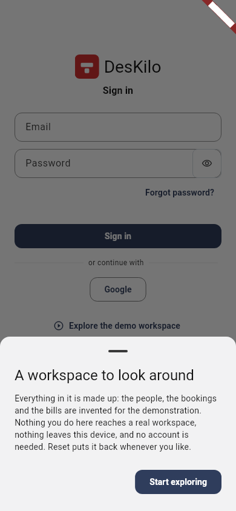
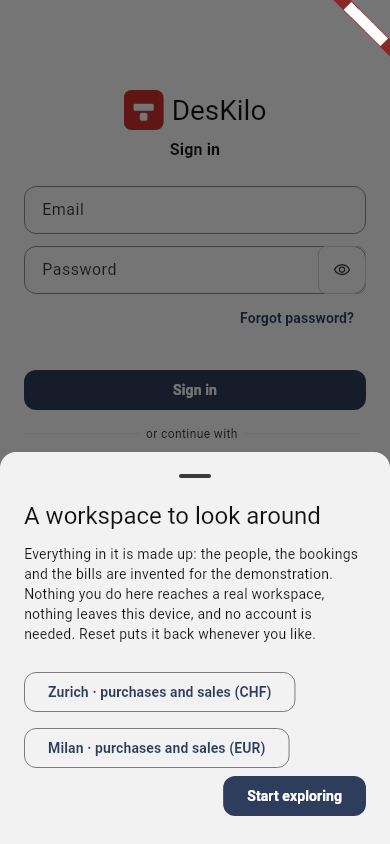
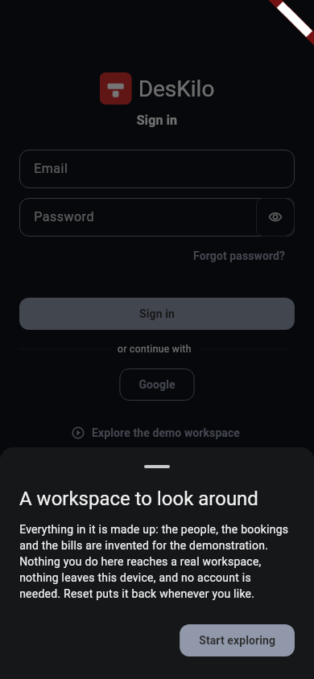
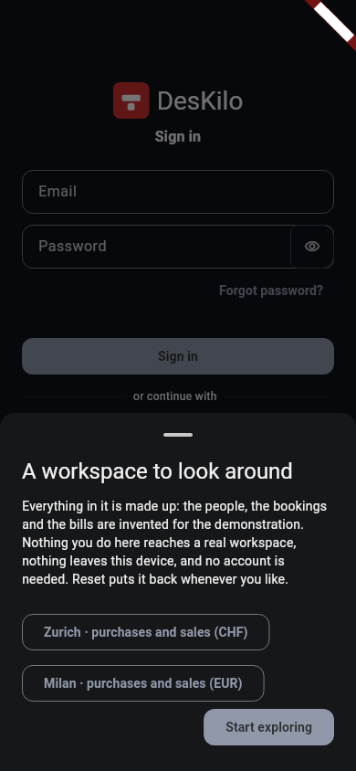

<!-- SPDX-License-Identifier: AGPL-3.0-or-later -->
# Purchasing and sales in the demonstration

The demonstration contains six businesses and the French business's development
twin. All records and bank movements are fictional, remain in the session and
reset together. Country rates here describe the seeded examples; they are not a
qualification of a real business's tax treatment. Sample bank identifiers come
from the application's existing document tests. No payment, e-mail, accounting
transfer or tax submission is sent.

| Business | Currency and zone | Purpose and useful entry |
|---|---|---|
| Atelier du Marché, Pézenas (`ws-1`) | EUR, Europe/Paris | Established coworking with the broad process catalogue |
| Leipzig (`ws-2`) | EUR, Europe/Berlin | A new practice with deliberately unfinished setup; its empty books and purchases are its own |
| Camden Yard, London (`ws-3`) | GBP, Europe/London | Three sites, three years of activity, VAT and simulated HMRC submission |
| Hudson Cooperative, New York (`ws-4`) | USD, America/New_York | Five sites, four years of activity, hourly usage; no VAT on its orders |
| Limmat Print & Supply, Zurich (`ws-5`) | CHF, Europe/Zurich | A service and supply business; `#/demo?space=zurich` opens purchasing |
| Navigli Design & Supply, Milan (`ws-6`) | EUR, Europe/Rome | A studio and supply business; `#/demo?space=milan` opens invoicing |
| Development twin (`ws-1-dev`) | EUR, Europe/Paris | Copied configuration, separate empty operating records |

Zurich and Milan use the existing service/studio profiles with place booking
switched off. Their site and equipment identify where costs belong. Each holds
a year of monthly service-contract sales and catalogue sales, suppliers, local
supplier invoices and payments, stock restocking, and a capitalised printer
purchase. Approved local purchases state their net amount, tax and tax recovery;
the equipment register carries the purchase cost net of the recovered tax.

## A purchase to payment

1. Enter Zurich or Milan as the owner and open Purchases → Approvals.
2. Open the pending supplies bill. Its supplier, currency, stated tax and stock
   classification belong to the selected business.
3. Approve it. A payable to that same supplier appears in To pay.
4. Record a partial or full bank transfer. The remaining payable and supplier
   balance change in that business, without changing another business's books.
5. Open purchase orders to inspect draft, sent, partly received, fully received
   and cancelled examples, and the two deliveries of the received order.

A second pending bill is denominated in the neighbouring business's currency:
EUR for Zurich and CHF for Milan. It retains an explicitly entered fictional
exchange rate and source. It is a review example, not evidence that a foreign
purchase's tax treatment has been approved by an authority.

## A sale to collection

1. View the business as the member and record a catalogue service.
2. Switch to the owner and confirm the request. The member's statement now
   includes that service.
3. Issue the current period's invoice. Its business, buyer, issuer, currency,
   tax and date come from that business and the session's clock.
4. Record the member's payment, have the other authorised person confirm it,
   and apply the resulting payment to the invoice.
5. Read the invoice, sales figures and the member's personal finances. They
   consume the same invoice and matching records.

A persona change rebuilds permissions and the screen tree while keeping
commercial records, including imported bank statements, their originals and
invoice reconciliation. Bank actions still check the current persona's
permissions. Reset creates a new fixture and restores the examples.

## Personal finances

Every human account represented in the demonstration has its own positive
invoices in at least two currencies. The supplementary customer relationships
live in Zurich and Milan. They grant no owner or administrator powers and do not
change the person's original membership or subscription. A kiosk is a device,
not a personal account.

Personal totals group currencies separately. EUR and CHF amounts are never
summed into a currency-free total, and one person's invoices and history do not
appear in another's personal home. The development twin remains reachable from
an entitled person's spaces and is excluded from real-business finance totals.

## Verification

- `test/core/demo/demo_commerce_consistency_test.dart` checks separate orders
  and accounting stores, and the country tax/currency inputs.
- `test/core/demo/demo_commerce_journey_test.dart` follows purchase approval and
  payment plus service confirmation, invoice issuance and collection through the
  production provider ports, with a non-default session clock.
- `test/core/demo/demo_entry_test.dart` taps each commercial entry.
- `test/core/demo/demo_commerce_persistence_test.dart` rebuilds the actual demo
  scope through owner, member, owner and Reset after purchasing writes and bank
  reconciliation; it also checks the member's refusal to undo a match.
- `test/core/demo/demo_feature_audit_test.dart` and
  `test/core/demo/demo_analysis_truth_test.dart` include both new businesses in
  setup, country and analysis checks.

These are in-memory demonstration checks. PostgreSQL authorisation, bank
acceptance and statutory transmission require their separate integration gates.

## Entry screen review

The real `DeskiloApp` consent sheet was rendered with the existing synthetic
repository overrides at 390 × 844 logical pixels, pixel ratio 1, English,
bundled Roboto and SDK icon fonts. Both light and dark captures passed before
and after the change (two capture tests per version). The before version is
commit `83f47379f348ad1fbaf0fad208dc7f634ea5a5e4`.

| Theme | Before | With the two commercial choices |
|---|---|---|
| Light |  |  |
| Dark |  |  |

The two country labels and all three actions remain visible without clipping
or overlap. The capture driver and viewport were identical for both versions.
The captured entry widget's SHA-256 is
`4a1746121f1b773bd6056bec928f4e1bf7aaa466da0208f6c44b62201a713a3c`;
subsequent fixture refactoring did not change it. These images establish this
entry screen at normal text scale. They are review evidence, not golden tests,
native-device qualification or a full browser purchase-and-sales journey.
