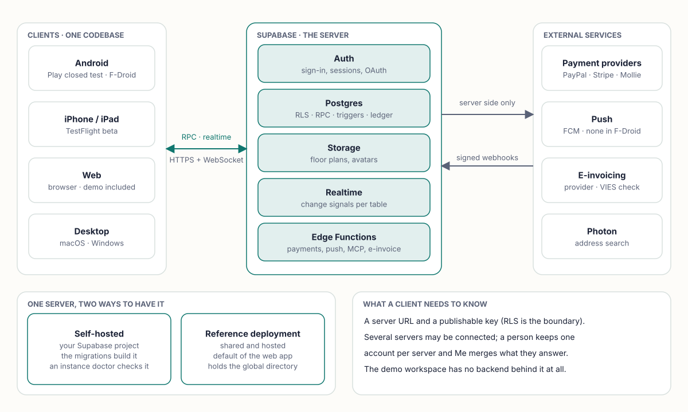
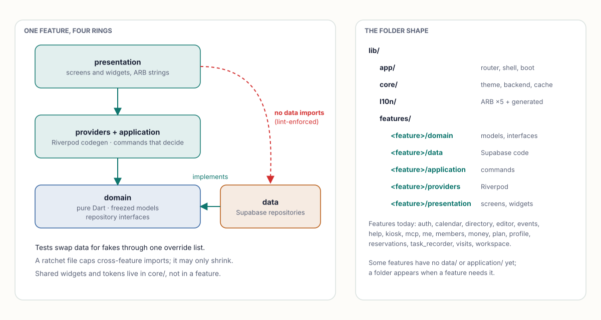
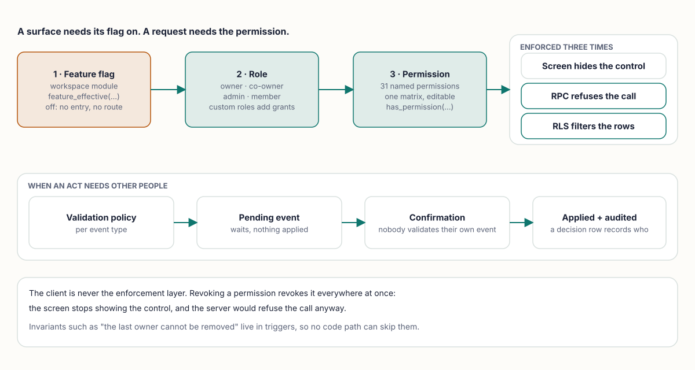
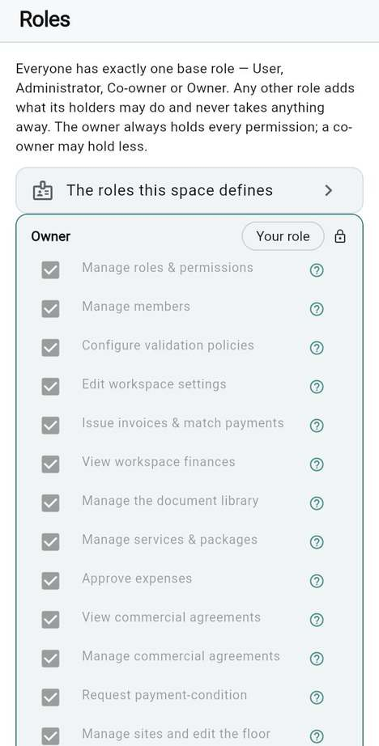
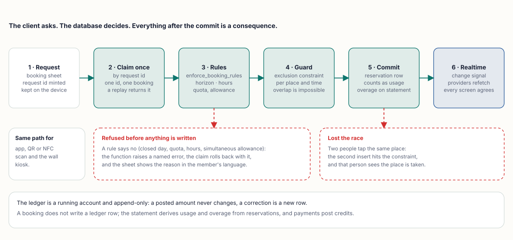
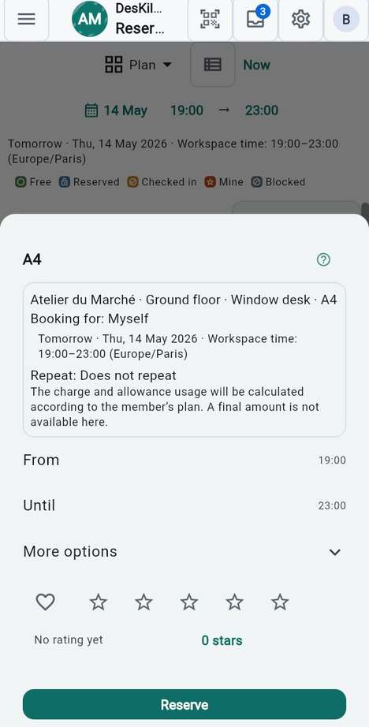
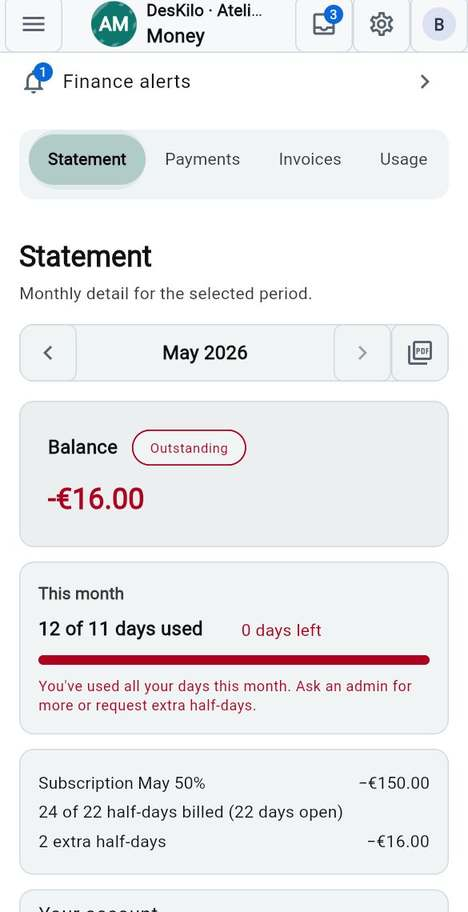
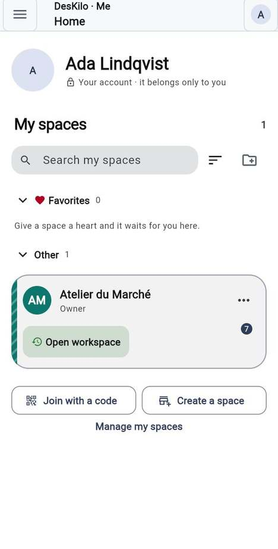
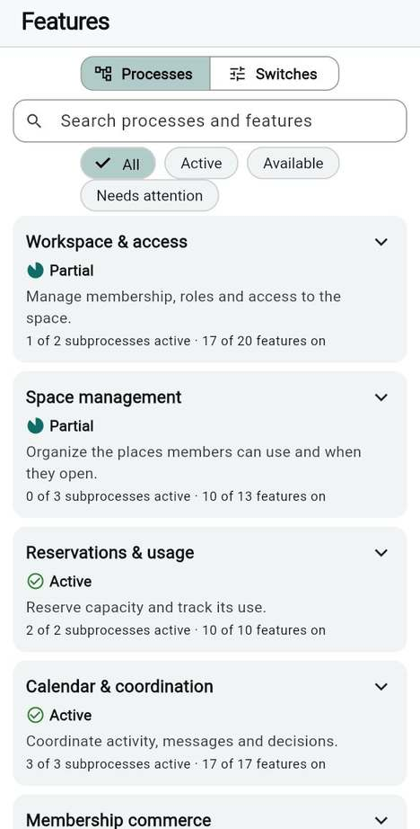
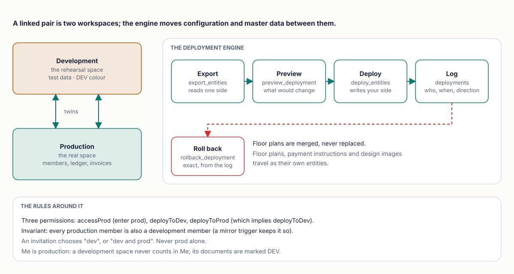

<div align="center">

**How DesKilo is built: one Flutter client, one Postgres that enforces every rule.**

[Home](Home) &nbsp;·&nbsp; **Architecture** &nbsp;·&nbsp; [Implementation](Implementation) &nbsp;·&nbsp; [Technical reference](Technical-Reference) &nbsp;·&nbsp; [User guide](https://fdittgen-png.github.io/deskilo/guide/en.html) &nbsp;·&nbsp; [Setup guide](https://fdittgen-png.github.io/deskilo/guide/setup-en.html)

</div>

> **The device is never trusted.** The client asks; PostgreSQL decides. Every multi-user write goes through a `SECURITY DEFINER` function that checks who is calling and what they may do, so a rule written once binds the app, a QR scan, the wall kiosk and an assistant alike.

<table>
<tr>
<td width="33%" valign="top">
<br>
<b>Own your server</b><br>
Supabase is the whole backend. Run your own project, or use the shared reference deployment; the client accepts both.
</td>
<td width="33%" valign="top">
<br>
<b>Rules live in SQL</b><br>
Constraints, triggers and RPCs hold the invariants. The screens only ask, and hide what you may not do.
</td>
<td width="33%" valign="top">
<br>
<b>Every module is a flag</b><br>
129 workspace features, each with its own switch. Off means no entry point, no route, and the stored data untouched.
</td>
</tr>
</table>

## System overview

<picture><source media="(prefers-color-scheme: dark)" srcset="images/diagram-system-overview-dark.svg"></picture>

There is no application server. Everything a server does is a Postgres function, a trigger, a policy or one of nine small Edge Functions. The client carries a server URL and a publishable key; **row level security is the boundary**, which is why the key can ship in every binary.

| Edge Function | What it does | Who may call it |
|---|---|---|
| `create-payment-order` | Starts a provider order and returns its approval URL | the member's session |
| `paypal-webhook`, `stripe-webhook`, `mollie-webhook` | Verify the provider's signature, then settle | the provider (no bearer token) |
| `send-e-invoice` | Hands an issued invoice to the transmission provider | a workspace admin's session |
| `vies-check` | Checks a VAT number against VIES | an invoice issuer's session |
| `send-push` | Fans a notification out (and sets the app badge) | database triggers |
| `badge-signin` | Proves a badge, then mints a session | the badge holder |
| `deskilo-mcp` | The assistant (MCP) endpoint | a delegated OAuth token |

`supabase/functions/exposure.json` classifies each function as `user_facing`, `system` or `webhook`, and `test/lint/edge_exposure_test.dart` keeps that file and the directory in step. Functions that act for a person refuse a delegated assistant token before any privileged work.

## Stack

| Layer | Choice | Why (ADR) |
|---|---|---|
| UI | Flutter 3.47.5 (Dart 3.12), Material 3 through `flex_color_scheme` | One codebase for Android, iOS, web, macOS and Windows ([0001](https://github.com/fdittgen-png/deskilo/blob/master/docs/decisions/0001-flutter-riverpod-stack.md)) |
| State | Riverpod 3 with code generation (`@riverpod`) | Compile-safe providers; no hand-wired `Provider` or `StateProvider` |
| Models | `freezed` immutable classes | Value semantics, exhaustive matching |
| Routing | `go_router` with a `StatefulShellRoute` shell | Redirects encode sign-in, role and feature gating |
| Backend | Supabase: Auth, Postgres 17, Storage, Realtime, Edge Functions | One multi-user source of truth, self-hostable ([0002](https://github.com/fdittgen-png/deskilo/blob/master/docs/decisions/0002-supabase-backend.md)) |
| Networking | `supabase_flutter` (PostgREST, GoTrue, Realtime); `dio` and `http` for raw calls | |
| Local data | `shared_preferences` stores, `flutter_secure_storage` for auth secrets, a scoped read cache (`core/cache`) | Offline-friendly reads; never a second source of truth |
| i18n | ARB, English canonical + FR, DE, ES, IT | Every string translatable, lint-enforced ([0007](https://github.com/fdittgen-png/deskilo/blob/master/docs/decisions/0007-i18n-five-locales.md)) |
| QR and NFC | `qr_flutter` (render), `flutter_zxing` (scan), `nfc_manager` behind an injectable reader | Free-software scanning, no Google services required |
| Maps and address | `flutter_map` + clustering; Photon geocoding for the directory | Open map stack; the endpoint can be replaced per deployment |
| Documents | `pdf`, `xml`, `archive` | Statements, invoices, reports, exports, configuration bundles |
| Push | local package `deskilo_push` (Firebase Cloud Messaging) or `deskilo_push_foss` | The F-Droid build swaps in the package with no Google code ([0011](https://github.com/fdittgen-png/deskilo/blob/master/docs/decisions/0011-notifications-first-fcm.md), [0012](https://github.com/fdittgen-png/deskilo/blob/master/docs/decisions/0012-fdroid-via-foss-push-package.md)) |

> **Rule.** No third-party tracking and no payment SDK in the app. The licence is AGPL-3.0-or-later with a commercial exception ([ADR 0031](https://github.com/fdittgen-png/deskilo/blob/master/docs/decisions/0031-agpl-with-a-commercial-exception.md), which replaced 0BSD). Google services are flavour-scoped, not forbidden: *CI · F-Droid no-GMS audit* proves the libre flavour carries none.

## Client layout

<picture><source media="(prefers-color-scheme: dark)" srcset="images/diagram-client-layers-dark.svg"></picture>

The code is **feature-first**: `lib/features/<feature>/` holds one slice of the product. The seventeen features today are `auth`, `calendar`, `directory`, `editor`, `events`, `help`, `kiosk`, `mcp`, `me`, `members`, `money`, `plan`, `profile`, `reservations`, `task_recorder`, `visits` and `workspace`. `lib/app/` owns the router, the shell and boot; `lib/core/` owns what every feature shares (theme tokens, backend connection, cache, push, trace, formatting, validation, VAT, demo data).

Inside a feature the layers are the same everywhere:

| Folder | Holds | May import |
|---|---|---|
| `domain/` | `freezed` models, repository interfaces, pure rules | pure Dart only |
| `data/` | Supabase implementations of those interfaces | `domain/`, `core/` |
| `application/` | commands: a decision that used to hide in a widget ([ADR 0024](https://github.com/fdittgen-png/deskilo/blob/master/docs/decisions/0024-an-application-layer-one-context-at-a-time.md)) | `domain/`, `core/` |
| `providers/` | Riverpod providers that wire the layers | all of the above |
| `presentation/` | screens and widgets | `providers/`, `application/`, `domain/` |

Three lints in `test/lint/layering_test.dart` hold this: `presentation/` never imports `data/`, `domain/` stays pure, and the set of **cross-feature imports is a ratchet that may only shrink**. The number of screen files that still resolve a repository directly is also capped per feature ([the current map](https://github.com/fdittgen-png/deskilo/blob/master/docs/design/APPLICATION_BOUNDARIES.md), generated from the tree). Tests replace `data/` with **fakes, not mocks**, through one shared override list.

## State management

- Repositories are `keepAlive` providers. Commands in `application/` are classes behind providers, so a screen calls one method and a test fakes one seam.
- Derived state is an async provider that `watch`es upstream providers. `currentWorkspace` is computed from the account's workspaces and the stored active choice, and everything workspace-scoped watches it, so **switching workspace re-derives the whole app** with no extra wiring.
- The router's refresh listenable watches the enabled-features provider, so toggling a feature or switching space re-evaluates every redirect at once.
- Riverpod retries a failed provider before it reports an error, and nested providers stack that delay; providers that must fail fast (boot, router, entry intents) set `retry: null` explicitly.
- **Freshness is pushed, not polled.** `core/realtime` subscribes to Supabase Realtime `postgres_changes` for about two dozen tables (reservations, members, events, conversations, ledger entries, invoices, floor-plan tables and more), scoped by RLS. A signal is only an *invalidation*: the provider refetches through its normal repository. If a channel re-joins after an error, a resync signal refetches everything.
- On boot the client compares its own schema expectations with the server's marker (`schema_gate`), so an old app against a newer database says so instead of misbehaving.

## Backend model

The data model is generated, not hand-written: [`docs/database/`](https://github.com/fdittgen-png/deskilo/blob/master/docs/database/README.md) holds a data dictionary extracted from the PostgreSQL catalogues after a full migration replay (every table, column, key and relationship). The migrations, numbered `0001` to `0406`, are the only way the schema changes.

### Writes go through functions

| Rule | What it means |
|---|---|
| **Default-deny RLS** | Row level security is on for every table. Core tables have a `select` policy and nothing else: a client cannot insert, update or delete a reservation, a ledger entry or an invoice. |
| **RPC-only writes** | Each mutation is a `SECURITY DEFINER` function that resolves `auth.uid()` to one active member row and checks a permission before doing anything ([ADR 0020](https://github.com/fdittgen-png/deskilo/blob/master/docs/decisions/0020-postgres-enforces-the-rules.md)). |
| **Helpers, not recursion** | `is_member_of`, `has_permission` and `feature_effective` are definer functions policies can call without recursing into themselves. |
| **Invariants in triggers** | `protect_last_owner`, `invoices_no_mutation`, `ledger_entries_no_rewrite` and similar refuse a bad write whichever path carries it. |
| **System columns** | Six technical columns (`created_datetime`, `modified_datetime`, `company_id`, `site_id`, `created_by_user`, `modified_by_user`) on every table, stamped by a `zz_`-prefixed trigger; a lint refuses a table without them ([ADR 0018](https://github.com/fdittgen-png/deskilo/blob/master/docs/decisions/0018-system-columns.md)). |
| **Contract and replay** | CI replays every migration from an empty database, runs the pgTAP files (`supabase/tests/database`) and compares a contract digest of the schema. |

<details>
<summary><b>What the schema holds, by area</b></summary>

- **Identity and tenancy.** `profiles` (one per auth user), `workspaces` (`invite_code` doubles as the human-readable workspace ID), `members` (additive `is_admin`/`is_owner`, status `active | paused | pending | exited`), single-use personal `invitations` (0051), join validation (0052), co-owner (0058), managed members who exist before they have an account (0152-0161).
- **Floor plan.** `levels` → `offices` → `desks` → `seats` (0003), seat blocking, accessories, level photos, resizable images, XML import and export. Whole levels, offices and desks are bookable (0050, 0057, 0059).
- **Booking.** `reservations` and the conflict-checked RPCs (0005), rules and series, availability and closures, granularity down to minute slots, half-day walk-up, quota and extra-half-day requests, the single `enforce_booking_rules` chokepoint (0116-0122), idempotent creation by request id (0214, 0353).
- **Money.** The member ledger (0008), expenses, services, percentage subscriptions with fee bands, day packages, per-member overage policy, finance permission gates, reminders, price negotiations, usage records.
- **Invoicing and tax.** Immutable invoices with a SHA-256 content signature and a void-and-replace chain (0060-0068), e-invoicing identity (0069-0073), fiscal groups, treatments and dated VAT-rate versions (ADR 0016), VIES evidence, recapitulative statements, locked VAT periods (0404-0406).
- **Events and validation.** The confirmation protocol (0007), quorum validation (0017), validation domains with an amount floor (0181).
- **Kiosk and badges.** `kiosk_act`, hashed QR and NFC badges, revocation that deletes the hash, per-badge scope.
- **People and conversations.** Conversations with realtime, receipts and reference links (0125-0130), the Me layer, message requests and blocks, the directory and public pages.
- **Environments.** Workspace twins and the deployment engine (0160, 0179, 0185-0190).

</details>

### Permission and validation catalogues

`WorkspacePermission` is a flat list of **31 permissions** (the matrix, the wire name and the SQL catalogue are pinned to each other by test), asked through one server function. A revoked permission is therefore revoked everywhere: the screen hides the control and the RPC refuses anyway. They fall into three groups: administration (`manageRoles`, `manageMembers`, `manageValidation`, `workspaceSettings`, `manageSites`, `manageBilling`, `manageConfiguration`, `manageIntegrations`…), operations (`manageReservations`, `operateKiosk`, `issueInvoices`, `viewFinances`, `exportData`, `viewAnalytics`, `deployToProd`, `deployToDev`, `accessProd`…) and the member's own everyday side (`useMessages`, `makeReservations`, `viewCalendar`, `viewDirectory`, `viewMyMoney`, `viewDocuments`).

Roles are `owner`, `co-owner`, `admin` and `member`; a custom role is an additive grant on top of them ([ADR 0029](https://github.com/fdittgen-png/deskilo/blob/master/docs/decisions/0029-a-custom-role-is-an-additive-grant.md)). Owners always hold everything and are not stored in the matrix. Row policies read the matrix, never a hard-coded `is_admin_of` (0216).

**Validation domains** are the second catalogue: each event type (a reservation for somebody else, a payment, an expense, a role change, an invoice issue or void, a refund, a status or subscription change, a matrix change…) can carry a policy that makes the act wait for confirmation. With no policy it applies at once and an *applied* event is recorded for the audit trail. Nobody validates their own event (0086).

<picture><source media="(prefers-color-scheme: dark)" srcset="images/diagram-permission-model-dark.svg"></picture>

<p align="center"></p>
<p align="center"><em>The role matrix is a screen because the catalogue is data. <a href="https://fdittgen-png.github.io/deskilo/guide/en.html#user.roles.matrix">Read the guide</a>.</em></p>

### A booking's life

<picture><source media="(prefers-color-scheme: dark)" srcset="images/diagram-booking-life-dark.svg"></picture>

1. The booking sheet mints a **request id** and keeps it on the device until the booking is seen settled.
2. `create_reservation_once` claims that id. A replay with the same payload returns the first booking; the same id with a different payload is refused by name; `reservation_request_outcome` lets a client that lost the answer ask what became of its request.
3. `enforce_booking_rules` is the single chokepoint every creation path calls (`create_reservation`, `kiosk_act`, `update_reservation`): advance horizon, minimum and maximum length, granularity, the past-day guard, the same-day rule, the outside-hours policy (`off`, `walkup_only`, `free`, `charged`), the open-days check, the quota and the simultaneous-booking allowance. Guards were *moved* into it, not copied, which is what closed the kiosk-parity gap.
4. An **exclusion constraint** (`gist` on the place and a time range) makes an overlap impossible, whatever the client believed about availability.
5. The row commits. It counts as usage, so the member's statement shows quota and overage; the **ledger is a running account and append-only** ([ADR 0022](https://github.com/fdittgen-png/deskilo/blob/master/docs/decisions/0022-the-ledger-is-a-running-account.md)), so a booking does not write a ledger row of its own. Payments, expenses and settlements post rows, and a correction is a new row.
6. Realtime tells every subscribed client that `reservations` changed; their providers refetch and the plan, the calendar and the day view agree.

<table>
<tr>
<td width="50%" valign="top" align="center">
<br>
<em>The booking sheet: the member's side of steps 1 to 3.</em>
</td>
<td width="50%" valign="top" align="center">
<br>
<em>The statement, derived from usage and the ledger. <a href="https://fdittgen-png.github.io/deskilo/guide/en.html#user.money.statement">Read the guide</a>.</em>
</td>
</tr>
</table>

### Online payments

Four providers behind one architecture: **PayPal** (Orders v2), **Stripe** (Checkout), **Mollie** (Payments API) and **Wero**, offered *through* Mollie. No provider SDK ships in the app ([ADR 0021](https://github.com/fdittgen-png/deskilo/blob/master/docs/decisions/0021-payments-never-touch-the-client.md)): the app never sees a card number, never holds a secret and never learns from its own device that a payment succeeded.

```
app → RPC: create a payment intent → create-payment-order → provider API (secret key, server side)
    → the browser opens the provider's page
provider → webhook → Edge Function → signature check → settle_online_payment → ledger
```

- `payment_intents` tracks each provider order. `payment_credentials` holds the per-workspace secrets in a **deny-all table**: row level security on, deliberately no policy. Only service-role functions and owner definer RPCs touch it, and secret values are never returned, only key names through `payment_credentials_status`.
- The owner writes credentials through `set_payment_credentials` (a blank field keeps the old value) and removes a provider with `clear_payment_provider`.
- Each webhook runs with `verify_jwt` off. Authenticity comes from the provider: PayPal's verify-webhook-signature, Stripe's signing secret, a Mollie re-fetch. Settlement is idempotent on `(provider, order_id)`, guarded by `for update` and a status check, so a replayed webhook cannot double a payment.
- Webhook URLs to register in the dashboards (PayPal and Stripe; Mollie's is sent per payment): `https://<project-ref>.supabase.co/functions/v1/paypal-webhook` and `…/stripe-webhook`. The dashboard walkthrough is in the [guide](https://fdittgen-png.github.io/deskilo/guide/en.html#user.money.payments.provider).
- **E-invoices** follow the same stance ([ADR 0010](https://github.com/fdittgen-png/deskilo/blob/master/docs/decisions/0010-e-invoice-transmission.md)): DesKilo produces the document, `send-e-invoice` hands it to a transmission provider whose token sits in a second deny-all table. It is not an accredited platform itself.

### Security model

The reasoning is written down in the [threat model](https://github.com/fdittgen-png/deskilo/blob/master/docs/security/THREAT_MODEL.md), the [RLS matrix](https://github.com/fdittgen-png/deskilo/blob/master/docs/security/SUPABASE_RLS_MATRIX.md) and ADR 0020. In short:

1. **Tenancy is the central boundary.** Reads are scoped to co-members; storage policies are scoped to the workspace folder; a member of one workspace cannot see another's rows or files.
2. **Privilege is a matrix, not a flag.** `has_permission` answers every gate; the last owner cannot be demoted or removed, whichever path writes.
3. **Money is immutable.** An issued invoice carries a content signature and can only be corrected by a replacement; ledger rows are never rewritten.
4. **Invitations are credentials.** A code is single-use, personal and expiring; the role granted on join is derived on the server from the code that matched, never from a client parameter, and every join lands as *pending* until validated.
5. **Badges are hashed and revocable.** QR and NFC credentials are stored as hashes; a PIN is a second factor.
6. **Edge Functions are classified.** Webhooks authenticate by the provider's signature, user-facing functions by the caller's own session, and assistant tokens are refused where a person's authority is needed.
7. **No telemetry.** Diagnostics stay on the device.
8. **Operators get a doctor.** `dart run tool/instance.dart doctor` (and a scheduled workflow) reads an instance's auth settings and policies and says whether people can actually sign in.

> **Honest limits.** The threat model lists which mitigations have a database test and which do not; read its "proof today" column before relying on one.

### Concurrency

The database decides, never a possibly stale client view. Availability is checked at commit time under an exclusion constraint; creation is idempotent by request id; settlement is idempotent by `(provider, order_id)`; the confirmation of an event is a single transaction. What the client shows is refreshed by Realtime invalidation after the fact.

## The person-centred layer

A person has one account across many spaces, and what concerns them personally does not belong to the space they last used. Three decisions shape that layer:

<table>
<tr>
<td width="33%" valign="top">
<br>
<b>Me holds what is personal</b><br>
Home, agenda, messages, wallet and privacy across every space. Me renders versioned <i>personal items</i> that SQL contributors register by type, and never imports a workspace kind's domain ([ADR 0038](https://github.com/fdittgen-png/deskilo/blob/master/docs/decisions/0038-the-me-space-holds-everything-personal.md), design in <code>docs/design/ME_SPACE.md</code>).
</td>
<td width="33%" valign="top">
<br>
<b>The messenger lives in Me</b><br>
One inbox, one read state. What others may see of a person is a field-by-audience visibility matrix with its own reachability rule, plus message requests and a block list ([ADR 0034](https://github.com/fdittgen-png/deskilo/blob/master/docs/decisions/0034-the-messenger-lives-in-me.md)).
</td>
<td width="33%" valign="top">
<br>
<b>Servers can be connected</b><br>
A space publishes a page on purpose; the global directory lives on the reference deployment, and any server can be linked to it. A connected installation answers the same reads, and Me merges them, naming the server.
</td>
</tr>
</table>

Federation is built from small, checkable pieces. `FederationAuthority` accepts only public routing metadata (an installation id and an HTTPS issuer for a custom OIDC provider); it carries no credential and grants no membership. Connected installations keep their own sessions. The public-network contract (`lib/core/public_network`) names three surfaces, **public** (anonymous), **participant** (an account acting for itself) and **management** (authoring what the public sees), and its catalogue grants nothing: SQL grants, RLS and the RPC bodies decide.

<p align="center"></p>
<p align="center"><em>Me home: one account, every space. <a href="https://fdittgen-png.github.io/deskilo/guide/en.html#user.me.home">Read the guide</a>.</em></p>

> **Rule.** Me is production. A development space never counts in Me; its documents are shown apart and marked DEV.

## Assistants (MCP) and the task recorder

**An assistant is another UI, not another authority.** The `deskilo-mcp` Edge Function speaks the Model Context Protocol over stateless Streamable HTTP. Every request carries a delegated OAuth token that Auth verifies; the Supabase client is built per request with that token and the publishable key, never `service_role`. `tools/list` answers what *this* caller may call, `tools/call` goes through one facade function that re-checks every gate, and a sensitive write waits for a native confirmation in the app. The operation catalogue (24 operations in the committed `tools/list` golden) is generated, validated against its input schema before the database is reached, and grants nothing by itself: SQL decides. An installation epoch lets an operator invalidate an endpoint after restoring a database. Workspaces choose what to offer to assistants ([guide](https://fdittgen-png.github.io/deskilo/guide/en.html#user.advanced.assistants)).

**The task recorder** (`features/task_recorder`) records what a person does in the app as typed steps, lets them review and edit it, and exports a task package, a Word document and a storyboard. It makes **no video** ([ADR 0036](https://github.com/fdittgen-png/deskilo/blob/master/docs/decisions/0036-the-task-recorder-makes-no-video.md)), substitutes people at the data seam so recordings carry no real names ([ADR 0032](https://github.com/fdittgen-png/deskilo/blob/master/docs/decisions/0032-recording-privacy-substitutes-people-at-the-data-seam.md)) and captures typed values only by the person's choice ([ADR 0037](https://github.com/fdittgen-png/deskilo/blob/master/docs/decisions/0037-a-recording-may-capture-values-by-choice.md)). It also drives step-by-step guides inside the app.

## Feature flags

`WorkspaceFeature` and `featureManifest` (`features/workspace/domain/workspace_feature.dart`) are a declarative registry of **129 features**. Each has a `defaultOn`, a tier, an optional `requires` chain, and its enum name is the key in `workspaces.feature_flags`. `resolveEnabledFeatures` starts from the defaults and applies the stored booleans, ignoring unknown keys so old and new clients coexist. Features that change money or permissions, or need owner setup, default **off**.

> **Rule.** Enable a feature and all of its surfaces appear; disable it and none remain. Stored data stays untouched.

- **Two client layers.** The entry point (tile, tab, button) checks the enabled set, and the route guards with a feature redirect, so deep links and bookmarks bounce too.
- **The server reads the same registry.** SQL gates ask `feature_effective(workspace, 'key')`, which is the stored boolean over the default *and* every parent. `feature_registry()` is generated from the manifest by `tool/build_feature_registry_sql.dart`, and a lint names the feature until its migration exists.
- **Every feature belongs to one process.** `workspace_process.dart` groups features into business processes; the Features screen shows one card per process with its state, and the catalogue is generated into `docs/design/process-catalogue.md`.
- The Features screen itself is never gated: it must stay reachable to switch a module back on.

<p align="center"></p>
<p align="center"><em>The Features screen. <a href="https://fdittgen-png.github.io/deskilo/guide/en.html#user.features.processes">Read the guide</a>.</em></p>

## Environments and deployment

<picture><source media="(prefers-color-scheme: dark)" srcset="images/diagram-environments-dark.svg"></picture>

A workspace has an `environment` and a twin. `deployable_entities()` is the registry of what can travel; `export_entities` reads one side, `preview_deployment` says what would change, `deploy_entities` writes, and `deployments` records who, when, in which direction, which entities and what the target held before, which is what makes `rollback_deployment` exact. A deployment writes **the side the caller stands on**, and its capability is a transaction-local token, so ordinary guards can refuse a write that a deployment may make without either knowing the other. Floor plans are merged, never replaced; payment instructions and design images travel as their own entities. The same engine, in merge mode, applies a workspace template ([ADR 0026](https://github.com/fdittgen-png/deskilo/blob/master/docs/decisions/0026-a-workspace-template-is-the-deployment-engine-in-merge-mode.md)). See the [guide](https://fdittgen-png.github.io/deskilo/guide/en.html#user.advanced.environments).

**Shipping the app** is a separate pipeline, described in [Implementation](Implementation): pull request, three required checks, merge, then the release train to Play (alpha), TestFlight, a macOS DMG, a Windows MSI and the web build on GitHub Pages. Publishing the web build is a deliberate opt-in.

## Invites and deep links

Invite QR codes encode `deskilo://join?role=<user|admin>&code=<CODE>` (`InviteUriCodec`). A **v2** link also carries the installation it was issued on (`url`, `key`, an optional name), so an invitation is only ever checked on the server that issued it; v1 links and legacy raw codes resolve on the server the device chose. The `role` is informational: the server derives the real role from the code. The same `deskilo://` scheme carries the OAuth callback back into the app on every platform (Android manifest, iOS URL types, the Windows installer's registry keys).

A typed **entry intent** remembers what a person came to do (open a screen, join a space, create one, connect a server) and finishes it after sign-in, verification and consent. It never stores an invitation code, an OAuth code or a verifier; the person pastes the code again.

## Internationalization

- `app_en.arb` is canonical; FR, DE, ES and IT ship with full key parity (a CI gate).
- No hard-coded user-facing string: a lint test with a ratchet to zero. Every string goes through `AppLocalizations`.
- Dates, numbers and currency render through locale-aware `intl`; the workspace **country** drives the default currency. Timestamps are stored in UTC and recurring series recur in workspace-local time.
- Per-feature ARB fragments are merged into the app bundles, and the user guides and the setup questionnaire exist in all five languages.

## Platforms

| Platform | How it ships |
|---|---|
| **Web** | The live app in the browser (needs a sign-in); *Demo* is a self-contained workspace with no backend. Built by `web.yml`, published to GitHub Pages on request. |
| **Android** | Google Play closed test; F-Droid through the libre flavour. |
| **iPhone / iPad** | TestFlight beta. |
| **macOS, Windows** | Full app; macOS DMG, Windows MSI built by WiX (`windows/installer/deskilo.wxs`). The macOS sandbox needs the network-client, camera and file entitlements. |

Platform-specific behaviour degrades gracefully: push needs a transport and reports unavailable without one; NFC reading is a seam that is absent where the hardware is; the kiosk is a locked plan view that acts as the badge's member without any session on the device.

**F-Droid** is supported through reproducible builds, not F-Droid signing. The publishing job builds each ABI from a clean tree, builds arm64 twice, and refuses to publish if the two differ outside `META-INF`, with the build path pinned because Dart's AOT output embeds it. Whether F-Droid has published it yet is stated once, in the [F-Droid status](https://github.com/fdittgen-png/deskilo/blob/master/docs/guides/fdroid.md#status).

## Shared building blocks

Cross-surface concepts have exactly one implementation.

| Block | Used for |
|---|---|
| `PlanCanvas` (+ metrics) | the floor plan on the Plan tab, the Reserve hub and the kiosk |
| `seat_occupancy` | occupant labels, seat states, presence dots |
| `LevelChipRow` | the level selector |
| `runGuarded` | the traced-failure wrapper for every mutating call |
| `linkLauncherProvider` | the one test-capturable external-link seam |
| `SheetShell`, `form_kit`, wizard scaffolds | modal forms and multi-step wizards |
| `centsToMajor`, `parseCentsInput` | money input |
| the shell (`lib/app/shell`) | bottom bar, drawer, title bar, space chip |
| the demo seam | the repository layer swaps to an in-memory fixture for the demo workspace ([ADR 0028](https://github.com/fdittgen-png/deskilo/blob/master/docs/decisions/0028-the-demo-environment-is-the-repository-seam.md)) |

A public top-level declaration in `lib/` must have a reader outside its file, and dead code is a test failure, so a "shared" block is only shared if something shares it.

## Design system

Material 3 with three themes (light, dark and a warm signature blend), brand colour burnt orange `#C2410C`, and a workspace may carry its own colours, emblem and pattern. `AppRadius` tokens (4, 8, 12, 16, 24) replace inline radii (lint-enforced). Seat states use a muted, colour-blind-safe palette and are never conveyed by colour alone; accessibility tests guard it. The details are in [`docs/design/DESIGN_SYSTEM.md`](https://github.com/fdittgen-png/deskilo/blob/master/docs/design/DESIGN_SYSTEM.md).

## Where next

[Implementation](Implementation) &nbsp;·&nbsp; [Technical reference](Technical-Reference) &nbsp;·&nbsp; [Home](Home) &nbsp;·&nbsp; [Decisions (ADRs)](https://github.com/fdittgen-png/deskilo/tree/master/docs/decisions) &nbsp;·&nbsp; [Threat model](https://github.com/fdittgen-png/deskilo/blob/master/docs/security/THREAT_MODEL.md) &nbsp;·&nbsp; [Data dictionary](https://github.com/fdittgen-png/deskilo/blob/master/docs/database/README.md) &nbsp;·&nbsp; [User guide](https://fdittgen-png.github.io/deskilo/guide/en.html)
