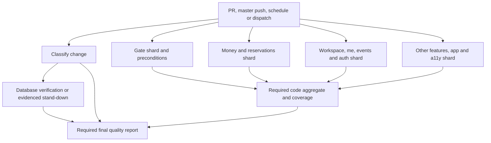

# CI and automation

This page explains what DesKilo's GitHub Actions workflows run, which results block a merge, what they publish, and how to diagnose a failure. Start with the [Actions dashboard](https://github.com/fdittgen-png/deskilo/actions) for a particular run.

**Verified on 31 October 2026**, against [master at `340830d5a3`](https://github.com/fdittgen-png/deskilo/tree/340830d5a3236d3af86dbccc728f067c7e2f2d7b/.github/workflows) and the live `master` branch-protection API. The linked source files are the authority when the implementation changes. Cron times below are **UTC**, so their local time changes with daylight saving.

## Contents

- [The merge gates](#the-merge-gates)
- [Quality workflow and test shards](#quality-workflow-and-test-shards)
- [Database verification](#database-verification)
- [Other validation workflows](#other-validation-workflows)
- [Scheduled health and maintenance](#scheduled-health-and-maintenance)
- [Release and publishing workflows](#release-and-publishing-workflows)
- [Artifacts and evidence](#artifacts-and-evidence)
- [Diagnosing and retrying a failed run](#diagnosing-and-retrying-a-failed-run)
- [Local preparation and maintenance](#local-preparation-and-maintenance)

## The merge gates

GitHub displays **workflow names** in the Actions sidebar and **job names** as status checks. These are different identifiers. The workflow group describes its purpose:

| Prefix | Purpose |
| --- | --- |
| `CI` | Pull-request validation or maintenance supporting it |
| `Nightly` | Scheduled regression evidence outside the pull-request path |
| `Release` | Builds and delivery to app stores or desktop users |
| `Publish` | Web, hosting packages, listing material, functions, or release assets |
| `Status` | Operational inspection; some workflows also offer explicit write options |
| `Tools` | Manually dispatched utilities |

The live required checks on `master` are:

| Required status-check context | What must succeed |
| --- | --- |
| `analyze · l10n gate · test · coverage` | Preconditions, all four test shards, complete and consistent test evidence, and coverage floors |
| `quality · database` | The database disciplines, or an independently recorded classifier verdict that they do not apply |
| `quality · report` | The complete quality table, its inputs, and all required upstream jobs |

The verified setting is `strict: false`: branch protection does not itself require a branch to be up to date with `master`. That setting does not prove a candidate remains compatible with newly merged migrations. Readiness still requires the correct migration sequence and regenerated outputs.

The individual shard names and other workflows are not in that verified required-context list. A green required aggregate includes the shard verdicts; renaming a protected aggregate requires a coordinated protection change. Additional native and format checks remain useful evidence even when branch protection does not require them.

[Protection verification script](https://github.com/fdittgen-png/deskilo/blob/master/scripts/branch_protection.sh) distinguishes `verified-match`, `verified-drift`, and `unverified-access`. Its advisory CI invocation can be green without having permission to inspect settings. Use a successful authenticated settings read to establish the actual requirements.

## Quality workflow and test shards

[`quality.yml`](https://github.com/fdittgen-png/deskilo/blob/master/.github/workflows/quality.yml), **CI · Quality report**, runs on every pull request, every push to `master`, manual dispatch, and daily at **04:30 UTC**. Draft pull requests run validation too. Flutter is pinned to **3.47.5** in this source snapshot.



The four test jobs run independently on Ubuntu runners. The database job starts after classification and runs beside them. The final report waits for classification, every shard, the code aggregate, and database verification.

### Change classification

[The shared classifier](https://github.com/fdittgen-png/deskilo/blob/master/tool/ci_classify/classify.dart) selects expensive **database** and **browser** work. It reads the complete pull-request diff from full Git history, uses NUL-delimited paths, and counts both names of a renamed file.

- A known independent change can mark the database or web discipline `not_applicable`, with a reason and classifier version in an artifact.
- SQL, backend contracts, relevant adapters, and the production sources used by physical-topology tests select database verification. A file's extension alone is insufficient to establish independence.
- Browser inputs include `lib/`, `web/`, `assets/`, path-dependent `packages/`, and dependency manifests.
- Workflows, scripts, generators, dependency changes, an unknown base, an incomplete or empty diff, or a failed classifier select full validation. Pushes, schedules, and dispatches also select everything.
- Code analysis and the Flutter suite still run for documentation changes. Documentation participates in generated help and parity checks.

Standing down is a recorded result, not silently skipping a required job. Missing or malformed classification evidence fails closed.

### What each shard runs

The assignment comes from [`tool/quality_rows/selection.dart`](https://github.com/fdittgen-png/deskilo/blob/master/tool/quality_rows/selection.dart), not a manually duplicated list of files in YAML.

| Shard ID | Job name | Selection | Job timeout |
| --- | --- | --- | --- |
| `gate` | `quality · test · gates` | All `test/**/*_test.dart` outside `test/features/`, except `test/app/` and `test/a11y/`; includes lint, tool, i18n, UX, perf, and core tests | 30 min |
| `money` | `quality · test · money and reservations` | `test/features/money/` and `test/features/reservations/` | 45 min |
| `workspace` | `quality · test · workspace, me, events and auth` | `test/features/workspace/`, `me/`, `events/`, and `auth/` | 45 min |
| `rest` | `quality · test · other features, app and a11y` | All remaining feature tests, plus `test/app/` and `test/a11y/` | 45 min |

A new root test directory defaults to `gate`; a new feature directory defaults to `rest`. The aggregate independently walks the test tree and proves that every required file is assigned exactly once. Database-backed topology execution additionally runs in the database job with its stack configuration.

Before its selected tests, `gate` also:

1. Resolves dependencies with the pinned SDK and lockfile-keyed package cache.
2. Runs `dart run tool/build_arb.dart` and `flutter gen-l10n`, rejecting uncommitted localization drift.
3. Runs `scripts/generated_drift.sh` around `build_runner`, rejecting changed `.g.dart` or `.freezed.dart` output.
4. Tests the push transport package. Separately resolves, analyzes with fatal infos, and tests the pure-Dart document model, PDF, document editor, task recording, and asset gzip packages.
5. Runs `dart analyze --fatal-infos` for the app tree.

Each shard invokes `flutter test --coverage` with runner-core concurrency and records its actual exit status, JSON test stream, and LCOV coverage. Its envelope identifies the candidate, run ID, run attempt, shard selection, runtime profile, and evidence hashes. Missing, incomplete, duplicated, stale, or mismatched evidence makes the aggregate fail.

### Coverage and discipline rows

The aggregate merges validated shard coverage. [`scripts/coverage_gate.sh`](https://github.com/fdittgen-png/deskilo/blob/master/scripts/coverage_gate.sh) then validates LCOV structure before computing percentages and enforces:

| Scope | Minimum measured line coverage |
| --- | --- |
| Domain | 85% |
| Presentation | 80% |
| `lib/core/` | 75% |
| All `lib/` | 65% |

Missing layer evidence fails. The data layer has no separate percentage floor; its database behavior is tested against real queries. These are regression floors, not targets to lower when a candidate fails.

[`.github/quality-manifest.psv`](https://github.com/fdittgen-png/deskilo/blob/master/.github/quality-manifest.psv) defines the required report rows and their evidence. Code rows cover Tests, Architecture, Security, Accessibility, Localization, MCP conformance, Privacy, and Coverage. MCP conformance marks its required tests strict: skipped security evidence cannot count as a pass. The report rejects missing or unrecognized rows rather than silently dropping a renamed discipline.

Many evidence-producing steps use `continue-on-error` to collect the remaining results. Their **outcomes are checked by a final gate**; that flag does not excuse the failure. Timings and the advisory protection inspection are explicitly informational.

## Database verification

The `quality · database` job has a **40-minute timeout**. It uses the [local-stack composite action](https://github.com/fdittgen-png/deskilo/blob/master/.github/actions/local-stack/action.yml), Supabase CLI **2.118.0**, and Deno **v2.x** in this snapshot. This work uses ephemeral runner databases; it does not deploy the application's production schema.

The normal stack starts once. `supabase start` replays the migrations from an empty database and publishes its database URL to the following checks. Supabase images are pulled from **GHCR authenticated as the workflow job**, which grants `packages: read`; registry authentication failures are reported rather than falling back to an anonymous image quota.

| Discipline / step | Evidence it supplies |
| --- | --- |
| Migration safety | Every checked-in migration can replay from empty |
| Database disciplines | pgTAP suite, including tenant isolation, financial invariants, permissions, and query/index budgets |
| Policy drift | Effective policies match what the migrations declare |
| Effective contract | Replayed routines, grants, constraints, and triggers match the committed contract |
| Concurrency | Separate sessions race for a seat and conditional snapshot writes; exactly the permitted outcome wins |
| Conditional writes | Two owners attempting a feature-map decision are serialized; the rival stale decision is refused |
| Payments | The actual payment handler admits the member's intent and refuses unauthorized callers |
| Payment settlement | Stripe, PayPal, Mollie, and Wero handlers exercise signatures, identity/amount checks, retries, duplicate or concurrent delivery, and reconciliation |
| MCP token containment | A delegated token is constrained to the MCP facade through real PostgREST; native sessions retain their own behavior |
| Restore drill | Seed, dump, restore into a fresh database, compare counts, and reconcile |
| MCP races | Concurrent booking, void, subscription, and member decisions preserve their idempotency and authorization rules |
| Instance lifecycle | Empty installation, interruption/resume, upgrade, foreign-table refusal, migration markers, and doctor isolation |
| Archive preservation | Upgrade a populated historical instance while preserving signed fields, hashes, postings, and the unverifiable state of legacy material; catch a destructive control |
| Physical topology | Real P, W-A, and W-B instances exercise account/profile and workspace paths over signed HTTP, including outages and late answers |
| MCP coverage evidence | Required pgTAP files actually ran and passed for this candidate, according to the MCP evidence map |

See the exact commands and conditions in [the database job](https://github.com/fdittgen-png/deskilo/blob/master/.github/workflows/quality.yml), especially `scripts/contract_check.sh`, `scripts/edge_payment_check.sh`, `scripts/db_race_check.sh`, `scripts/instance_lifecycle_check.sh`, and `scripts/populated_upgrade_check.sh`.

The data dictionary is regenerated from the replay, but **dictionary drift is advisory**. The separate refresh workflow updates documentation after merge. A mismatch in the effective database contract is a blocking failure.

### Fixture ordering and physical faults

pgTAP fixtures use transactions with rollback. Race scripts isolate or clean their own records. The restore seed remains in the shared database, so it runs after checks expecting only their own rows; lifecycle and populated-upgrade drills use separate databases in their prescribed order. A new database check should attach to the existing stack, not start another ordinary stack.

Physical topology is the intentional exception: P and W-B are additional independent stacks, alongside the main stack as W-A. Each has its own Postgres, Auth, Storage, identity, ports, volumes, and JWT secret. They prove separation that three schemas on one database could not prove.

`scripts/topology_stacks.sh` prepares, seeds, faults, restores, and stops those stacks. Fault cases pause or stop a selected API gateway; serial execution of the fault and personal-directory tests prevents one case from breaking a neighboring test's stack. Cleanup runs with `always()`.

### Migration drafts and readiness

A later migration draft can already provide useful pgTAP and contract evidence while its preceding migration waits to merge. A sequence gap can independently fail the project-scale and lifecycle marker checks. Read **all** database verdicts: a gap is not an explanation for unrelated authorization, contract, or fixture errors.

Before making a migration candidate ready, bring in the landed predecessor, regenerate the applicable outputs, and inspect fresh evidence for the resulting head. With multiple MCP migrations, the later migration's catalogue seed must be regenerated from the **merged** `contracts/mcp/operations.json`; otherwise it can erase an earlier migration's operations. Already applied migrations also require the project's migration coordination rules, rather than casually changing deployed SQL.

## Other validation workflows

| Workflow and source | Triggers | What runs and what a green result means |
| --- | --- | --- |
| [CI · Android boot check](https://github.com/fdittgen-png/deskilo/blob/master/.github/workflows/android-boot.yml) | Relevant `master` pushes (`lib/main.dart`, app/core, Android, dependencies, integration tests, or this workflow); manual dispatch | Builds an R8-shrunk x64 release APK and installs it on an API 34 x86_64 Pixel 6 emulator. Checks cold-launch process survival after 15 seconds, background entry, and resume. Startup `TotalTime` has a 12,000 ms budget; implausibly small APKs fail. It is not a full device journey suite. Timeout 30 min. |
| [CI · F-Droid no-GMS audit](https://github.com/fdittgen-png/deskilo/blob/master/.github/workflows/fdroid-foss.yml) | Path-filtered PRs/master pushes affecting push packages, `pubspec.yaml`, or push code; PRs also include F-Droid recipe and workflow paths; manual dispatch | Swaps in the libre push package as the F-Droid recipe does, regenerates, analyzes and tests that flavor, builds the release APK, inspects DEX for Google Play Services/Firebase, and rejects an extra signing block. Timeout 50 min. |
| [CI · E-invoice validators](https://github.com/fdittgen-png/deskilo/blob/master/.github/workflows/einvoice-validate.yml) | Money-domain/validator PRs and master pushes; sample-test and workflow paths additionally select PRs; manual dispatch | Generates samples through the app's writers and runs pinned official validators. KoSIT covers EN 16931/XRechnung/Peppol, Mustang covers Factur-X including the French CIUS handling, and schemas cover SdI/KSeF. Inspect the validator report for the exact format and rule. Timeout 30 min. |
| [CI · SAF-T schemas](https://github.com/fdittgen-png/deskilo/blob/master/.github/workflows/saft-validate.yml) | Money-domain, SAF-T fixture/tool PRs and master pushes; sample-test/workflow paths additionally select PRs; manual dispatch | Builds profile samples and validates against SHA-256-pinned schemas: Norway 1.30, Luxembourg FAIA 2.01, Denmark 2.1, Romania D406 2.4.9. The OECD-full structural check uses Luxembourg's published OECD-namespace tree; it is not a separate OECD certification. Timeout 20 min. |
| [CI · VAT filing schemas](https://github.com/fdittgen-png/deskilo/blob/master/.github/workflows/vat-filing-validate.yml) | Money-domain, VAT fixture/tool PRs and master pushes; named sample tests/workflow additionally select PRs; manual dispatch | Generates VAT samples, checks pinned authority files, and validates Italian LIPE, Spanish SII, and Swiss eCH-0217 XML. Spanish Modelo 303 and normalized register designs are exercised by Dart tests with pinned reference spreadsheets. Timeout 20 min. |
| [Publish · Edge functions](https://github.com/fdittgen-png/deskilo/blob/master/.github/workflows/edge-functions.yml) | PRs affecting `supabase/functions/`, `contracts/mcp/`, or the workflow; manual dispatch | `deno check` for every function and Deno tests, with the MCP endpoint suite and a nonempty executed-test result required. PRs only validate. Deploy requires manual `deploy=true`, a function slug or `all`, and configured Supabase credentials. Merging function code alone does not deploy it. |
| [Publish · Web app (GitHub Pages)](https://github.com/fdittgen-png/deskilo/blob/master/.github/workflows/web.yml) | Every PR, with the shared classifier deciding browser relevance; manual dispatch; reusable release call | Builds the pinned candidate, checks Chromium offline task storage, adds the SPA fallback, and publishes a downloadable artifact. PRs never deploy. Pages deployment requires a successful build, a non-PR event, and `deploy=true`. Build timeout 30 min. |

Path filters are literal YAML rules, not transitive dependency analysis. An apparently relevant edit outside a workflow's listed paths does not automatically start that specialized workflow; use its manual dispatch when additional evidence is needed.

## Scheduled health and maintenance

| Workflow | Schedule / dispatch | Operation and interpretation |
| --- | --- | --- |
| [Nightly · Journey latency benchmark](https://github.com/fdittgen-png/deskilo/blob/master/.github/workflows/perf-bench.yml) | **03:20 UTC daily**, or manual | Runs `flutter test tool/bench`; `scripts/perf_gate.sh` gates shape budgets such as round trips, elements, frames, retry budget, and complete evidence. Wall time is reported, not gated. Headless runner measurements do not establish device cold-start, frame timing, transition latency, or API p95. Timeout 25 min. |
| [CI · Quality report](https://github.com/fdittgen-png/deskilo/blob/master/.github/workflows/quality.yml) | **04:30 UTC daily**, plus its PR/master/manual triggers | Full validation, including database replay, detects platform-image or dependency-environment failures between code changes. The nightly code aggregate also publishes the test inventory; PRs test the inventory tool but do not generate that inventory artifact. |
| [CI · Dictionary refresh](https://github.com/fdittgen-png/deskilo/blob/master/.github/workflows/dictionary-refresh.yml) | **04:40 UTC daily**, every `master` push, or manual | Replays migrations, regenerates `docs/database/dictionary.json` and its renderings, and maintains one `ci/dictionary-refresh` PR. It attempts auto-merge and explicitly dispatches quality checks, because a workflow-token push/PR does not itself start those checks. Missing repository permission to create the PR is explained in the summary. Timeout 30 min. |
| [Status · Instance doctor](https://github.com/fdittgen-png/deskilo/blob/master/.github/workflows/instance-doctor.yml) | **07:10 UTC daily**, or manual with an optional project ref | Reads the configured live project's auth health and policy state. Public output uses sanitized levels/titles/counts. Findings open or update one issue; an unhealthy project can be reported via that issue while the workflow itself remains green. Failure to execute the doctor is a separate error. Missing credentials produce a not-configured summary, not a health verdict. |
| [Release · Play track upload](https://github.com/fdittgen-png/deskilo/blob/master/.github/workflows/play-internal.yml) | **16:00 UTC daily**, manual, or reusable release call | Builds and uploads the scheduled internal-track candidate when configured. This is delivery automation, not merely a nightly test. |

Scheduled start times are requests to GitHub's scheduler, not guarantees of exact start or finish times. A queued run and a slow executing run have different causes.

## Release and publishing workflows

### One candidate across platforms

[Release · Train (all platforms)](https://github.com/fdittgen-png/deskilo/blob/master/.github/workflows/release-train.yml) is manually dispatched with a ref, `alpha` or `production`, and optional shared notes. It resolves the ref **once** to a full commit SHA, then calls Android, iOS, macOS, Windows, and web workflows with that SHA. The web leg deploys Pages only for the production train; the iOS leg requests external TestFlight distribution.

Each release leg checks its checkout through [the source-identity action](https://github.com/fdittgen-png/deskilo/blob/master/.github/actions/source-identity/action.yml). Its evidence records the SHA, flavor, defines, and base href where applicable. The always-running train report records per-leg results and reports failures through an issue and, when configured, SMTP. A multi-platform train can partially deliver before another leg fails; read every leg's outcome before deciding what to retry.

| Workflow | Entry points and outputs | Operational details |
| --- | --- | --- |
| [Release · Play track upload](https://github.com/fdittgen-png/deskilo/blob/master/.github/workflows/play-internal.yml) | Schedule, manual track choice, or train; signed AAB artifact and Play upload | Uses a monotonic build number and Android upload keystore. Missing Play service-account configuration can leave a green artifact-only build; the summary distinguishes shipped from skipped. Audit tags are created only for an actual upload; a tag push failure does not undo store delivery. Timeout 30 min. |
| [Release · iOS TestFlight build](https://github.com/fdittgen-png/deskilo/blob/master/.github/workflows/ios-testflight.yml) | Manual or train; App Store Connect/TestFlight build, symbols, and audit tag | Runs on `macos-15`, selects stable Xcode, resolves pods, signs through match and App Store Connect, and optionally distributes externally. Manual modes also support metadata, app creation, build attachment, and certificate repair. These are distinct operations; inspect the selected inputs. Timeout 45 min. |
| [Release · macOS DMG](https://github.com/fdittgen-png/deskilo/blob/master/.github/workflows/macos-app.yml) | Relevant macOS PRs, `v*\+*` version tags, manual, or train; DMG artifact and tag-release attachment | Runs on `macos-15`. PR builds are ad-hoc/unsigned distribution checks; non-PR builds can sign and notarize when configured. The summary states what the DMG actually is. Certificate repair is a separate manual mode. Timeout 60 min. |
| [Release · Windows MSI](https://github.com/fdittgen-png/deskilo/blob/master/.github/workflows/windows-msi.yml) | Relevant Windows PRs, `v*\+*` version tags, manual, or train; MSI artifact and tag-release attachment | Uses `windows-latest`, Flutter release build, and WiX packaging. EXE/MSI signing is conditional on the configured certificate. A packaging pass alone does not establish that the installer is signed. Timeout 45 min. |
| [Publish · F-Droid release APKs](https://github.com/fdittgen-png/deskilo/blob/master/.github/workflows/fdroid-release.yml) | Manual ref, release tag, and expected signing-certificate hash | Builds the libre ABIs, rebuilds arm64 to check repeatability, rejects device filters and unexpected signing certificates, then uploads release assets. Independent of the no-GMS audit and the main release train. Timeout 90 min. |
| [Publish · Web app (GitHub Pages)](https://github.com/fdittgen-png/deskilo/blob/master/.github/workflows/web.yml) | PR validation, manual build/deploy, or train | A normal downloadable build uses base href `/`; a Pages deployment uses `/<repository>/`. The source-identity artifact records it. A successful artifact build is separate from a successful Pages deployment. |
| [Publish · GoDaddy site package](https://github.com/fdittgen-png/deskilo/blob/master/.github/workflows/godaddy-site.yml) | Manual ref, site URL, and `push` option; site ZIP | Builds the web app, assembles and smoke-tests the hosting package. With `push=true` (the default), also commits the package to `hosting/godaddy` and updates a rolling release. This packages hosting material; it does not prove a third-party server has installed it. Build/package timeouts 40/20 min. |
| [Publish · Play Store listing](https://github.com/fdittgen-png/deskilo/blob/master/.github/workflows/play-listing.yml) | Manual, with optional `dry_run` | Synchronizes store text and graphics. The default is a committed store edit; `dry_run=true` validates without committing. No app binary is built here. |
| [Status · Play track availability](https://github.com/fdittgen-png/deskilo/blob/master/.github/workflows/play-availability.yml) | Manual track inspection | Read-only with default options. Explicit options can set countries, retire every release on a track, remove drafts, or move tester groups. The `Status` prefix does not make those selected options read-only. Timeout 10 min. |
| [Tools · Add iOS TestFlight tester](https://github.com/fdittgen-png/deskilo/blob/master/.github/workflows/ios-testers.yml) | Manual tester/group inputs | Invites testers or creates an external group through App Store Connect; resend can replace a pending invitation. This changes tester access and can send invitation email. Timeout 15 min. |
| [Tools · Dev APK (sideload)](https://github.com/fdittgen-png/deskilo/blob/master/.github/workflows/dev-apk.yml) | Manual ref | Builds an arm64 **debug APK** and retains it for 14 days. It is a sideload/testing utility, not evidence of the signed store build. Timeout 30 min. |

### Credentials and permissions

Validation should be understood separately from delivery configuration. The workflow files state the exact secret names and conditions; values never belong in documentation or logs.

| Operation | Credential/configuration families |
| --- | --- |
| Quality database replay / dictionary refresh | Workflow token with `packages: read` for GHCR, plus Docker on the runner; no hosted-project credentials needed for replay |
| Edge deploy / live instance doctor | `SUPABASE_ACCESS_TOKEN`, `SUPABASE_PROJECT_REF` or the doctor's explicit project-ref input |
| Android release | `ANDROID_KEYSTORE_BASE64`, keystore/key passwords and alias; `PLAY_STORE_SERVICE_ACCOUNT_JSON` for actual Play delivery |
| Apple builds and testers | `APP_STORE_CONNECT_API_*`; signing builds additionally use `MATCH_DEPLOY_KEY` and `MATCH_PASSWORD`; external beta distribution can need `BETA_*` contact/demo settings |
| Windows signing | `WINDOWS_CERT_PFX_BASE64`, `WINDOWS_CERT_PASSWORD` |
| F-Droid publishing | `FDROID_KEYSTORE_BASE64`, `FDROID_KEYSTORE_PASSWORD`, and expected certificate input |
| Release failure email | `SMTP_*`, `NOTIFY_EMAIL_TO`; the issue/report remains the other notification channel |

Most validation workflows grant `contents: read`. Dictionary refresh needs repository/PR/action writes; Pages requires `pages: write` and OIDC; release and hosting steps have their own scoped write permissions. Consult job-level permissions too, since they can differ from the workflow default.

Concurrency groups normally cancel only a superseded **pull-request** run. Scheduled, dispatched, and release operations generally queue rather than being interrupted midway. Some utilities have no explicit concurrency group; check their YAML before assuming serialization.

## Artifacts and evidence

For quality artifacts, `N` below means the **current `github.run_attempt`**. Always compare the candidate SHA, run ID, and attempt before combining evidence.

| Artifact | Contents / use | Explicit retention |
| --- | --- | --- |
| `quality-classification-attempt-N` | Database/web verdicts, reasons, classifier version | Workflow/action default unless specified |
| `testshard-{gate,money,workspace,rest}-attempt-N` | `envelope.json`, `tests.jsonl`, `lcov.info`; exact evidence consumed by the aggregate | 14 days |
| `quality-code-attempt-N` | Test discipline rows and coverage result rows | Repository default |
| `quality-database-attempt-N` | Database rows and diagnostic reports emitted under `report/` | Repository default |
| `quality-report-attempt-N` | Rendered final quality report | Repository default |
| `quality-timings-attempt-N` | Test timings and bounded event identities/times, without printed/error text | 14 days |
| `test-inventory-attempt-N` | Generated testing inventory, on the quality schedule only | Repository default |
| `launch-logcat` | Full captured Android launch/background/resume log | 7 days |
| `einvoice-validation`, `saft-samples`, `vat-filing-samples` | Generated samples and, for e-invoices, validator reports/summary | Repository default |
| `perf-journeys` | `report/perf.psv`, including declared measurement limits | 30 days |
| `source-identity-<leg>` | Exact release source and build-profile identity | 90 days |
| Platform/site artifacts | AAB, DMG, MSI, web directory, site ZIP, or debug APK as named by the workflow | Varies; see YAML |

The run summary is the fastest starting point, but a missing artifact, truncated test stream, or failed producer cannot be repaired by a reassuring summary. The final quality gate checks producers and their evidence as well as row text.

## Diagnosing and retrying a failed run

1. Check the run's **event, source SHA, and attempt**, then the quality table and failed step. A PR run can use GitHub's candidate merge SHA; do not substitute another branch's result.
2. Find the first useful producer failure: analyzer/codegen, the failing test or pgTAP assertion, stack startup, a contract diff, or an artifact validation error. The final report often fails because that producer failed.
3. Fix deterministic defects in code or generated outputs and push a new candidate. Read sibling database steps even if migration replay or a sequence check already failed.
4. For a genuinely transient failure on an **unchanged** quality candidate, rerun the **whole workflow once**. Do not use failed-job-only or individual-job reruns: the aggregate requires all four shard envelopes, the plan, and row artifacts to belong to the same run attempt. It will not borrow earlier-attempt successes.
5. A rerun of an old run uses its old source/workflow. Changed workflow code needs a new normal run. Verify current-head checks after pushing; an earlier green run does not validate the new head.

Common failure signatures:

| Symptom | Pragmatic next step |
| --- | --- |
| Localization or generated-code drift | Run the named generators with the pinned toolchain, inspect the diff, and commit the generated output with the change |
| Analyzer info treated as fatal | Correct the reported source issue; the command is intentionally `dart analyze --fatal-infos` |
| Missing/mismatched shard or attempt | Inspect all four current-attempt artifacts and producer outcomes; whole-workflow rerun only if transient and unchanged |
| Shard hits its timeout | Find its last test/timing evidence and reproduce the affected test; increasing the cap alone does not fix a stuck or slow test |
| Coverage absent or malformed | Repair the producer/merge evidence before interpreting percentages; do not lower the floor |
| GHCR login or image pull failure | Inspect job `packages: read`, registry login, and actual image registry; distinguish infrastructure failure from migration SQL failure |
| Contract/catalogue mismatch | Reconcile the merged migrations and operations, regenerate the applicable contract/bundle/catalogue outputs, and verify the resulting candidate |
| pgTAP permission or isolation failure | Read the assertion and role transition; reproduce against a disposable database with the correct grants and transactional fixtures |
| Android launch crash | Download `launch-logcat`, inspect `AndroidRuntime`/fatal exceptions and the release build's resource or shrinker behavior |
| XML/schema rejection | Inspect the generated sample, validator rule, pinned schema, and writer; retain the sample that reproduces the defect |
| Green build but no deployment/upload | Read summary and selected inputs for skipped credentials, `deploy=false`, unsigned packaging, or an artifact-only build |
| Green doctor run with an unhealthy instance | Read its findings issue and summary; health findings and inability to execute are distinct outcomes |

Read-only CLI examples, followed by the supported unchanged-candidate recovery:

```sh
gh run list --repo fdittgen-png/deskilo --workflow quality.yml --limit 10
gh run view RUN_ID --repo fdittgen-png/deskilo
gh run view RUN_ID --repo fdittgen-png/deskilo --log-failed
gh run download RUN_ID --repo fdittgen-png/deskilo \
  --name quality-report-attempt-N --dir /tmp/deskilo-quality-report

# Only for a transient failure on an unchanged quality candidate:
gh run rerun RUN_ID --repo fdittgen-png/deskilo
```

Manual validation dispatches can target an existing branch without publishing an app:

```sh
gh workflow run quality.yml --repo fdittgen-png/deskilo --ref BRANCH
gh workflow run android-boot.yml --repo fdittgen-png/deskilo --ref BRANCH
gh workflow run edge-functions.yml --repo fdittgen-png/deskilo \
  --ref BRANCH -f function=all -f deploy=false
gh workflow run web.yml --repo fdittgen-png/deskilo \
  --ref BRANCH -f ref=BRANCH -f deploy=false
```

## Local preparation and maintenance

Use the repository's pinned Flutter version and an isolated branch. Start with `dart run tool/preflight.dart --list`; run only the generators it selects, inspect their output, and run fatal-info analysis plus lint and affected tests. Documentation changes need the applicable documentation/help checks. The complete suite belongs in CI; avoid launching several full local suites while other sessions share the machine. Use the shared guarded Flutter runner where configured by the local collaboration setup.

For database changes, prove the actual RLS/RPC/trigger behavior with pgTAP or the relevant real-database harness. A mocked adapter does not prove a database authorization rule. Live-project health inspection and deployments are separate from ephemeral CI verification.

Measure performance from comparable run samples: queue time, executing job time, setup overhead, and the slowest parallel shard. Do not sum parallel wall clocks or present a proposed shard balance as a measured speedup. [`scripts/ci_timings.sh`](https://github.com/fdittgen-png/deskilo/blob/master/scripts/ci_timings.sh) and the timing artifacts help locate the critical path. [`docs/ci/CI_BASELINE.md`](https://github.com/fdittgen-png/deskilo/blob/master/docs/ci/CI_BASELINE.md) contains dated historical samples; its old layouts and protection snapshots are not current settings evidence.

When changing CI, update its producers, consumers, `needs` graph, artifact names, retry behavior, quality manifest, and workflow tests together. Preserve the protected job names unless repository settings change in lockstep. Keep this page and its repository source, `docs/wiki/CI-and-Automation.md`, in step when publishing the wiki.

Related documentation: [Implementation](Implementation), [Technical reference](Technical-Reference), [Environments: dev and prod](Environments-Guide), [workflow conventions](https://github.com/fdittgen-png/deskilo/blob/master/.github/workflows/README.md), and [contribution rules](https://github.com/fdittgen-png/deskilo/blob/master/CONTRIBUTING.md).
