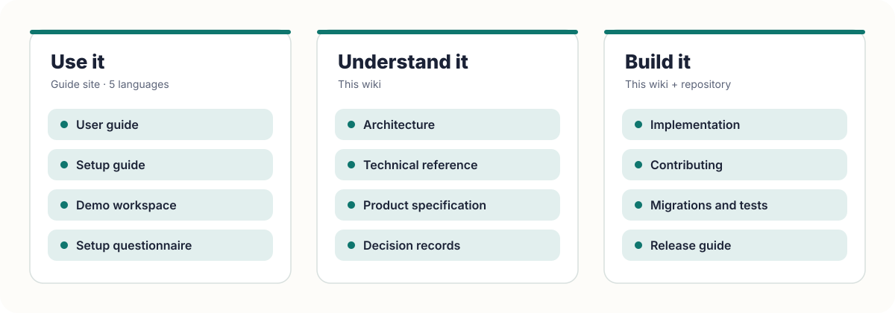

**The DesKilo wiki — use it, understand it, build it.**

[User guide](https://fdittgen-png.github.io/deskilo/guide/en.html) &nbsp;·&nbsp; [Setup guide](https://fdittgen-png.github.io/deskilo/guide/setup-en.html) &nbsp;·&nbsp; [Architecture](Architecture) &nbsp;·&nbsp; [Technical reference](Technical-Reference) &nbsp;·&nbsp; [Implementation](Implementation)

> **DesKilo** is free, privacy-first, open-source software for small self-organized coworking communities: visual desk booking, the community money layer and a private-by-default social network of spaces. It runs on Android (Play), iPhone and iPad (TestFlight), macOS, Windows and in the browser — one app, live-synced across every device — on a backend you host yourself or on the reference deployment operated by Florian DITTGEN.

<picture>
  <source media="(prefers-color-scheme: dark)" srcset="images/diagram-docs-map-dark.svg">
  
</picture>

## Use it

The user guide and the setup guide live on the **guide site**, not in this wiki: five languages each, a section per screen, an audience filter, search, and screenshots from the demo workspace *Atelier du Marché* (every person and figure invented). The same guides open from the **?** buttons inside the app.

<table>
<tr>
<td width="33%" valign="top">
 
<b><a href="https://fdittgen-png.github.io/deskilo/guide/en.html">User guide</a></b> 
Every screen by audience — member, administrator, owner, operator.  <a href="https://fdittgen-png.github.io/deskilo/guide/en.html">English</a> · <a href="https://fdittgen-png.github.io/deskilo/guide/fr.html">Français</a> · <a href="https://fdittgen-png.github.io/deskilo/guide/de.html">Deutsch</a> · <a href="https://fdittgen-png.github.io/deskilo/guide/es.html">Español</a> · <a href="https://fdittgen-png.github.io/deskilo/guide/it.html">Italiano</a>
</td>
<td width="33%" valign="top">
 
<b><a href="https://fdittgen-png.github.io/deskilo/guide/setup-en.html">Setup guide</a></b> 
For a future owner: what is possible, what is necessary, in which order.  <a href="https://fdittgen-png.github.io/deskilo/guide/setup-en.html">English</a> · <a href="https://fdittgen-png.github.io/deskilo/guide/setup-fr.html">Français</a> · <a href="https://fdittgen-png.github.io/deskilo/guide/setup-de.html">Deutsch</a> · <a href="https://fdittgen-png.github.io/deskilo/guide/setup-es.html">Español</a> · <a href="https://fdittgen-png.github.io/deskilo/guide/setup-it.html">Italiano</a>
</td>
<td width="33%" valign="top">
 
<b><a href="https://fdittgen-png.github.io/deskilo/">Try it first</a></b> 
The demo workspace: a fictional community as owner, administrator or member. Nothing you do there reaches a server.  <a href="https://fdittgen-png.github.io/deskilo/setup.html">Setup questionnaire</a>
</td>
</tr>
</table>

## Understand it

Every feature serves at least one of four goals — the *feature filter*: **know where you can sit**, **know what you owe or are owed**, **run the space without a landlord platform**, and **belong to a network, not a silo**. These pages explain how the product is built to serve them.

<table>
<tr>
<td width="33%" valign="top">
 
<b><a href="Architecture">Architecture</a></b> 
The system in diagrams: clients, Supabase backend, layers, the life of a booking, permissions, environments, platforms.
</td>
<td width="33%" valign="top">
 
<b><a href="Technical-Reference">Technical reference</a></b> 
Versions, every dependency and why, the server, all quality gates, the release pipeline, the standards implemented, the decision index.
</td>
<td width="33%" valign="top">
 
<b><a href="{R}docs/SPECIFICATION.md">Product specification</a></b> 
What the product is for and what it covers, module by module; delivery status lives in the capabilities manifest.
</td>
</tr>
</table>

## Build it

<table>
<tr>
<td width="33%" valign="top">
 
<b><a href="Implementation">Implementation</a></b> 
Repository map, the hard rules, building on every platform, migrations, tests, CI and the release trains, step by step.
</td>
<td width="33%" valign="top">
 
<b><a href="{R}CONTRIBUTING.md">Contributing</a></b> 
Ways to help — code, tests, translations, documentation, pilots — and how a change travels from issue to merge.
</td>
<td width="33%" valign="top">
 
<b><a href="{R}docs/guides/OPERATIONS.md">Operate it</a></b> 
Instance health, backup, restore, upgrades and recovery for whoever runs a server.
</td>
</tr>
</table>

## Reference in the repository

| What | Where |
|---|---|
| Product specification | [`docs/SPECIFICATION.md`](https://github.com/fdittgen-png/deskilo/blob/master/docs/SPECIFICATION.md) |
| Capabilities and evidence | [`docs/product/CAPABILITIES.md`](https://github.com/fdittgen-png/deskilo/blob/master/docs/product/CAPABILITIES.md) |
| Architecture decision records | [`docs/decisions/`](https://github.com/fdittgen-png/deskilo/tree/master/docs/decisions) |
| Contribution rules | [`CONTRIBUTING.md`](https://github.com/fdittgen-png/deskilo/blob/master/CONTRIBUTING.md) · [`docs/AGENT_RULES.md`](https://github.com/fdittgen-png/deskilo/blob/master/docs/AGENT_RULES.md) |
| SQL schema, RLS and RPCs | [`supabase/migrations/`](https://github.com/fdittgen-png/deskilo/tree/master/supabase/migrations) |
| Source | [`lib/`](https://github.com/fdittgen-png/deskilo/tree/master/lib) — one folder per feature |

AGPL-3.0-or-later © 2026 Florian DITTGEN — free for associations, collectives and individuals; a company that modifies it publishes its changes or buys a [commercial licence](https://github.com/fdittgen-png/deskilo/blob/master/COMMERCIAL-LICENCE.md) (ADR 0031). Sibling project of [Sparkilo](https://github.com/fdittgen-png/tankstellen).

