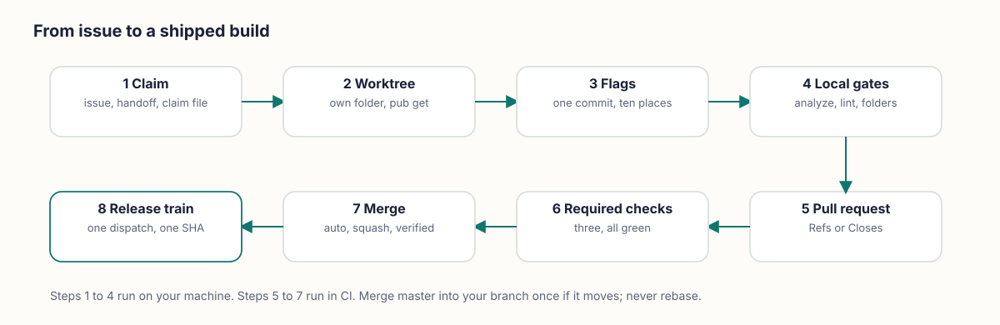
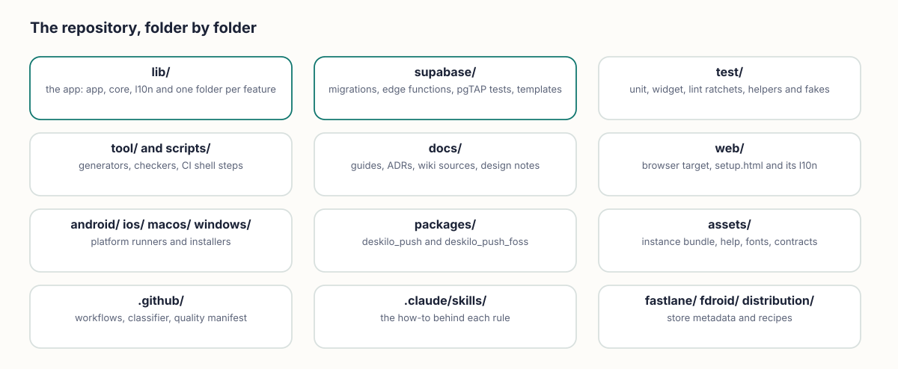
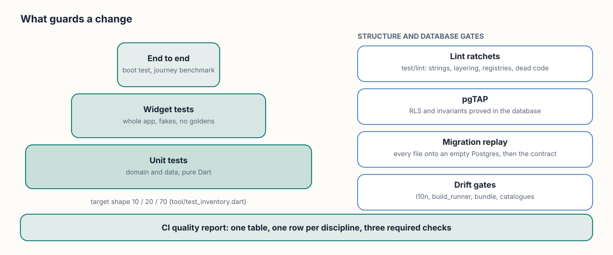
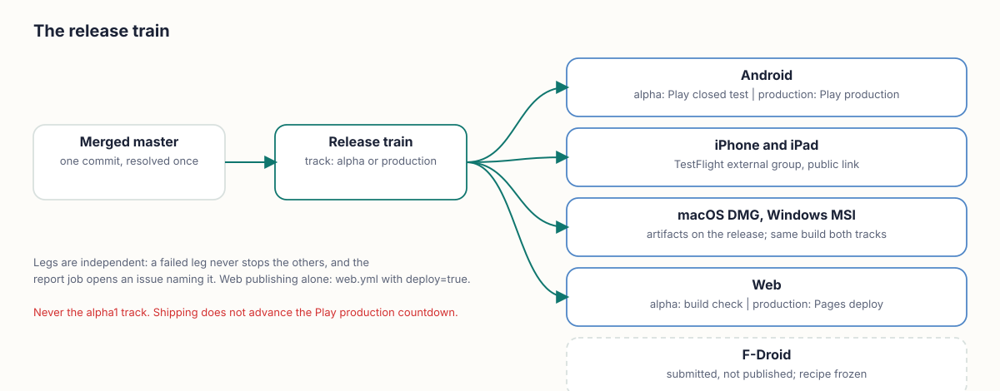

<div align="center">

**How DesKilo is built, tested and shipped — and how to add to it without breaking the rules.**

[Home](Home) &nbsp;·&nbsp; [Architecture](Architecture) &nbsp;·&nbsp; **Implementation** &nbsp;·&nbsp; [Technical reference](Technical-Reference) &nbsp;·&nbsp; [Repository](https://github.com/fdittgen-png/deskilo)

</div>

> **Short version.** Every change starts as an issue, lives on its own branch in its own worktree, passes a few fast local gates, and merges through three required CI checks. The full suite runs in CI only. A release is one train dispatch that ships every platform from one commit.

<br>

<table>
<tr>
<td width="33%" valign="top">
<br>
<b>The rules</b><br>
Five hard rules, a coding standard and a flag lifetime rule, kept in <code>docs/AGENT_RULES.md</code>.
</td>
<td width="33%" valign="top">
<br>
<b>The backend</b><br>
Numbered, immutable migrations. Prove them on the dev project before you apply them.
</td>
<td width="33%" valign="top">
<br>
<b>The release</b><br>
One train, one commit, every platform. Web publishing is a separate, opt-in step.
</td>
</tr>
</table>

## The workflow at a glance

<picture><source media="(prefers-color-scheme: dark)" srcset="images/diagram-issue-to-merge-dark.svg"></picture>

Each step is written out in [From issue to merge](#from-issue-to-merge) below.

## Repository layout

<picture><source media="(prefers-color-scheme: dark)" srcset="images/diagram-repo-map-dark.svg"></picture>

| Path | What lives there |
|---|---|
| `lib/app/` | boot, router, route policy, shell, theme |
| `lib/core/` | backend config, cache, formatting, help, i18n and other shared services |
| `lib/features/<feature>/` | one folder per feature, each split into `domain/` (pure Dart), `data/`, `providers/`, `presentation/` |
| `lib/l10n/` | `_fragments/` (the source of every string) and the generated `app_<locale>.arb` files |
| `supabase/migrations/` | numbered SQL files: schema, RLS, RPCs. `APPLIED.sha256` pins the applied ones |
| `supabase/functions/` | Edge Functions (payments, push, e-invoice, MCP, badge sign-in, VIES check) |
| `supabase/tests/database/` | pgTAP files, run by CI against a replayed database |
| `test/` | `lint/` (ratchets and registry pins), `features/`, `app/`, `core/`, `a11y/`, `property/`, `perf/`, `tool/`, with fakes in `helpers/` |
| `integration_test/` | the boot test |
| `tool/`, `scripts/` | generators (`build_*.dart`), checkers, and the shell steps CI calls |
| `web/` | the browser target and the setup questionnaire (`setup.html`) |
| `packages/` | `deskilo_push` (FCM) and `deskilo_push_foss` (no Google dependency) |
| `assets/` | the instance bundle (`assets/instance/`), generated help, fonts |
| `docs/` | `AGENT_RULES.md`, `decisions/` (ADRs), `guide/`, `guides/`, `design/`, `wiki/` |
| `.github/` | workflows, the change classifier, the quality manifest |
| `.claude/skills/` | the how-to behind each rule (see below) |
| `fastlane/`, `fdroid/`, `distribution/` | store metadata, the F-Droid recipe, release notes |

> **Count nothing by hand.** This page never states how many migrations, flags, tests or workflows exist: those numbers rot. Ask the repository: `dart run tool/project_scale.dart` for size and `dart run tool/test_inventory.dart` for the suite. `test/lint/no_frozen_counts_test.dart` enforces this.

## The hard rules

The binding text is [`docs/AGENT_RULES.md`](https://github.com/fdittgen-png/deskilo/blob/master/docs/AGENT_RULES.md); [`CLAUDE.md`](https://github.com/fdittgen-png/deskilo/blob/master/CLAUDE.md) and [`CONTRIBUTING.md`](https://github.com/fdittgen-png/deskilo/blob/master/CONTRIBUTING.md) point to it. Read it before your first branch. In short:

1. **No hard-coded user-facing text.** Every string goes through ARB in all five languages (EN, FR, DE, ES, IT) in the same PR.
2. **Never develop without a GitHub issue.** Large work is split into checkpoints the issue already names.
3. **Clean codegen before push.** Generated files are committed and show zero drift.
4. **Locale key parity.** A missing key in any locale fails CI.
5. **The setup questionnaire never lags.** `web/setup.html` changes in the same PR as any configurable parameter.

Beyond those five:

- **Every functionality sits behind a `WorkspaceFeature`**, for the lifetime of the project.
- **One registry-touching branch at a time.** Features, routes, permissions, migrations and generated registries all collide.
- **Code.** No `print`, no empty `catch`, no `setState` for shared state, no inline `BorderRadius.circular`. `presentation/` never imports `data/`. `domain/` is pure Dart. After an `await`, check `context.mounted`.
- **Never format an existing file.** The repo is not format-clean. Format only files you created.
- **Git.** Branch off `master`, conventional commits, small PRs, squash-merge. No direct commits to `master`, no force-push, no `--no-verify`, no amending pushed commits.

### Skills

The how-to behind each rule lives in `.claude/skills/`. Each skill points to the rule instead of restating it.

| Skill | Use it when |
|---|---|
| `deskilo-ship-feature` | you start any issue: claim, worktree, flag ritual, local gates, docs, PR |
| `deskilo-supabase-migration` | you touch a migration, RPC, policy or pgTAP file |
| `deskilo-widget-test-gotchas` | a widget test fails for a reason that is not your code |
| `deskilo-reports` | you change anything that is printed |
| `deskilo-ci-release` | your PR is open, a check is red, or you deploy |
| `deskilo-documentation` | you touch the guides, help anchors or screenshots |
| `deskilo-forms` | you build or change a form |
| `project-evolution-playbook` | you apply this method to another repository |

## Building & running

The Flutter version is pinned in `.flutter-version` (currently **3.47.5**) and in the `FLUTTER_VERSION` of every workflow. Use that version and no other: it carries the Dart SDK the project needs, and CI builds with it.

```bash
flutter pub get
dart run tool/build_arb.dart && flutter gen-l10n          # strings: fragments -> ARB -> localizations
dart run build_runner build --delete-conflicting-outputs  # riverpod, freezed, json
```

| Target | Command | Notes |
|---|---|---|
| Web | `flutter run -d chrome` | release build as CI does it: `flutter build web --release --no-web-resources-cdn --pwa-strategy=none --base-href <path>` |
| Android | `flutter run -d <device>` · `flutter build apk` | Play builds are signed app bundles from CI (`flutter build appbundle`) |
| iPhone / iPad | `flutter run -d <iphone>` | TestFlight builds come from CI (fastlane) |
| macOS | `flutter run -d macos` · `flutter build macos` | needs Xcode; the runner is sandboxed and carries network, camera and file entitlements |
| Windows | `flutter build windows` | MSI on CI: `gh workflow run windows-msi.yml -f ref=master` |
| F-Droid (libre) | `flutter build apk --release` after `tool/fdroid_foss_swap.sh` | swaps `deskilo_push` for `deskilo_push_foss` (ADR 0012) |
| Sideload APK | `gh workflow run dev-apk.yml -f ref=master` | debug-signed, from any ref |

**Which server.** A build talks to the shared reference deployment unless you override it with `--dart-define=SUPABASE_URL=… --dart-define=SUPABASE_KEY=…`. `--dart-define=DESKILO_NO_DEFAULT_SERVER=true` removes the default, so the app asks which server to use. The *Demo* workspace needs no backend at all.

**Worktrees need `flutter pub get`.** A fresh worktree without `.dart_tool` resolves `package:deskilo` to your main checkout, so generators silently write stale output.

**Codegen.** If a full `build_runner` run hangs in a worktree, build one file with `--build-filter 'lib/<path>/<file>.g.dart'`. A filtered run with `--delete-conflicting-outputs` deletes every other generated file; restore them with `git ls-files -d -z | xargs -0 git checkout --` before you commit.

## Backend & migrations

PostgreSQL carries the rules: row-level security, booking conflicts, financial invariants. Every multi-user write goes through a `SECURITY DEFINER` RPC. See [Architecture](Architecture) for the model.

- **Numbered and immutable.** Files are `supabase/migrations/NNNN_name.sql`. An applied file never changes; a fix is a new migration. `test/lint/applied_migrations_immutable_test.dart` and `APPLIED.sha256` hold that line.
- **The number is taken at push time.** Use master's latest plus one when you push, never earlier, never into a gap. If another open PR holds the same number, push anyway: the first to merge keeps it, the other renames inside the merge of master it needs anyway.
- **Harness before apply.** Prove the migration and its assertions in one rolled-back transaction on the dev project (red before, green after). Then apply the exact same text. Then record it with `dart run tool/record_applied_migrations.dart`. All of this happens before your first push.
- **File shape.** Line 1 is the SPDX header, line 2 `-- risk: additive|transforming|destructive`. Every new table is followed by `select public.ensure_system_columns('<table>');`. Every new function gets `revoke execute … from public, anon` in the same file. The last statement is `select public.set_deskilo_schema_version(NNNN);`.
- **Secrets tables get zero policies.** Only service-role functions and owner RPCs reach them.
- **Anchored patches.** To patch a long function you do not own, use `pg_temp.anchor_replace` at an asserted anchor, and make the harness execute every branch the patch touches.
- **The contract digest.** `quality · database` is a required check, and a stale `assets/instance/contract.txt` holds the PR open. Predict it before you push with `dart run tool/contract_predict.dart sql <file>`; only an exit code of 2 sends you to CI's artifact.
- **The instance bundle.** After any migration change, or after merging master into a migration branch, run `dart run tool/build_instance.dart` and check that `assets/instance/bundle.json` names every migration. `test/lint/instance_bundle_test.dart` pins it.
- **Two migration PRs collide on purpose.** `APPLIED.sha256`, the bundle, `contract.txt` and `requiredSchemaVersion` conflict between them. That conflict is the signal that the later PR takes the next number.
- **Local backend.** The Supabase CLI works (`supabase start`, `supabase/config.toml`), and CI replays every migration onto an empty Postgres this way. The reference deployment is hosted Supabase.
- **Edge Functions** are deployed to the hosted project. Webhooks run with `verify_jwt` off and authenticate by the provider's signature. Provider credentials resolve table-first, environment-fallback, so a single-workspace self-host can use environment variables alone. After editing `supabase/functions`, rebuild `bundle.json` and the capability evidence.
- **SQL-side registries.** Event types, the permission catalogue and the feature registry each have a SQL copy that a migration must carry. The skill `deskilo-supabase-migration` lists them.

## Feature flags: the checklist

Every functionality ships behind a `WorkspaceFeature`. *Enable a feature and you get all of it; disable it and you get none.* Land all of the following in one commit:

1. The enum value (appended at the end) and its `featureManifest` entry (`requires`, default) in `lib/features/workspace/domain/workspace_feature.dart`.
2. Its name in `feature_names.dart` and its description on the Features screen.
3. ARB fragments `featureXxx` and `featureXxxDesc`, in all five languages.
4. `web/setup.html`: the feature line and the `REQUIRES` entry. Then `dart run tool/build_setup_l10n.dart` and commit `web/setup_l10n.js` and `web/setup_catalogue.js`.
5. A primary subprocess (or an explicit internal reason) in `workspace_process.dart`; then `dart run tool/build_process_catalogue.dart`.
6. Its assessment line in `feature_lifecycle.dart`.
7. A migration carrying the output of `dart run tool/build_feature_registry_sql.dart`. A server gate calls `public.feature_effective(ws, 'key')`, never the raw flag.
8. The gate at both layers: hide the entry point (`features.contains(WorkspaceFeature.x)`) and guard the route (`featureEnabled(...)` in its `redirect`, plus a `RouteRule`). Test both the hidden entry and the bounced deep link.
9. After any `router.dart` edit, rebuild `router.g.dart` or CI's drift gate fails.

**Default on** unless the feature is risky or needs owner setup. **Off must degrade honestly:** entry points disappear, routes redirect, stored data stays untouched. Flags are never removed; a retired key moves to the retired list.

## Testing

<picture><source media="(prefers-color-scheme: dark)" srcset="images/diagram-quality-gates-dark.svg"></picture>

**Before every push** run the fast gates and see them green:

```bash
dart analyze --fatal-infos            # exactly what CI runs; includes the riverpod_lint plugin
flutter test test/lint                # every lint and registry pin
flutter test test/<folders you touched>
dart run tool/preflight.dart --list   # which generators your change implicates
```

Then run only the generators `--list` names. Never run the whole preflight: its `build_runner` step can hang.

**The full suite runs in CI only.** Do not run bare `flutter test` before a push. Several local full suites on one machine starve each other into timeouts. Docs-only changes need only the lint and doc tests.

> **Read the verdict line, never the exit of a pipe.** Redirect the output to a file, print the exit code, and look for `All tests passed!`. Piping `flutter test` into `tail` or `grep` hides a red run. Counting `[E]` lines reports green on a failed suite.

| Layer | Where | Notes |
|---|---|---|
| Unit | `test/core`, `test/features/*/domain`, `test/property` | pure Dart, fakes over mocks; `mocktail` only for widget callbacks |
| Widget | `test/features`, `test/app`, `test/a11y` | whole `DeskiloApp` under `ProviderScope(overrides: standardTestOverrides(...))`; structural assertions, no golden images; fakes live in `test/helpers/` |
| Lint ratchets | `test/lint` | strings, layering, dead code, public surface, registries, workflow names, drift. A ratchet counts the thing, so a partial win shows |
| pgTAP | `supabase/tests/database` | RLS, definer guards, triggers, invariants, proved in the database |
| Migration replay | CI `quality · database` | every migration onto an empty Postgres, then the effective contract and policy drift |
| End to end | `integration_test`, `tool/bench` | the boot test and the nightly journey benchmark |

Rules that save a day:

- **A bug fix starts with a failing test** that calls the exact method the failing UI calls. Then search for the same pattern elsewhere and fix every occurrence.
- **A new affordance gets a test that taps it**, with a tap target big enough for `androidTapTargetGuideline`.
- **Producer and consumer ship together.** Never merge the reader half without the writer.
- **A claim about the database is proved in the database.** In pgTAP, `set local role authenticated` or the test proves nothing; assert the positive case beside the negative one; an `UPDATE` refused by RLS does not raise, so read the row back and check it is unchanged.
- **Wait for real I/O with `untilReal`**, never a fixed delay. Time comes from the injected clock (`no_wall_clock`).
- **Every test file states its invariant** in a header paragraph and is classified by `tool/test_inventory.dart`.
- **A widget test fails for a reason that is not the code?** Look in the skill `deskilo-widget-test-gotchas` first.

## CI

Three checks are required on `master`. All three are produced by one workflow, **CI · Quality report** (`quality.yml`):

| Required check | What it proves |
|---|---|
| `analyze · l10n gate · test · coverage` | the ARB pipeline and codegen are committed, `dart analyze --fatal-infos` is clean, the whole suite passes, coverage holds its gate |
| `quality · database` | migration safety, tenant isolation, financial invariants, concurrency, conditional writes, query budgets, policy drift and the effective contract, on a replayed database |
| `quality · report` | every discipline row named in `.github/quality-manifest.psv` reported, none missing, none unexplained |

A failure says **which discipline** regressed, because the run summary is one table with one row per discipline. A *classify the change* job decides which work a diff requires and never decides whether a check may report.

> **A workflow name is free to change; a job name is not.** A job name is a required status-check context. Renaming `analyze · l10n gate · test · coverage` would make every PR unmergeable until branch protection is updated in lockstep. Workflows are named `<Group> · <what it does>`; the table is in [`.github/workflows/README.md`](https://github.com/fdittgen-png/deskilo/blob/master/.github/workflows/README.md).

- **Branch protection is data.** `scripts/branch_protection.sh` (verify, apply, show) holds it. `master` requires the checks above, blocks force-pushes and deletions, and demands linear history. Strict mode is off, so serialise merges rather than arming several at once.
- **Platform builds run on PRs that touch them:** *Release · macOS DMG*, *Release · Windows MSI*, *Publish · Web app* and *CI · F-Droid no-GMS audit*.
- **Flakes.** `cancelled` means a runner hiccup or a superseded run: rerun once. Infrastructure flakes get one rerun. Anything else is real.
- **A red `quality · database` holds a PR open.** The usual cause is a stale `contract.txt`.
- **Never `--admin`**, and never force-push to `master`.

## From issue to merge

1. **Claim.** A GitHub issue exists. Run `git log origin/master --grep '#N'` first: issue bodies go stale and checkpoints may already be merged. Check open PRs and `.agent-work/*.json` for other people's claims, then write your own.
2. **Worktree.** `git worktree add /private/tmp/deskilo-<issue> -b <branch> origin/master`, then `flutter pub get` inside it. One registry-touching branch at a time.
3. **Build.** Write the failing test first. Land flags, strings, `setup.html`, docs and migrations together (see the checklists on this page).
4. **Local gates.** `dart analyze --fatal-infos`, `flutter test test/lint` and the affected folders, and the generators `preflight --list` names.
5. **Pull request.** Conventional title with the issue number, for example `feat(scope): … (#123)`. Body: what and why, how it was tested. **`Refs #N`** for a partial PR; **`Closes #N`** only when the PR meets the whole acceptance. Keep PRs small.
6. **Required checks.** Queue the merge as soon as the PR is open: `gh pr merge <n> --auto --squash --match-head-commit <sha>`. A queued auto-merge is not a merge, and a new head SHA invalidates earlier evidence.
7. **Merge.** Confirm the PR is `MERGED` and the squash commit is on `origin/master`. If master moved under you, merge it into your branch **once**; never rebase. A migration PR that collided renames to the next free number inside that merge.
8. **Ship.** After the last merge of a batch, dispatch one train (next section).

**Ready and Done.** *Ready* means the issue states the user, the outcome, the proving scenario, the real consumer and the test layers. *Done* means the producer and its consumer work through success, refusal and recovery, acceptance maps to named tests, and the candidate SHA has green required checks. Proof you could not obtain is `NOT RUN` or `BLOCKED`, never `PASS`. Stop when the outcome is Done: no speculative abstractions, no unrelated cleanup. A defect found on the way gets its own issue.

## Releases

<picture><source media="(prefers-color-scheme: dark)" srcset="images/diagram-release-train-dark.svg"></picture>

```bash
gh workflow run release-train.yml -f track=alpha -f release_notes="…"     # the closed test
gh workflow run release-train.yml -f track=production
gh workflow run web.yml -f ref=master -f deploy=true                     # publish the web app
```

| Platform | `alpha` | `production` |
|---|---|---|
| Android | Play **alpha**, the closed test the testers are enrolled in | Play production (Play may refuse while access is pending; the report says so) |
| iPhone / iPad | TestFlight external group (public link) | the same group |
| macOS, Windows | DMG (Developer-ID signed, notarised) and MSI attached as artifacts | same build |
| Web | build check only | GitHub Pages deploy |
| F-Droid | **submitted, not published**: the recipe is frozen while it is under review | see [F-Droid status](https://github.com/fdittgen-png/deskilo/blob/master/docs/guides/fdroid.md#status) |

- **One candidate.** The ref is resolved once to a SHA and every leg builds that SHA or fails. A push to master mid-train cannot mix two commits.
- **Legs are independent.** A failed leg never stops the others; a report job opens an issue and names it.
- **The input is the Play track.** Alpha is the closed test. Never use `alpha1`, the open track the project does not ship to.
- **Shipping does not advance the Play production countdown.** That needs enough testers enrolled and continuous days, not a green train.
- **Web publishing is opt-in.** Merging `web/setup.html` or the guides updates the repository copy; the live page moves only when the web workflow runs with `deploy=true`, or on a production train.
- **Store builds only use FCM.** The libre flavour has no push transport; notifications are local.
- Details and the owner-held secrets: [`docs/guides/RELEASING.md`](https://github.com/fdittgen-png/deskilo/blob/master/docs/guides/RELEASING.md).

## Adding a feature: the checklist

- [ ] The issue exists, is claimed, and the work fits one PR (or the checkpoint it names).
- [ ] A worktree off `origin/master`, `flutter pub get` done.
- [ ] A failing test first.
- [ ] Model in `domain/`, a seam in the repository interface, the Supabase implementation in `data/`, a provider, then the screen. `presentation/` does not import `data/`.
- [ ] The `WorkspaceFeature` ritual above, in one commit.
- [ ] Strings as fragments in all five languages, then `build_arb.dart` and `flutter gen-l10n`; no literal in a `Text`.
- [ ] A migration, if the server changes: RLS, revokes, system columns, version marker, harnessed on dev, applied, recorded, contract predicted, bundle rebuilt. The fake repository mirrors the server contract.
- [ ] `web/setup.html` (field, XML export, XML import, five languages) in the same PR if anything is configurable.
- [ ] A guide section with an `<!-- anchor: … -->` for everything a user can see or configure, in five languages, and the help symbol beside it (skill `deskilo-documentation`).
- [ ] An ADR in `docs/decisions/` if you decided something; a rule in `AGENT_RULES.md` if the next contributor must obey it.
- [ ] Gates green: `dart analyze --fatal-infos`, `flutter test test/lint`, the affected folders, the generators `preflight --list` names.
- [ ] PR with `Refs` or `Closes`, auto-merge queued, merge verified.

## Where next

[Architecture](Architecture) &nbsp;·&nbsp; [Technical reference](Technical-Reference) &nbsp;·&nbsp; [Setup guide](https://fdittgen-png.github.io/deskilo/guide/setup-en.html) &nbsp;·&nbsp; [User guide](https://fdittgen-png.github.io/deskilo/guide/en.html) &nbsp;·&nbsp; [Agent rules](https://github.com/fdittgen-png/deskilo/blob/master/docs/AGENT_RULES.md) &nbsp;·&nbsp; [Releasing](https://github.com/fdittgen-png/deskilo/blob/master/docs/guides/RELEASING.md)
