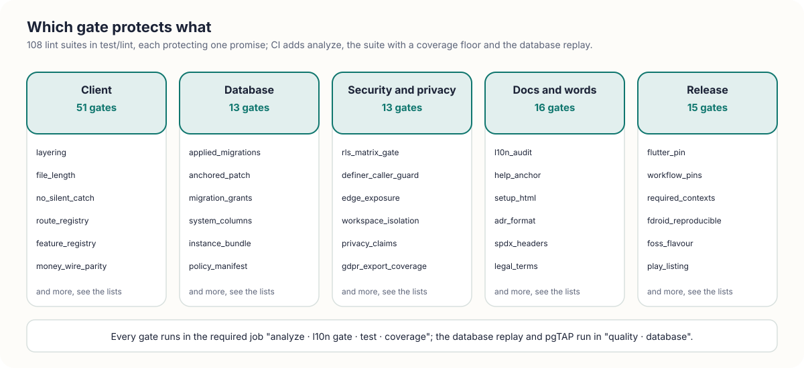
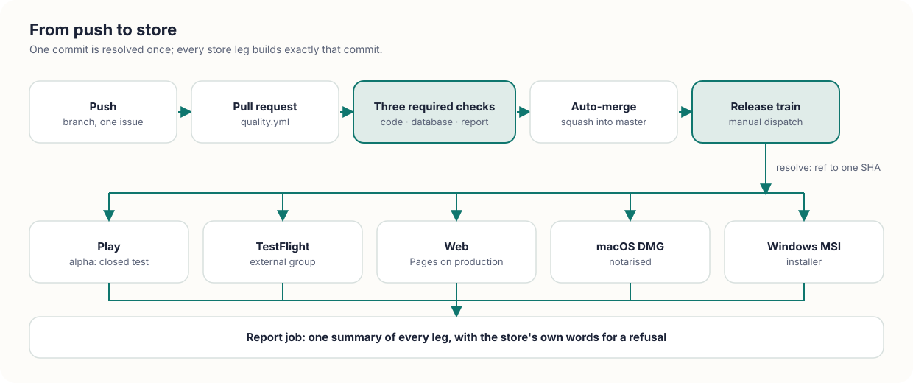

**The exact, current reference: versions, dependencies, server, gates, pipelines, standards and decisions.**

[Home](Home) &nbsp;·&nbsp; [Architecture](Architecture) &nbsp;·&nbsp; [Implementation](Implementation) &nbsp;·&nbsp; [User guide](https://fdittgen-png.github.io/deskilo/guide/en.html) &nbsp;·&nbsp; [Setup guide](https://fdittgen-png.github.io/deskilo/guide/setup-en.html) &nbsp;·&nbsp; [Repository](https://github.com/fdittgen-png/deskilo)

> **Every fact on this page was read from the repository on 2026-10-11**, at migration 0406: versions from `pubspec.yaml` and the workflows, gates from `test/lint/`, workflows from `.github/workflows/`, decisions from `docs/decisions/`. Counts go stale at the next merge; the files they came from do not.

<table>
<tr>
<td width="33%" valign="top">
 
<b>Build it</b> 
<a href="#versions-and-floors">Versions</a>, <a href="#the-dependencies-and-why-each-is-there">dependencies</a>, the <a href="#architecture-in-one-page">architecture</a> and its <a href="#patterns-and-where-to-read-one">patterns</a>.
</td>
<td width="33%" valign="top">
 
<b>Run it</b> 
<a href="#the-server">The server</a>, the <a href="#release-trains-and-workflows">release trains and workflows</a>, the <a href="#licences">licences</a>.
</td>
<td width="33%" valign="top">
 
<b>Trust it</b> 
<a href="#quality-gates">108 quality gates</a>, <a href="#standards-the-code-implements">standards</a> and the <a href="#decisions-adr-index">39 decisions</a>.
</td>
</tr>
</table>

## Versions and floors

| | |
|---|---|
| App version | `1.0.3+4` |
| Flutter | **3.47.5**, the only version: declared once per workflow (`FLUTTER_VERSION`, 11 workflows) and pinned by `flutter_pin_test` and `workflow_pins_test` |
| Dart SDK | `^3.13.0` (`pubspec.yaml`); `pubspec.lock` resolves `>=3.13.0 <4.0.0` and Flutter `>=3.44.0` |
| Android | `minSdk`, `targetSdk`, `compileSdk` and the NDK all follow the Flutter pin (`flutter.minSdkVersion` and friends in `android/app/build.gradle.kts`) |
| iOS and iPadOS | **15.0** floor (`ios/Podfile`) |
| macOS | deployment target 10.15 (`macos/Runner.xcodeproj`); notarised DMG |
| Windows | MSI installer |
| Web | Flutter web, on GitHub Pages |
| Languages | five: English (canonical), French, German, Spanish, Italian |
| Licence | **AGPL-3.0-or-later**, see [Licences](#licences) |

| Counted now | |
|---|---|
| Migrations | **406** (`supabase/migrations`, `0001` to `0406`) |
| Edge functions | **9** (`supabase/functions`, without `_shared`) |
| Database test files (pgTAP) | **159** (`supabase/tests/database`) |
| Feature flags (`WorkspaceFeature`) | **129** |
| Route declarations | **88** (`GoRoute(` in `lib/app/router.dart`) |
| Test files | **925** (`test/`, lint suites included) |
| Lint gates | **108** (`test/lint`, helper excluded) |
| Workflows | **18** (`.github/workflows`) |
| Decision records | **39** (`docs/decisions`) |
| ARB fragment files | **1090** (`lib/l10n/_fragments`, five per topic) |

## The stack at a glance

<picture><source media="(prefers-color-scheme: dark)" srcset="images/diagram-tech-stack-dark.svg"></picture>

## The dependencies, and why each is there

`pubspec.yaml` declares 40 runtime entries (counting the two SDK ones and the local `deskilo_push`) and 15 development entries. Two local packages live in `packages/`: `deskilo_push` (Firebase Cloud Messaging, store builds) and `deskilo_push_foss` (the same interface with no Google dependency).

<b>Runtime dependencies (40)</b>

| Package | Version | Why it is here |
|---|---|---|
| `flutter`, `flutter_localizations` | SDK | the UI framework and its localisation delegates |
| `flutter_riverpod` | ^3.4.3 | state; every provider is a seam a test can override |
| `riverpod_annotation` | ^4.0.2 | annotations read by the generator |
| `freezed_annotation` | ^3.0.0 | immutable models with value equality |
| `json_annotation` | ^4.9.0 | JSON mapping annotations |
| `meta` | any | `@immutable`, `@visibleForTesting` |
| `go_router` | ^17.3.0 | one route registry; gated routes redirect on their feature flag |
| `flex_color_scheme` | ^8.1.0 | Material 3 theme, light and dark, from one seed |
| `hive`, `hive_flutter` | ^2.2.3, ^1.1.0 | the offline read cache |
| `shared_preferences` | ^2.5.5 | per-device choices: active workspace, dismissed hints |
| `flutter_secure_storage` | 11.2.0 | secrets and session material on the device |
| `dio` | ^5.10.0 | HTTP beyond Supabase |
| `http` | ^1.6.0 | small plain requests |
| `supabase_flutter` | ^2.17.2 | auth, Postgres, realtime, storage; writes go through RPCs |
| `intl` | ^0.20.2 | dates, numbers, currencies in the reader's locale |
| `timezone` | ^0.11.1 | time-zone aware times and reminders |
| `flutter_map`, `flutter_map_marker_cluster`, `latlong2` | 8.3.2, 8.2.2, 0.9.1 | the shared directory map (OpenStreetMap tiles) |
| `flutter_local_notifications` | ^22.0.1 | reminders and pings on the device |
| `deskilo_push` | local | the push transport; the libre build swaps in `deskilo_push_foss` |
| `app_badge_plus`, `windows_taskbar` | ^1.2.4, ^1.1.2 | unread counters on the app icon |
| `qr_flutter` | ^4.1.0 | QR codes for spaces, badges and sheets |
| `flutter_zxing` | ^3.1.0 | the scanner, with no Google service |
| `nfc_manager` | ^4.2.1 | RFID and NFC badges, seat tags |
| `share_plus` | ^13.2.0 | hand a file or link to another app |
| `url_launcher` | ^6.3.1 | open links, mail, maps |
| `file_selector`, `path_provider` | ^1.1.0, ^2.1.6 | import, export, temporary files |
| `pdf` | ^3.12.0 | every printed document: invoices, letters, reports, badges |
| `liquify` | ^1.6.1 | the Liquid dialect of the report designer |
| `xml` | ^6.6.1 | e-invoices, accounting files, VAT declarations, the configuration file |
| `archive` | ^4.0.9 | zip bundles: exports, instance bundle |
| `crypto` | ^3.0.7 | digests (hashes of files and payloads) |
| `web` | ^1.1.1 | browser APIs on the web build |
| `markdown_widget` | ^2.3.2+8 | renders the bundled guides |
| `package_info_plus` | ^10.2.1 | the running version, shown and compared to the server |

<b>Development dependencies (15)</b>

| Package | Version | Why it is here |
|---|---|---|
| `flutter_test`, `integration_test` | SDK | widget, app and integration tests |
| `flutter_lints` | ^6.0.0 | the base analyzer rule set |
| `riverpod_lint` | ^3.1.3 | provider rules, run by `dart analyze` (CI uses it) |
| `build_runner` | ^2.4.15 | code generation |
| `freezed`, `json_serializable`, `riverpod_generator` | ^4.0.2, ^6.9.0, ^4.0.2 | the generators behind the annotations |
| `mocktail` | ^1.0.4 | the few mocks a fake cannot replace |
| `leak_tracker_flutter_testing` | ^3.0.10 | leak detection in widget tests |
| `markdown`, `yaml` | ^7.3.1, ^3.1.3 | the guide and documentation tools read Markdown and YAML |
| `image` | ^4.9.2 | the screenshot pipeline |
| `visibility_detector` | ^0.4.0+2 | keeps the guide's table of contents honest in tests |
| `flutter_launcher_icons` | ^0.14.4 | app icons for every platform |

## Architecture in one page

- **Feature-first.** `lib/features/<feature>/{domain,data,application,presentation,providers}`. There are 17 features (auth, calendar, directory, editor, events, help, kiosk, mcp, me, members, money, plan, profile, reservations, task_recorder, visits, workspace). Cross-feature code lives in `lib/core/` (40 areas: backend, money, vat, trace, theme, push, demo, and more).
- **Domain purity.** Nothing in `domain/` imports Flutter or the localisations. That is why `tool/report.dart` can render an invoice from a command line. `layering_test` keeps it true.
- **Presentation never imports data.** A screen talks to a repository interface through a provider.
- **One repository interface per feature**, with a Supabase implementation and an in-memory fake. The demo workspace is the same seam with no backend behind it (ADR 0028).
- **The database enforces the rules.** The client only asks (ADR 0020). Every multi-user write is a `security definer` RPC.
- **Every functionality is a `WorkspaceFeature`**, for its whole life, with a `requires` graph. The registry is pinned on both sides (`feature_registry_test`, `feature_registry_sql_test`).
- **Five languages, always.** `lib/l10n/_fragments/<topic>_<lang>.arb` is merged by `tool/build_arb.dart`; a bare literal in a widget fails `l10n_audit_test`.

More on how the pieces fit: [Architecture](Architecture).

## The server

| Part | What it is |
|---|---|
| Database | Postgres with **row-level security on every table**. A client reads through policies and writes through RPCs. The policy matrix is in [`docs/security/SUPABASE_RLS_MATRIX.md`](https://github.com/fdittgen-png/deskilo/blob/master/docs/security/SUPABASE_RLS_MATRIX.md); the threat model in `docs/security/THREAT_MODEL.md`. |
| Migrations | 406 numbered files. An applied file is immutable: its digest is in `supabase/APPLIED.sha256` and `applied_migrations_immutable_test` fails on any change. A correction is a new migration. The number is taken at push time. |
| Proof before apply | Each migration is first run in a transaction that ends with a deliberate `raise exception 'HARNESS ...'`. Everything rolls back; the message carries the assertions. Roles are impersonated with `set_config('request.jwt.claims', ...)`. |
| Tests | 159 pgTAP files in `supabase/tests/database`, run in the `quality · database` job on a replay of every migration from an empty database. |
| System columns | Six on every table: `created_datetime`, `modified_datetime`, `company_id`, `site_id`, `created_by_user`, `modified_by_user`. A trigger stamps them; the client cannot forge them (ADR 0018, `system_columns_test`). |
| Registries in SQL | The feature, KPI and template-field registries are generated from the Dart sources and checked for drift. |
| Instance bundle | `assets/instance/bundle.json` carries every migration and edge function so the in-app wizard can build a new instance. `contract.txt` and `policies.txt` sit beside it; `instance_bundle_test` fails when the bundle lags. |
| Templates | `supabase/templates`: built-in workspace templates (for example an association template). |

<b>Edge functions (9)</b>: every function and who may call it (<code>supabase/functions/exposure.json</code>)

| Function | Job |
|---|---|
| `badge-signin` | sign in by scanning an RFID badge: the tag identifies, a PIN proves; mints a native session |
| `create-payment-order` | starts a real online payment for a member's bill; payments never touch a client SDK (ADR 0021) |
| `send-e-invoice` | posts an issued invoice to the workspace's e-invoicing provider (ADR 0010) |
| `send-push` | fans a notification event out to devices (FCM) |
| `vies-check` | asks the EU VIES service whether a VAT number is valid |
| `deskilo-mcp` | the Model Context Protocol endpoint: the same processes, roles and approvals as the app |
| `stripe-webhook`, `mollie-webhook`, `paypal-webhook` | payment confirmations, authenticated by the provider's own signature or by fetching the object back |

User-facing and system functions refuse a delegated (MCP) token before any privileged work. Shared helpers (`_shared`): CORS, delegated-token refusal, a local JWT check, the money boundary (`money.ts`, the TypeScript twin of `accounting_amount.dart`), payment providers, place images, MCP contract validation.

## Patterns, and where to read one

| Pattern | Where |
|---|---|
| Repository + fake | one interface per feature in `domain/`, the Supabase class in `data/`, the fake in `test/` |
| Value object | `SystemColumns`, `VatRate`, money in cents: immutable, equal by value |
| Null object | `SystemColumns.none` for a row the server never stamped |
| Registry + lint | features, routes, route policies, processes, permissions, report kinds, placeholders, help anchors: one list, one test that reads both sides |
| Snapshot | an invoice freezes its lines, parties and VAT breakdown at issue |
| Append-only ledger | the member account is a running account that is never rewritten (ADR 0022) |
| Anchored patch | a migration rewrites a long function by asserted anchor (`pg_temp.anchor_replace`), never by retyping it; `anchored_patch_test` guards it |
| Capability token | `set_config('deskilo.deploying', ...)` lets one RPC pass another's guard for one transaction |
| Preview and one write | a process intent has one preview and one write conditioned on what the preview read (ADR 0027) |
| Template as deployment | a workspace template is the deployment engine in merge mode (ADR 0026) |
| Observer | `TraceProviderObserver` traces every provider failure |
| Guarded action | `runGuarded`: one wrapper that traces the start, end and failure of every mutation |
| Federation | one personal account across servers: `lib/core/backend` (handoff, connected installations) |
| Generated, then drift-checked | `.g.dart`, ARB, help assets, the SQL registries, the instance bundle, the dependency map: each has a gate that regenerates and compares |

## Quality gates

<picture><source media="(prefers-color-scheme: dark)" srcset="images/diagram-tech-gates-dark.svg"></picture>

> **Rule.** A promise that no test enforces is a wish. `test/lint/` holds **108 suites**, each pinning one promise. CI adds `dart analyze --fatal-infos`, the l10n drift gate, the full suite with a coverage floor that may only go up, the migration replay and the pgTAP run.

Run the lint folder yourself: `flutter test test/lint`. Rules of the road: [Implementation](Implementation).

<b>Client: shape of the code, registries, tokens, money (51 gates)</b>

| Gate (`test/lint/<name>_test.dart`) | Promise |
|---|---|
| `capability_manifest` | the capability page cites evidence paths that exist at HEAD |
| `chevron_affordance` | a trailing chevron means it opens something |
| `chip_checkmark` | a chip with an avatar does not also draw the selection checkmark |
| `chip_row_affordance` | a horizontal chip row shows that it scrolls |
| `config_reachable` | every parameter an owner can set is reachable in the UI |
| `configuration_classification` | every configurable setting is classified in the configuration matrix |
| `contrast` | WCAG AA contrast over the shipped colour schemes, measured |
| `dead_code` | no public top-level declaration that nothing in lib/ uses |
| `demo_coverage` | the Demo coverage map names files that exist |
| `dependency_map` | the generated dependency map matches the tree |
| `distinct_tile_labels` | two rows of one list never carry the same label |
| `fab_safe_list` | a list under a floating button ends above the button |
| `feature_flag_writers` | every flag writer uses the canonical change-set or is a named exception |
| `feature_registry` | the WorkspaceFeature enum, its manifest and its requires graph agree; flags live forever |
| `file_length` | a file-length budget with a ratcheting allow-list; nobody plans a 1 500-line screen |
| `form_patterns` | forms are built from the form kit, not by hand |
| `generated_drift` | generated code equals what build_runner writes |
| `generic_error` | the generic error sentence may only become rarer |
| `icon_button_labels` | every icon button has a tooltip |
| `ignore_budget` | the count of // ignore: switches may only fall, each with a reason |
| `json_decoding` | the data layer decodes rows through one reader that names the missing column |
| `layering` | feature-first layers: domain imports no Flutter, presentation never imports data |
| `lexicon_allow_list` | the app and the server agree on which words a workspace may rename |
| `main_exit_code` | a tool sets exitCode; Dart ignores what int main returns |
| `money_wire_parity` | the Dart and TypeScript money boundaries agree |
| `no_day_duration` | printed, invoiced or chased dates never use Duration(days: n) |
| `no_escaped_dollar` | a switched-off string interpolation is a compile-time lie; none allowed |
| `no_frozen_counts` | orientation documents carry no count of the repository |
| `no_hand_rolled_cents` | amounts go through parseCentsInput / centsToMajor, never hand-rolled |
| `no_inline_border_radius` | corner radii come from the AppRadius tokens |
| `no_raw_dateformat` | times go through AppFormat, which honours the member's clock and time zone |
| `no_render_tree_blur` | the retired Demo blur mechanism does not come back |
| `no_silent_catch` | no empty catch; every exception is traced |
| `no_wall_clock` | nothing a widget test pumps reads the wall clock |
| `pezenas_template` | the Pézenas variant stays within what its source document said |
| `platform_checks` | Platform.isX lives behind a core/ seam, never inline |
| `process_registry` | every capability has one business home or an explicit internal reason |
| `provider_watch_before_await` | a provider registers its dependencies before its first await |
| `public_surface` | no declaration made public that no other production file names |
| `recorder_keys` | every control the task recorder names has a string key |
| `recording_seam` | filming mode substitutes invented people at the data seam, and the seam stays closed |
| `report_kind_registry` | a report kind gains export, import, label and defaults or fails |
| `route_policy_registry` | every route is classified, every rule names a real route |
| `route_registry` | a route cannot be added, duplicated or left ungated silently |
| `shared_formatters` | one implementation each for money, date, CSV cell and percent text |
| `state_primitives` | an empty list never looks like a failed one; loading and empty views are shared |
| `template_contract` | every built-in workspace template passes one contract |
| `template_coverage` | nothing a template could carry is without a disposition |
| `test_inventory` | the test inventory lists exactly the tests that exist |
| `visual_tokens` | a screen picks neither its own font size nor its own colour |
| `wire_enum` | wire enums fall back instead of throwing on an unknown value |

<b>Database: migrations, grants, SQL registries (13 gates)</b>

| Gate (`test/lint/<name>_test.dart`) | Promise |
|---|---|
| `anchored_patch` | a function re-created from scratch must not discard anchored patches |
| `applied_migrations_immutable` | an applied migration is history: its digest in APPLIED.sha256 never changes |
| `booking_rules_single_key` | booking_rules is written one key at a time, merged in the database |
| `database_clock` | a database test never depends on the hour the pipeline runs |
| `feature_registry_sql` | the server's feature registry is the Dart manifest |
| `instance_bundle` | the instance bundle never lags the migrations or the functions |
| `kpi_registry_sql` | the server's KPI registry is the Dart catalogue |
| `local_stack_harness` | one local stack per job; nothing order-dependent on it |
| `migration_grants` | a migration that creates a function revokes anon in the same file |
| `migration_version_marker` | every migration states the schema version it makes and the kind of change |
| `policy_manifest` | the policy manifest lists what the migrations create |
| `system_columns` | six system columns on every table |
| `template_field_registry_sql` | the server's template field registry is the Dart one |

<b>Security and privacy: RLS, edge authentication, isolation, export (13 gates)</b>

| Gate (`test/lint/<name>_test.dart`) | Promise |
|---|---|
| `definer_caller_guard` | a callable SECURITY DEFINER function checks who is calling |
| `edge_exposure` | every edge function is classified and the class is enforced in its source |
| `edge_function_auth` | an edge function knows who asks and resolves one member row |
| `gdpr_export_coverage` | every table holding a member's data is exported or exempt on the record |
| `grant_table_policy` | a grant row is never the thing that proves access |
| `payment_money` | payment functions convert money through one helper, never * 100 |
| `privacy_claims` | the privacy policy and the erasure function say the same thing |
| `privacy_policy_version` | changed consent text asks every account again |
| `rls_matrix_gate` | a row policy asks the role matrix, never just "admin or owner" |
| `sign_out` | a sign-out drops the cache so the next person sees nothing of the last |
| `silent_rls_refusal` | a write RLS refuses matches no rows; the client must notice |
| `workspace_export_coverage` | every table a workspace owns is exported or exempt on the record |
| `workspace_isolation` | one workspace's data never mixes with another's |

<b>Docs and words: help, guides, setup, five languages (16 gates)</b>

| Gate (`test/lint/<name>_test.dart`) | Promise |
|---|---|
| `adr_format` | decision records keep the shape that makes them citable |
| `arb_register` | one register per language (formal German, and so on) |
| `cost_planner_runs` | the cost planner's fixtures run under node |
| `help_anchor` | one anchor identity for the help symbol, the guide heading and the screenshot |
| `help_coverage` | help symbols map to exact anchors, measured |
| `help_generated` | assets/help is what the generator writes from docs/wiki |
| `help_guide_parity` | the in-app help loses no guide in any language |
| `help_host_inventory` | the inventory of help-card hosts, and a guard against new ones |
| `l10n_audit` | no user-facing literal outside the decided ones; the one localization scanner |
| `legal_terms` | the words a tax authority reads are pinned per language |
| `setup_html` | the setup questionnaire never lags the app |
| `setup_l10n` | the setup questionnaire speaks the five languages |
| `setup_runs` | the questionnaire's JavaScript executes without error |
| `spdx_headers` | every source file declares AGPL-3.0-or-later and nothing else |
| `user_guide` | the guides are chapter files per language; everything else is derived |
| `welcome_page` | the welcome page speaks the five languages |

<b>Release: pins, stores, the libre build, workflows (15 gates)</b>

| Gate (`test/lint/<name>_test.dart`) | Promise |
|---|---|
| `android_manifest` | the Android manifest keeps the permissions notifications need |
| `android_reach` | Play does not turn a permission into a hardware requirement |
| `coverage_gate` | the coverage floor and its red controls |
| `fdroid_frozen` | the F-Droid submission stays frozen while under review |
| `fdroid_reproducible` | the rebuild of the pinned commit matches the shipped binary |
| `flutter_pin` | one pinned Flutter version, and everything reads it |
| `foss_flavour` | the F-Droid flavour stays buildable and Google-free |
| `manifest_permissions` | the main manifest declares INTERNET for release builds |
| `perf_gate` | the journey benchmark gates its shape, with red controls |
| `play_availability` | the availability tool and its workflow stay in step |
| `play_listing` | every store language has the screenshots Play demands |
| `required_contexts` | no required status context that no job emits |
| `workflow_naming` | workflow names carry their group (CI, Nightly, Release, Publish, Status, Tools) |
| `workflow_pins` | every workflow builds with the same Flutter, declared once |
| `workflow_source_identity` | the release train resolves one commit; every leg builds it |

## Release trains and workflows

<picture><source media="(prefers-color-scheme: dark)" srcset="images/diagram-tech-pipeline-dark.svg"></picture>

- **Three required checks** guard master: `analyze · l10n gate · test · coverage`, `quality · database`, `quality · report`. They are the jobs of `quality.yml`. The first job's name is the required status context; never rename it (`required_contexts_test`).
- **One train.** `release-train.yml -f track=alpha|production` resolves the ref **once** to a commit; every leg builds that commit or fails. `alpha` is the Play closed test the testers are enrolled in; `production` is the public track. Per leg: Play uploads to the track; TestFlight goes to the external group; macOS and Windows produce a DMG and an MSI; the web leg only checks the build on `alpha` and deploys to GitHub Pages on `production`. A report job summarises every leg.
- **Libre build.** F-Droid builds from a frozen recipe with the transport-free push package; `fdroid-foss.yml` proves it carries no Google dependency.

Workflow names carry their group (`workflow_naming_test`): CI, Nightly, Release, Publish, Status, Tools.

<b>All 18 workflows</b>

| Workflow | File | Trigger | What it does |
|---|---|---|---|
| CI · Quality report | `quality.yml` | push to master, pull request, nightly | jobs `classify`, `code`, `database`, `report`; the gate every PR waits on |
| CI · Android boot check | `android-boot.yml` | push to master (paths), manual | installs the shrunk release APK on an emulator and proves it stays alive |
| CI · F-Droid no-GMS audit | `fdroid-foss.yml` | pull request and push (paths) | the libre flavour carries no Google dependency |
| CI · Dictionary refresh | `dictionary-refresh.yml` | push to master, nightly | regenerates the data dictionary from the migration replay |
| Nightly · Journey latency benchmark | `perf-bench.yml` | nightly | gates the shape (round trips, elements, frames) of the user journeys |
| Release · Train (all platforms) | `release-train.yml` | manual | one commit to every store (legs: resolve, android, apple, macos, windows, web, report) |
| Release · Play track upload | `play-internal.yml` | nightly, manual, called by the train | signed AAB to a Play track |
| Release · iOS TestFlight build | `ios-testflight.yml` | manual, called by the train | build, upload, optional external distribution |
| Release · macOS DMG | `macos-app.yml` | manual, PR/push (paths), called by the train | notarised disk image |
| Release · Windows MSI | `windows-msi.yml` | manual, PR/push (paths), called by the train | installer |
| Publish · Web app (GitHub Pages) | `web.yml` | manual, pull request, called by the train | browser build; deploy on request |
| Publish · Edge functions | `edge-functions.yml` | pull request (paths), manual | typecheck, and deploy on request |
| Publish · F-Droid release APKs | `fdroid-release.yml` | manual | the signed libre APKs F-Droid reproduces against |
| Publish · Play Store listing | `play-listing.yml` | manual | store texts and graphics |
| Status · Instance doctor | `instance-doctor.yml` | nightly, manual | examines a project for drift against the repository |
| Status · Play track availability | `play-availability.yml` | manual | what Play actually serves, per track |
| Tools · Add iOS TestFlight tester | `ios-testers.yml` | manual | invite a tester or create the external group |
| Tools · Dev APK (sideload) | `dev-apk.yml` | manual | a one-off APK from any ref |

Scripts behind the jobs live in `scripts/` (coverage gate, perf gate, generated-drift check, contract check, classifier, restore and upgrade checks). Generators and checkers live in `tool/` (`build_arb`, `build_help`, `build_instance`, `preflight`, `report`, `layering`, `dead_code`, `l10n_audit`, `contract_predict`, and more). `dart run tool/preflight.dart --list` shows the local pre-push gate.

## Standards the code implements

<picture><source media="(prefers-color-scheme: dark)" srcset="images/diagram-tech-standards-dark.svg"></picture>

| Domain | Standard | Where |
|---|---|---|
| E-invoice | **EN 16931** semantic model, syntaxes **UBL 2.1** and **UN/CEFACT CII D16B** (the syntax Factur-X embeds in the PDF) | `invoice_ubl.dart`, `invoice_cii.dart`, `e_invoice_totals.dart` |
| E-invoice checks | the norm's fatal business rules, named where they apply, reported before export | `invoice_ubl_check.dart` |
| E-invoice routing | how an invoice travels per country and audience (XRechnung, Factur-X/ZUGFeRD and FatturaPA are named there) | `e_invoice_routing.dart`, `einvoice_gateway.dart`, edge function `send-e-invoice` |
| France | **FEC** (*fichier des écritures comptables*) | `fec.dart` |
| Germany, Austria | **DATEV EXTF Buchungsstapel**, an exchange file for the accountant | `datev.dart` |
| Accounting exchange | **SAF-T, invoicing subset** (header, master files, sales invoices; optional sales-cycle postings that balance), stamped with the app version. Not a complete audit file | `saf_t.dart`, `saf_t_ledger.dart` |
| Accounting | Sage export (net and tax as separate columns) | `sage.dart` |
| VAT | **Directive 2006/112/EC**: rates and categories, exemptions, reverse charge (art. 196), place of supply, tax point and prepayments; one setting for when VAT falls due | `lib/core/vat`, `vat_*.dart`, ADRs 0015 to 0017 |
| VAT returns | periodic declaration per rate; **recapitulative statement** (EU sales list, art. 262); a filed period is locked | `vat_declaration.dart`, `recapitulative_statement.dart`, `vat_period_lock.dart`, ADR 0039 |
| VAT numbers | syntax check and **VIES** lookup | `vat_compliance.dart`, edge function `vies-check` |
| Post | **NF Z 10-011** address block | `lib/features/profile/domain/personal_info.dart` |
| Calendar | iCalendar files for reservations | `reservation_calendar_file.dart` |
| Accessibility | WCAG AA contrast measured over the shipped schemes | `lib/core/theme/contrast.dart`, `contrast_test.dart` |
| Protocol | Model Context Protocol endpoint, with a committed tool contract | `deskilo-mcp`, `contracts/mcp` |

> **Rule.** A format appears here only when code writes it. A claim is never wider than the file: a DATEV file is an accountant exchange, not a filing to an authority. Details per export: see [`docs/domain/ACCOUNTING_EXPORTS.md`](https://github.com/fdittgen-png/deskilo/blob/master/docs/domain/ACCOUNTING_EXPORTS.md).

## Decisions (ADR index)

The decision records in [`docs/decisions`](https://github.com/fdittgen-png/deskilo/tree/master/docs/decisions). A record is never deleted: a newer one supersedes it. `adr_format_test` keeps their shape.

<b>All 39 ADRs, one line each</b>

| ADR | Decision | Status |
|---|---|---|
| 0001 | Flutter with the Riverpod stack | accepted |
| 0002 | Supabase as the shared source of truth | accepted |
| 0003 | No Firebase, no Google Play Services | superseded by 0011 |
| 0004 | MIT licence | superseded by 0009 |
| 0005 | Square-grid floor-plan model, the seat is the bookable unit | accepted |
| 0006 | Quota and overage billing on a member ledger; tracking, not processing | accepted |
| 0007 | Full translatability: English canonical plus French, German, Spanish, Italian | accepted |
| 0008 | Billing v2: percentage subscriptions with fee bands, priced services, quorum validation | accepted |
| 0009 | Relicense to 0BSD | superseded by 0031 |
| 0010 | E-invoice: produce the document here, let a service provider transmit it | accepted |
| 0011 | Notifications first: FCM, F-Droid dropped | accepted |
| 0012 | F-Droid via an interchangeable push package | accepted |
| 0013 | Positioned report layouts beside the bands | accepted |
| 0014 | Identity lives on the profile; a managed member holds it only until claimed | accepted |
| 0015 | VAT: what the review found, what changed, what is filed | accepted |
| 0016 | Intra-EU B2B: the customer's tax, the price stays the tariff | accepted |
| 0017 | When VAT falls due: one setting, one apportionment, two readers | accepted |
| 0018 | Six system columns on every table, owned by the server | accepted |
| 0019 | An invitation chooses dev, or dev and prod; never prod alone | accepted |
| 0020 | The database enforces the rules; the client only asks | accepted |
| 0021 | Payments never use a client SDK | accepted |
| 0022 | The ledger is a running account, and it is append-only | accepted |
| 0023 | The administrator's home is a list of decisions, not a dashboard | proposed |
| 0024 | An application layer, one context at a time | accepted |
| 0025 | Generated closure days never rewrite an invoiced month | accepted |
| 0026 | A workspace template is the deployment engine in merge mode | accepted |
| 0027 | A process intent has one preview and one write | accepted |
| 0028 | Demo is the repository seam, with no backend behind it | accepted |
| 0029 | A custom role is an additive grant, resolved in one place | accepted |
| 0030 | A demo reset is a new fixture, and a restart is a new demo | accepted |
| 0031 | AGPL-3.0 with a commercial exception; the name is a mark | accepted |
| 0032 | Filming mode substitutes people at the data seam | accepted |
| 0033 | A tutorial video is encoded by the platform's own encoder | superseded by 0036 |
| 0034 | The messenger lives in Me | accepted |
| 0035 | My finances live in Me; invoicing stays a workspace process | accepted |
| 0036 | The task recorder makes no video | accepted |
| 0037 | A recording may capture values, by the person's choice | accepted |
| 0038 | The Me space holds everything personal; workspace kinds feed it through one item contract | proposed |
| 0039 | A filed VAT period is locked; later changes are corrections of the next return | accepted |

## Licences

| What | Licence |
|---|---|
| The app, its assets, its migrations and its edge functions | **AGPL-3.0-or-later**, every source file carries an SPDX header (`spdx_headers_test`). `LICENSE`, © 2026 Florian DITTGEN |
| App-store exception | an additional permission under AGPL section 7 to convey through Apple's App Store, TestFlight, Google Play, Microsoft Store and similar channels (`LICENSE-EXCEPTIONS.md`); it also carries an author-credit term (section 5) |
| Commercial licence | for a for-profit company that modifies DesKilo and does not want to publish its changes (`COMMERCIAL-LICENCE.md`) |
| Name and logo | trademarks of the author (`TRADEMARK.md`) |
| Roboto faces in `assets/fonts` | Apache-2.0 (`Roboto_LICENSE.txt`) |
| Dependencies | pulled from pub.dev; the project rule is no third-party tracking and no GPL dependency that conflicts with AGPL distribution (ADR 0004 as carried forward) |

The history: MIT (ADR 0004), then 0BSD (0009), then AGPL with an exception (0031).

## Where to look

| | |
|---|---|
| What the product must do | [`docs/SPECIFICATION.md`](https://github.com/fdittgen-png/deskilo/blob/master/docs/SPECIFICATION.md) |
| The rules every contributor obeys | [`docs/AGENT_RULES.md`](https://github.com/fdittgen-png/deskilo/blob/master/docs/AGENT_RULES.md) |
| The schema, policies and RPCs | `supabase/migrations/`, the data dictionary in `docs/database/` |
| The security model | `docs/security/` |
| CI, local pre-push gate, SQL contract | `docs/ci/` |
| Test inventory and the demo coverage map | `docs/testing/` |
| The guides | `docs/guide/` (sources), `docs/wiki/` (mirror), `assets/help` (compiled into the app by `tool/build_help.dart`) |
| Decisions | `docs/decisions/` |

## Where next

[Architecture](Architecture) &nbsp;·&nbsp; [Implementation](Implementation) &nbsp;·&nbsp; [Home](Home) &nbsp;·&nbsp; [User guide](https://fdittgen-png.github.io/deskilo/guide/en.html) &nbsp;·&nbsp; [Setup guide](https://fdittgen-png.github.io/deskilo/guide/setup-en.html) &nbsp;·&nbsp; [Releases](https://github.com/fdittgen-png/deskilo/releases)
