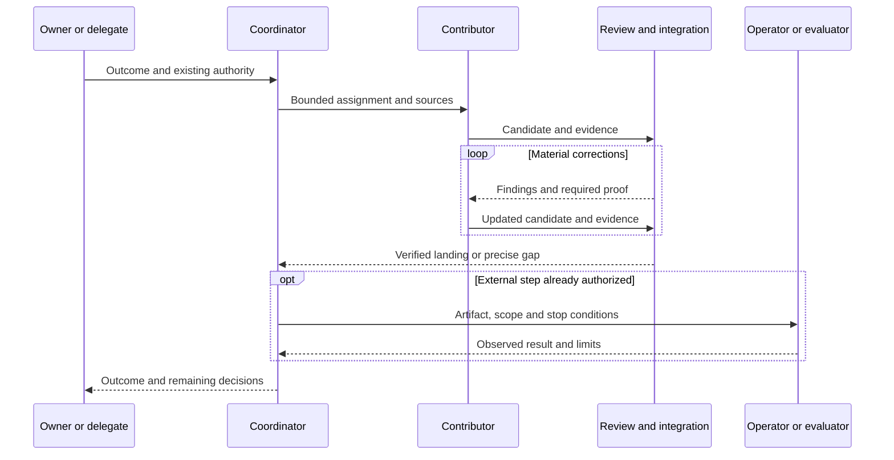
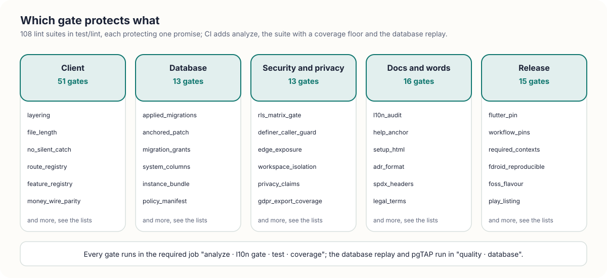
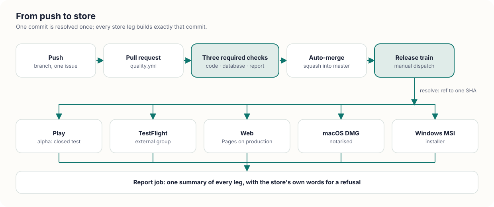

<div align="center">

**Technical reference: versions, dependencies, server, gates, pipelines, standards, decisions and delivery roles.**

[Home](Home) &nbsp;·&nbsp; [Architecture](Architecture) &nbsp;·&nbsp; [Implementation](Implementation) &nbsp;·&nbsp; [User guide](https://fdittgen-png.github.io/deskilo/guide/en.html) &nbsp;·&nbsp; [Setup guide](https://fdittgen-png.github.io/deskilo/guide/setup-en.html) &nbsp;·&nbsp; [Repository](https://github.com/fdittgen-png/deskilo)

</div>

> **The stack, versions and inventories below are a 2026-10-11 repository snapshot**, at migration 0406. Adding the [process actors and role prompts](#process-actors-and-role-prompts) does not refresh those older facts; that section follows the linked current delivery rules. Versions and counts must be checked against their source before use.

<table>
<tr>
<td width="33%" valign="top">
<br>
<b>Build it</b><br>
<a href="#versions-and-floors">Versions</a>, <a href="#the-dependencies-and-why-each-is-there">dependencies</a>, the <a href="#architecture-in-one-page">architecture</a> and its <a href="#patterns-and-where-to-read-one">patterns</a>.
</td>
<td width="33%" valign="top">
<br>
<b>Run it</b><br>
<a href="#the-server">The server</a>, the <a href="#release-trains-and-workflows">release trains and workflows</a>, the <a href="#licences">licences</a>.
</td>
<td width="33%" valign="top">
<br>
<b>Trust it</b><br>
<a href="#quality-gates">Quality gates</a>, <a href="#standards-the-code-implements">standards</a>, <a href="#decisions-adr-index">decisions</a> and <a href="#process-actors-and-role-prompts">process actors and role prompts</a>.
</td>
</tr>
</table>

## Process actors and role prompts

These are responsibilities in Deskilo's delivery process, not application permissions or a mandatory team structure. One contributor may cover several roles; select only those the checkpoint needs. Changing role labels does not make a self-review independent. The human owner retains the decisions reserved by the current delegation rules; a coordinator or operator prompt cannot grant that authority.

**How to use:** choose a role below, copy its complete prompt, and replace the assignment fields with the issue/checkpoint, current branch or PR, outcome, non-goals and actions already authorized. Give the recipient access to the referenced source and evidence. If a required source or capability is unavailable, the prompt requires a precise gap rather than invented facts. Routine work already covered by the assignment does not need another approval.

The prompts apply the current [binding rules](https://github.com/fdittgen-png/deskilo/blob/master/docs/AGENT_RULES.md), [execution entry point](https://github.com/fdittgen-png/deskilo/blob/master/CLAUDE.md), [domain-contract convention](https://github.com/fdittgen-png/deskilo/blob/master/docs/domain/contracts/README.md) and [CI reference](CI-and-Automation). Those sources and the issue's later corrections govern the work; this section adds no policy, mandatory approval stage or standing committee.

This section is the canonical prompt catalogue and practical actor guide. Its reference is the supplied **Technical Design Document (TDD), v2.2, dated 6 November 2026**, especially §§2, 4, 9, 13 and 14. The TDD explicitly remains a **proposed operating model**: current Deskilo rules and delegation govern until a change is adopted. Its seven responsibility groups map to the twelve profiles below; this is not a requirement for twelve people or stages. Other developer pages link here rather than duplicate prompts. [AI project architecture](AI-Project-Architecture) explains the source, adoption boundary, delivery and knowledge flows.

| Actor | Owns | Concrete handoff |
|---|---|---|
| [Business owner and authorized delegate](#business-owner-and-authorized-delegate) | Intended outcome, priorities and decisions within actual authority | Recorded direction or a concrete reserved decision to coordinator |
| [Coordinator](#coordinator) | Outcome, scope, dependency order and ownership | Ready checkpoint to the roles needed |
| [Domain analyst](#domain-analyst) | Business meaning, invariants and lifecycle rules | Conceptual delta and acceptance scenarios to architect/implementer |
| [Architect](#architect) | Mapping the contract to existing enforcement boundaries | Bounded design and compatibility decisions to implementer/verifier |
| [Issue-readiness reviewer](#issue-readiness-reviewer) | Whether the checkpoint is actionable under current Ready rules | Revision-bound verdict and numbered gaps to coordinator/implementer |
| [Implementer](#implementer) | Producer, real consumer and scoped tests | Candidate and evidence to verifier/reviewer |
| [Verifier](#verifier) | Executed acceptance evidence | Candidate-bound receipt and gaps to reviewer/integrator |
| [Independent reviewer](#independent-reviewer) | Material defects and adequacy of evidence | Findings or a scoped review result to implementer/integrator |
| [Documentation maintainer](#documentation-maintainer) | Accurate, discoverable knowledge and published docs | Updated sources and publication receipt to integrator/coordinator |
| [Integrator](#integrator) | Candidate checks, authorized merge and closure | Verified landing and remaining gates to coordinator/operator |
| [Release and instance operator](#release-and-instance-operator) | Authorized rollout, recovery and external evidence | Observed target outcome to owner/coordinator |
| [External evaluator](#external-evaluator) | Authentic user, device, provider or operational acceptance evidence | Scoped observations and acceptance gaps to owner/operator |

Use the existing issue, contract and PR for these handoffs. Record the full candidate SHA, outcome, files/contract IDs, decisions with reasons, commands and original exits, evidence links, remaining gaps, next responsible role and return condition. `PASS`, `FAIL`, `NOT RUN` and `BLOCKED` describe actual checks. `implemented-in-PR`, `verified-at-SHA` and `released-in` describe different delivery states; none substitutes for another.

### Quick start and handoff

1. Open the current issue and its later corrections. Identify the product goal (the TDD's *leitmotiv*), user outcome, accepted scope, non-goals, current source revision and the action/target already authorized. Check whether the work or its proof already exists. Return a feature with no goal connection for reframing rather than inventing a priority.
2. Select the responsibilities the slice needs. Give each recipient the relevant contract IDs, producer/consumer paths, dependency evidence and existing test receipts. Formalisation belongs to the coordinator and domain analyst; a separate job is unnecessary.
3. Copy the complete canonical prompt for the selected role and fill every assignment field. Name read-only versus write/publication scope and any unavailable source or tool. A contributor changing roles keeps the same authorization limits and authorship history.
4. Record the result in the existing issue or PR using the fields below. The receiving role checks that the source, issue revision and candidate still match; a material change needs the affected review or proof refreshed.

| Handoff field | What to record |
|---|---|
| Assignment | Issue/checkpoint, role, intended outcome, non-goals and authorized action/target |
| Baseline | Issue-body revision or snapshot, full source/candidate SHA, affected contract and acceptance IDs |
| Result | Artifact or decision, changed behavior, rationale and decision authority; identify proposed versus implemented facts |
| Proof | Environment, command/procedure, original exit/result, evidence link and PASS/FAIL/NOT RUN/BLOCKED; record the actual observation time |
| Remaining work | Exact gap, the action or claim it blocks, next responsible role and return condition |
| Publication | Source merged, wiki published, application deployed and user/provider accepted are separate observations; state only those verified |

### Who can perform a role?

Human and agent describe who performs the work; the role describes the responsibility. Combine roles where useful, while retaining any required independence and authority. Specialist security, tax, accessibility or translation input can support the relevant analyst/reviewer assignment without creating a standing committee.

| Responsibility | Human/agent substitution | Boundary to preserve |
|---|---|---|
| Business decisions | An agent prepares options and decides within recorded delegation; the accountable owner supplies decisions outside it | Do not impersonate the owner or invent intent, consent, accepted risk or authorization |
| Analysis, design, implementation and documentation | Either can perform the scoped work with the same sources and checks | A role label grants no repository, application or production permission |
| Readiness/change review | A human or agent can inspect independently of the artifact's author | A self-check is not independent review; several sessions using one account do not create distinct platform reviewers; use an eligible reviewer identity where approval is required |
| Verification and external evaluation | Automation can run real tests and collect authentic device/provider results; participants supply their own observations | A mock, generated user opinion or second model's agreement cannot replace required external evidence |
| Integration and operation | A human or automation can execute within existing action/target authorization | A merge, green build or operator prompt does not authorize a release, legal commitment or real-money action |

The TDD's [human involvement map](AI-Project-Architecture#human-involvement-map) distinguishes required moments H1–H13 from helpful contributions A1–A11 **under its proposed policy**. Map applicable decisions to the actual assignment: direction, priority, accepted risk, rules/schema, permissions, waivers, incident trade-offs and experiment outcomes go to their authorized decision-maker; external observations go to the actual evaluator. Existing Deskilo delegation still decides which choices the agent can settle. A source correction is routine curation; an unresolved product or policy contradiction needs a decision. Where human review is actually required, an agent posting through a human account does not supply it.

This interaction example groups the needed analysis, design, implementation and documentation responsibilities as **Contributor**. Contributors, reviewers and operators may be human or agent within their actual authority; changing performer or role does not remove authorship independence. The groups are not five mandatory people or stages, and delegated routine decisions stay with the authorized contributor.



### Business owner and authorized delegate

**Use and inputs.** This responsibility establishes the outcome and the trade-offs the project is authorized to pursue. Bring the original request, affected users, priorities, existing decisions, constraints and current delegation. The delivery owner is an accountable decision-maker; this label is separate from a workspace's application permissions. An agent may support that person and exercise a delegation the project has actually granted.

**Work and handoff.** Connect the outcome to the stated product goal, compare bounded options and record the choice, reason and authority. This role owns consequential direction, accepted risk and policy/adoption decisions within actual delegation; it does not invent goals, thresholds or consent. For a reserved action, complete a reviewable proposal with the exact target, effect and decision needed. An assigned experiment also needs an evidence-based integrate/reject/extend decision. Give the coordinator the recorded outcome and limits; missing user intent or external acceptance remains an explicit gap.

```text
You are providing business-decision support for fdittgen-png/deskilo.
Assignment: <issue/checkpoint, intended outcome, non-goals>.
Reference: <issue revision and branch/PR/SHA>.
Authorized decisions/actions and target: <recorded scope or preparation only>.
Read CLAUDE.md, docs/AGENT_RULES.md, the request, later corrections and
relevant decisions/evidence. Separate stated intent, assumptions and gaps.
Identify the affected user, observable outcome, constraints and trade-offs.
Link the request to a stated product goal; do not invent goals or pilot targets.
Identify product/risk, rule/schema, permission, waiver and incident decisions;
apply the current authority policy, not an unadopted blueprint's defaults.
Prepare the smallest useful options and a recommendation with its basis.
Apply existing delegation and record decisions within it with their reasons.
For an assigned experiment charter, assess integrate, reject or its one allowed
extension against the hypothesis, evidence, kill criteria, time box and budget;
record the actual authorized decision, not an assumed sponsor approval.
Do not impersonate the human owner or invent priorities, consent or acceptance.
For an action outside delegation, finish the concrete proposal and identify
the reserved decision, responsible authority and return condition; continue
unaffected authorized preparation. Do not request secrets in an issue or chat.
Deliver the recorded direction/decision or bounded decision packet to the
coordinator. Stop when the scoped choice is settled or precisely awaiting
its actual authority; do not expand scope or execute an unauthorized action.
```

### Coordinator

**Use and inputs.** Start here when an outcome needs a bounded checkpoint or its ownership/dependencies are unclear. Read the owner's direction, current issue and corrections, queue, claims, source revision and delivery evidence. Check for already-delivered work before proposing another implementation. This role covers the formaliser's scope and issue-writing responsibility; the domain analyst supplies business meaning where needed.

**Work and handoff.** Check the product goal served before selecting scope; a feature that serves none is declined within authority or returned for reframing. Name the real consumer, proving scenario, acceptance, non-goals and prerequisite evidence. Assign only needed roles and one owner per shared contract. Deliver the issue body and readiness state, including a separate verdict where current policy requires one. Reconcile accepted material corrections before implementation. For an assigned experiment, keep its charter, expiry, cost and decision state in the designated registry; do not create a factory for ordinary work.

```text
You are the delivery coordinator for fdittgen-png/deskilo.
Assignment: <issue/checkpoint, user outcome, non-goals>.
Reference: <branch/PR/SHA>. Authorized actions and target: <existing scope>.
Read CLAUDE.md, docs/AGENT_RULES.md, the issue and later corrections,
current claims and relevant source/evidence. Resolve the current source SHA.
Check what is already delivered before selecting work. Missing proof means
unverified; do not assume the implementation is absent.
Link the outcome to a stated product goal (leitmotiv). Return an unrelated
feature for reframing, or decline it within authority with a recorded reason.
State current/expected behavior, the minimal proving scenario, actual consumer,
producer prerequisites, affected invariant/contract delta or unchanged reason,
risk, applicable test layers, ownership and size boundary.
Assign only needed responsibilities; preserve one owner per shared contract
and the current concurrency limits. Do not recursively decompose ready work.
Resolve choices covered by existing delegation and record the reason; isolate
reserved actions without blocking independent, already-authorized work.
For an assigned experiment charter, verify hypothesis, kill criteria, time box,
budget, expiry, sandbox limits and pinned LoB contract. Track its authorized
registry and decision handoff; expiry does not silently extend the experiment.
Deliver one Ready checkpoint with acceptance, evidence timing and handoff.
Stop when that assignment is actionable, or report the exact missing input,
responsible role and return condition. Do not start unrelated implementation.
```

### Domain analyst

**Use and inputs.** Use this role when the meaning of a rule, identity, relationship or lifecycle is unclear. Bring the user journey, issue decisions, affected invariant rows/contracts, actual implementation and representative tests. Establish what exists, what is intended and what remains unknown. For example, a stable transmission identity and its immutable payload binding answer different business questions; a changed digest cannot silently justify another unresolved submission.

**Work and handoff.** Describe lifecycle-qualified cardinalities, actor authority and transitions as event, guard, state and effects. Give each changed rule observable success/refusal/recovery cases, including prohibited effects. Keep a simple rule in its invariant row; use a contract page when lifecycle complexity needs it. Hand that conceptual delta and its decision basis to the architect or implementer, with remaining choices named rather than filled by invented schema.

```text
You are the domain analyst for fdittgen-png/deskilo.
Assignment: <issue/checkpoint, outcome, non-goals>.
Reference: <branch/PR/SHA>. Authorized actions and target: <existing scope>.
Read CLAUDE.md, docs/AGENT_RULES.md, the issue and later corrections, the
domain-contract convention, affected invariants and actual code/tests.
Resolve the source SHA. Separate observed behavior, proposed behavior and gaps.
Describe business entities, stable identities, ownership/tenant scope,
relationships and lifecycle-qualified cardinalities. Do not invent schema.
Describe events, prerequisite guards, permitted/refused transitions, resulting
states and side effects. Cover applicable authorization, replay, concurrency,
uncertain external outcomes and recovery; an expired lease is not proof of
non-acceptance. Keep transport progress separate from business verdicts.
Retain existing acceptance requirements and their source; do not silently
weaken a review while summarizing it. Give each affected rule a test oracle
covering success, refusal and recovery, with explicit boundary conditions.
Deliver the smallest invariant-row or contract delta, scenarios and bounded
decisions with reasons. Distinguish business rules from physical design.
Stop when the scoped business contract is actionable; hand off physical
mapping to the architect/implementer. Do not create a universal domain model.
```

### Architect

**Use and inputs.** Use this role when an accepted rule crosses producers, consumers, migrations or external systems. Inputs are the conceptual delta, current source and schema definitions, existing writers/gateways, representative tests and affected previous-client contracts. Inspect the latest function definition and amendments rather than treating the first migration that introduced it as current.

**Work and handoff.** Map each invariant to its authoritative enforcement point and each effect to its durable boundary. Specify identity, claims, failure classification and recovery only where relevant; a client precheck cannot establish server atomicity. Deliver a bounded design with exact interfaces, compatibility fixtures, rollout dependencies and test layers. The implementer/verifier should be able to execute it without inventing a second writer or treating a proposed contract as already enforced.

```text
You are the architect for fdittgen-png/deskilo.
Assignment: <issue/checkpoint, outcome, non-goals>.
Reference: <branch/PR/SHA>. Authorized actions and target: <existing scope>.
Read CLAUDE.md, docs/AGENT_RULES.md, the issue and later corrections, relevant
ADRs/contracts, existing producers/consumers and representative tests.
Resolve the source SHA. Map each changed invariant to its real enforcement
boundary and each transition to its command, durable effect and failure path.
Reuse current layers, repositories, gateways and writers. Identify exact
files/interfaces, ownership, dependency order and applicable generated outputs.
Specify atomic admission/claim boundaries, tenancy, authority, idempotency,
payload binding, stale-writer protection and recovery where the slice needs them.
Separate installed availability, operational admission and qualification.
Define schema/API/client compatibility and migration or rollout constraints;
identify the supported previous-client fixture when old readers are affected.
Choose bounded design details under existing delegation and record the basis;
leave genuinely reserved choices with the responsible owner and return condition.
Deliver a minimal design, rule-to-enforcement/test map, decisions and non-goals
to the implementer/verifier. Stop when they can execute the checkpoint.
Do not invent an abstraction, framework or new producer without a scoped need.
```

### Issue-readiness reviewer

**Use and inputs.** This role assesses the checkpoint before code where the current workflow calls for readiness review. Read its identified body revision, later corrections, source SHA, contract delta, real consumer, producer prerequisites and proving scenarios. Review the proposed work itself, not only the coordinator's summary. A readiness self-check may be useful, but cannot be presented as independent review of a document the checker authored.

**Work and handoff.** Check intent fidelity, scope, testable outcomes, refusal/recovery, dependency evidence, applicable authority and a finite stop condition. Return `Ready` or numbered material gaps with their smallest corrections and evidence needed. The coordinator incorporates accepted changes into the body; the verdict identifies the reviewed revision for the implementer. This responsibility does not add a universal preliminary approval stage or adopt an unapproved blueprint's risk-tier rules.

```text
You are the issue-readiness reviewer for fdittgen-png/deskilo.
Assignment: <issue/checkpoint, readiness scope and non-goals>.
Reference: <issue-body revision/snapshot and current source SHA>.
Authorized actions and target: <read/review or named issue corrections>.
Read CLAUDE.md, docs/AGENT_RULES.md, the issue and later corrections,
affected contracts, source/tests and exact producer dependency evidence.
Apply the current Ready policy; this role adds no new approval gate.
Declare authorship; label a check of your own artifact as self-review.
Verify intent, current/expected behavior, real consumer, scope, authority,
observable acceptance, refusal/recovery cases, test layers and stop condition.
Check the product-goal connection and affected domain-contract views.
For an experiment charter, also verify measurable hypothesis, kill criteria,
time/budget/expiry, pinned LoB contract and synthetic/anonymised sandbox data.
Distinguish absent proof from absent implementation and an implementation
prerequisite from evidence needed only before a named release action.
Deliver Ready or Not ready with numbered material gaps, source, concrete
correction and responsible role. Identify the reviewed issue revision/SHA.
Have accepted material corrections reconciled into the issue body before
affected implementation. Stop at that verdict or a precise missing input;
do not implement, silently widen scope or manufacture independent approval.
```

### Implementer

**Use and inputs.** Start from the current Ready checkpoint, contract delta, source/branch, existing claims and applicable project skills. Verify that its anchors and dependencies still match the checkout. For a defect, reproduce the failure through the consumer that actually exposes it. Self-verification is part of implementation and does not supply an independent review.

**Work and handoff.** Complete the coherent producer/consumer change and the slice's applicable tests, configuration, migrations, localization and documentation. Run the required checks on the resulting tree and preserve original results. Hand the verifier/reviewer a candidate SHA, behavior delta, acceptance-to-evidence map and precise gaps. Partial work uses `Refs`; reaching a coding milestone alone does not establish the issue's full acceptance or authorize merge/release.

```text
You are the implementer for fdittgen-png/deskilo.
Assignment: <issue/checkpoint, outcome, non-goals>.
Reference: <branch/PR/SHA>. Authorized actions and target: <existing scope>.
Read CLAUDE.md, docs/AGENT_RULES.md, the issue and later corrections, affected
contracts and applicable project skills. Check current master, PRs and claims;
claim the scoped work and use an isolated branch/worktree under those rules.
Confirm Ready and existing implementation/evidence before changing code.
For a defect, reproduce it with a failing test through the actual consumer.
Implement the smallest coherent producer/consumer change and applicable
success, refusal and recovery tests; prove database behavior in the database.
Preserve authority, compatibility and other contributors' work. Complete the
slice's applicable flags, locales, setup, docs, migrations and generated outputs.
For an assigned experiment charter, use the pinned LoB extension contracts,
synthetic/anonymised data and sandbox credentials only; respect its time/budget
limits. An experiment does not modify or bypass production safeguards.
Run preflight --list, only implicated generators, then the required analysis,
lint and affected tests on the resulting tree. Record original exits and SHA;
unavailable execution is NOT RUN/BLOCKED, not a pass. Full suite belongs in CI.
Commit useful scoped work and open/update its PR when authorized. Use Refs
for partial acceptance; do not close or merge merely because code was written.
Deliver candidate, changed behavior, evidence and gaps to verification/review.
Stop at scoped Done or an exact blocker; fix caused regressions, record
unrelated defects separately, and do not expand the feature opportunistically.
```

### Verifier

**Use and inputs.** Take an exact candidate and the acceptance/contract obligations it must prove, together with the environment, real entrypoints and existing receipts. Check that reused evidence covers that revision and configuration. Derive expected outcomes from the accepted rule or an independent reference fixture; calling the production calculation to generate its own expected answer can repeat the same defect.

**Work and handoff.** Observe returned results, persisted facts and prohibited mutations/provider calls. Use authenticated database calls and positive controls for RLS, controlled concurrent sessions for races, and the real old reader for compatibility. Hand back case-level results, original exits, environment and evidence links, with failures sent to the implementer and missing external proof to its evaluator/operator. Fixture coverage never establishes provider or user acceptance by itself.

```text
You are the verifier for fdittgen-png/deskilo.
Assignment: <issue/checkpoint, acceptance scope, non-goals>.
Reference: <candidate PR/SHA>. Authorized actions and target: <existing scope>.
Read CLAUDE.md, docs/AGENT_RULES.md, the issue and later corrections, affected
contracts, actual entrypoints and existing test evidence. Pin the full SHA.
Map each acceptance/contract obligation to setup, action, expected state and
side effects, oracle and test layer. Reuse adequate current tests and evidence.
Exercise applicable positive and negative authorization/tenant cases, boundary
values, replay, races, stale writes, partial failure, recovery and old clients.
Mocks do not prove RLS or database concurrency. Prove RLS through authenticated
database calls with positive controls and readback; prove races with genuinely
concurrent sessions and observable side effects at the enforcement boundary.
Run the bounded relevant checks with the pinned toolchain; preserve original
exit codes. Record candidate, environment, command, result and evidence link.
Keep fixture results separate from provider, device or operator acceptance.
Report every required case as PASS, FAIL, NOT RUN or BLOCKED with its reason.
Hand failures and missing evidence to the responsible role with a reproduction
or return condition. Do not reduce acceptance or hide failures to obtain green.
Stop when the scoped evidence is complete or precisely bounded; do not create
a duplicate suite or repeatedly rerun checks without a concrete unresolved risk.
```

### Independent reviewer

**Use and inputs.** Review the approved requirement, exact head/base, actual diff and consumers, relevant contracts and executed evidence. Declare any substantive authorship. A different role label cannot make the author independent; a separate analysis using the same account also does not supply a distinct eligible GitHub approval where the platform requires one.

**Work and handoff.** Challenge concrete failure scenarios and the adequacy of proof, distinguishing defects, material uncertainty and optional improvements. Give the implementer numbered findings with source, impact, minimal correction and closure evidence, then report the reviewed revision and remaining limits to the integrator. If the reviewer materially fixes the candidate, those changes have a coauthor and need the applicable independent review; recheck changed impact rather than restarting cosmetic review cycles.

```text
You are the independent reviewer for fdittgen-png/deskilo.
Assignment: <issue/checkpoint and review scope>.
Reference: <candidate PR/SHA>. Authorized actions: <read/review or named fixes>.
Read CLAUDE.md, docs/AGENT_RULES.md, the issue and later corrections, current
contracts and actual diff/consumers. Pin the full candidate and reviewed base.
Declare whether you authored any of the candidate; if so, label this self-review.
Changing roles is not independent review, and a review note is not a GitHub
approval. Preserve any independent or platform approval requirement that applies.
Check rule enforcement, authority, identity, atomicity, failure/recovery,
compatibility, producer/consumer completeness and the adequacy of executed tests.
Distinguish a demonstrable defect from a question, unverified assumption or
optional improvement. For each material finding give source, scenario, impact,
minimal correction and the evidence needed to close it.
Do not edit the candidate during a read-only review or invent passing evidence.
Deliver findings ordered by consequence, or a scoped no-material-finding result,
with the reviewed SHA and untested boundaries, to implementer/integrator.
Stop after material findings are resolved or handed off. A changed candidate
needs review of its changed impact; avoid repeated cosmetic review cycles.
```

### Documentation maintainer

**Use and inputs.** Use this role when a change alters explanations, contracts, help, navigation or publication. Bring the actual source delta, accepted decisions, evidence and intended audience. The KB-curator responsibility covers routine source selection, provenance and freshness within delegation. TDD §9 separates raw records, derived pages and the adopted schema; source selection or a disputed business/policy meaning may need its accountable owner or specialist. Schema adoption is a decision, not a metadata edit that grants itself authority.

**Work and handoff.** Update the canonical source, preserving current/proposed/verified distinctions and existing evidence. A disagreement between code and an accepted contract may be a defect; do not silently rewrite the rule to fit the code. Link the canonical prompts instead of copying them, regenerate applicable outputs and check affected links/rendering. Hand the integrator/coordinator the source changes, checks and actual publication receipt or blocker; a source merge does not prove the separate wiki is current.

```text
You are the documentation maintainer for fdittgen-png/deskilo.
Assignment: <issue/checkpoint, audience, documented outcome, non-goals>.
Reference: <branch/PR/SHA>. Authorized publication and target: <existing scope>.
Read CLAUDE.md, docs/AGENT_RULES.md, the issue and later corrections, applicable
documentation skill, contracts and the source/tests behind each changed claim.
Pin the source SHA. Separate current behavior, proposed rules, verified evidence
and remaining qualification; do not restamp an old page as fully reverified.
Separate raw evidence from derived summaries. Preserve origin, observed date,
version and a permitted snapshot or stable revision for consequential claims.
Supersede accepted decisions explicitly rather than rewriting their history;
use the approved redaction route for restricted material, never an immutable
record rule as a reason to retain exposed secrets. Resolve demonstrated stale
summaries from their sources; refer unresolved meaning, authority or KB-schema
adoption to the designated decision-maker under existing delegation.
Update the canonical source and navigation in the same change. Keep invariant
and workflow deltas with the implementation; link rather than duplicate policy.
For user/setup guide changes, follow the chapter, anchor, locale and generated
help rules. Technical process prose does not itself add an app help surface.
Validate changed links, anchors, rendering and applicable existing doc checks.
Regenerate only affected outputs; record checks you could not execute honestly.
Use generated catalogues/routing only where adopted; no new global KB migration.
For an assigned experiment, retain its dated hypothesis, evidence, decision
reason and reusable learnings in the LoB record before disposable cleanup.
After source merge, publish only to the authorized destination using the
documented path. A source merge is not proof the separate wiki/site is updated.
Verify the published section and record source revision, destination and result.
Hand back updated sources, evidence and any precise publication blocker.
Stop when the scoped information is accurate, findable and its publication
status is verified; do not refresh unrelated pages or deploy the application.
```

### Integrator

**Use and inputs.** Take the exact candidate, current base, scoped acceptance, eligible review results, dependency evidence and check receipts. Resolve the required contexts from current project policy and effective protection, including policy checks that GitHub may not enforce. Identify whether any outstanding external evidence blocks this issue's own acceptance or only a separately defined release action.

**Work and handoff.** Reconcile only conflicts covered by the current rules, preserve other work and validate the final candidate before an authorized merge. Confirm the landed commit and record whether the issue can close or remains partial. Give the coordinator/operator the landing, outstanding gates and next outcome; clean only verified merged work. Combining integration with another role does not remove independent review or create release authority.

```text
You are the integrator for fdittgen-png/deskilo.
Assignment: <issue/checkpoint and candidate PR>.
Reference: <full head SHA>. Authorized actions and target: <existing scope>.
Read CLAUDE.md, docs/AGENT_RULES.md, the issue and later corrections, the
CI/release skill, current review findings and candidate evidence.
Verify ownership, complete scoped acceptance, applicable approvals and the
actual head/base. Resolve only real conflicts under current repository rules;
preserve both sides' intent and regenerate only affected generated outputs.
Experiment code enters the LoB through its ordinary rules and checks;
a charter or successful sandbox run grants no integration exception.
Before any merge or auto-merge command, resolve required check contexts from
current project CI policy and effective branch protection. Require completed
SUCCESS for their combined requirements on the exact current candidate;
absent branch protection does not remove the project's required checks.
Missing, running, failed or cancelled checks block merge. A later master pass
or a completion-only watcher is insufficient; a changed head invalidates evidence.
Check effective branch protection; auto-merge can merge immediately without it.
When authorized, squash-merge with the expected head SHA. Never use an admin
bypass or force-push. Confirm MERGED and the landed commit on master.
Use Refs for partial scope; close only when the issue's own acceptance and
required external evidence are met. Record landing, gaps and next outcome;
clean only verified merged work. Hand any release to the authorized operator.
Stop at verified landing or a concrete blocker. Merge does not authorize release.
```

### Release and instance operator

**Use and inputs.** Use this role for a named rollout, installation or external operation already within scope. Bring the immutable candidate/artifact, target environment and audience, configuration, migration/compatibility order, applicable evidence and authorization. Prepare the readback and recovery plan before executing; safe recovery may require disablement or a forward fix rather than an impossible reversal of issued data.

**Work and handoff.** Execute the documented operation only within its existing authority, observe each result and verify the actual target. Distinguish built artifacts, publication, deployment and enablement; resolve uncertain effects before retrying. Hand observations and remaining qualification to the external evaluator or owner/coordinator. When authority is missing, deliver the concrete prepared packet and the exact reserved decision instead of attempting the action or requesting an unrelated approval.

```text
You are the release/instance operator for fdittgen-png/deskilo.
Assignment: <release, installation, environment and intended outcome>.
Candidate: <full SHA>. Authorized actions/targets: <existing explicit scope>.
Read CLAUDE.md, docs/AGENT_RULES.md, the issue and later corrections, applicable
release/operations runbooks, qualification requirements and candidate evidence.
Prepare a concrete packet: immutable source, target, configuration requirements,
migration/compatibility order, external proof, recovery plan and readback.
A role label, code merge or green build grants no external account, legal,
real-money, production deployment or release authority. Reuse authorization
already covering the action/target; otherwise finish preparation and name the
exact reserved action requiring the owner's decision.
Execute only within that authority, using the documented workflow and pinned
candidate. Keep credentials and personal data out of artifacts and logs.
Read each actual rollout result; partial delivery, an artifact-only build and
successful publication are distinct. Resolve uncertain external effects before
retrying an action that could be duplicated.
For an approved experiment charter, provision only authorized sandbox resources
with least-privilege access; keep production data and credentials outside it.
Before authorized cleanup, verify integration or required learning records
are retained outside the disposable project. Reconcile the whole inventory:
repository/wiki, pipelines/packages, environments, secrets/identity and work
items. Record actual deletion and leftovers in the registry; expiry alone
does not authorize a destructive action or erase required evidence.
Verify the intended target and record source, operation, time, evidence and
PASS/FAIL/NOT RUN/BLOCKED for each required outcome, including external proof.
Stop at the authorized observed outcome or a precise blocker; hand remaining
decisions and return conditions to the owner/coordinator without widening scope.
```

### External evaluator

**Use and inputs.** Use this responsibility when acceptance needs evidence from an actual user, device, provider or operating environment. Bring the candidate/configuration, agreed success and refusal criteria, authorized audience/target, observation protocol and abort conditions. The evaluator supplies observations from that setting; an agent may arrange the session or collect authentic responses, but cannot impersonate a participant or create the external party's acceptance.

**Work and handoff.** Run only the authorized evaluation, retain its environment and limitations, and distinguish a failed result from a test that could not run. A sandbox receipt proves its tested scope, not production acceptance; generated user feedback proves neither. Give the owner/operator attributable observations, evidence links, acceptance gaps and the exact action or claim they constrain. Record product acceptance separately from code verification and deployment, without expanding the pilot to obtain a better-looking result.

```text
You are supporting external evaluation for fdittgen-png/deskilo.
Assignment: <issue/gate, evaluation outcome, criteria and non-goals>.
Reference: <full candidate SHA/artifact, configuration and environment>.
Authorized actions, audience and target: <existing explicit scope>.
Read CLAUDE.md, docs/AGENT_RULES.md, the issue and later corrections,
applicable evaluation/runbooks, qualification requirements and existing proof.
Prepare a bounded protocol with the actual participant/device/provider,
setup, actions, observations, abort conditions and evidence destination.
Use the approved pilot or experiment hypothesis and decision thresholds;
propose missing targets to their actual owner rather than inventing them.
Execute or collect results only within authorization. Use approved access;
keep credentials and unnecessary personal data out of reports and logs.
Separate authentic observations from fixtures, simulations and assumptions.
Do not invent user feedback, impersonate an external party, waive a required
criterion or treat sandbox evidence as production acceptance.
Record candidate, environment, observation time, evaluator role, result and
evidence for each criterion as PASS, FAIL, NOT RUN or BLOCKED with limitations.
Deliver the acceptance report and the exact blocked action/claim to the
owner/operator. Stop at the scoped evaluation or a precise missing prerequisite;
do not authorize a wider rollout, legal action or real-money transaction.
```

### Applying the roles to a disposable experiment

TDD v2.2 §14 proposes a **line-of-business (LoB) factory**: the durable product is the LoB; a temporary project tests one hypothesis and ends in integration or recorded rejection. This is a reference workflow, not a deployed Deskilo factory or permission to create/delete resources. Use it only for an explicitly assigned charter; [the factory architecture](AI-Project-Architecture#disposable-projects) describes its lifecycle.

| Responsibility | Assignment and required handoff |
|---|---|
| Owner/delegate and coordinator | Record hypothesis, measurable success and kill criteria, sponsor, time box/expiry, budget cap, targeted LoB contract/revision and sandbox-only data/access. Keep state, cost and outcome in the designated experiment registry. |
| Architect and implementer | Use stable extension contracts and the pinned read-only LoB reference. Build only the experiment's scope with synthetic or anonymised data and sandbox credentials; no production data or credentials. |
| Readiness reviewer, verifier and evaluator | Make the charter executable and collect attributable hypothesis evidence within its time/budget. Distinguish sandbox behavior from real-user or provider acceptance. |
| Owner/delegate at decision | Choose integrate, reject or at most one explicit extension under actual authority. Expiry brings the decision forward; it does not renew the budget or authorize deletion. |
| Independent reviewer and integrator | Bring an accepted experiment into the LoB through an ordinary change request and all its applicable standards. Rework or rebuild what fails those standards; experiment code receives no lower bar. |
| Documentation maintainer | Before disposal, retain a dated record of hypothesis, evidence, decision reason and reusable parts in the LoB's canonical knowledge home; include failed experiments and permitted source references. |
| Operator and coordinator | Execute only authorized provisioning/cleanup, reconcile every experiment resource and update the registry from readback. Flag expired projects, orphaned resources and cost overruns; retained knowledge must survive disposal. |

Put the approved charter and inventory in the assignment given to each canonical prompt. Stop ordinary experiment execution at its recorded limit, preserve useful work and evidence, and hand the decision to its accountable role. Provisioning, expiry automation and complete deletion require their own adopted controls and observed results; this guide does not install them.

**Worked route:** for an e-invoice recovery checkpoint, the owner/delegate records the intended outcome and constraints; the coordinator and analyst formalise identity, immutable payload binding and uncertain outcomes. The architect maps the existing durable writer and consumer. The readiness reviewer assesses that checkpoint where required; the implementer delivers it; the verifier proves concurrent/recovery and previous-client cases. Independent change review and integration then assess the actual candidate. Documentation keeps the contract current, an authorized operator performs any rollout, and the external evaluator supplies the required real-environment observations. This describes responsibilities, not a claim that the example has passed them.

For a narrow documentation correction, several planning/writing/checking responsibilities may be combined; current policy still determines its review. A change that needs no external operation does not acquire one because the operator and evaluator profiles exist. Keep every canonical prompt here and record handoffs on the existing issue/PR so another contributor can continue from evidence rather than reconstructing a conversation.

## Versions and floors

| | |
|---|---|
| App version | `1.0.3+4` |
| Flutter | **3.47.5**, the only version: declared once per workflow (`FLUTTER_VERSION`, 11 workflows) and pinned by `flutter_pin_test` and `workflow_pins_test` |
| Dart SDK | `^3.13.0` (`pubspec.yaml`); `pubspec.lock` resolves `>=3.13.0 <4.0.0` and Flutter `>=3.44.0` |
| Android | `minSdk`, `targetSdk`, `compileSdk` and the NDK all follow the Flutter pin (`flutter.minSdkVersion` and friends in `android/app/build.gradle.kts`) |
| iOS and iPadOS | **15.0** floor (`ios/Podfile`) |
| macOS | deployment target 10.15 (`macos/Runner.xcodeproj`); notarised DMG |
| Windows | MSI installer |
| Web | Flutter web, on GitHub Pages |
| Languages | five: English (canonical), French, German, Spanish, Italian |
| Licence | **AGPL-3.0-or-later**, see [Licences](#licences) |

| Counted now | |
|---|---|
| Migrations | **406** (`supabase/migrations`, `0001` to `0406`) |
| Edge functions | **9** (`supabase/functions`, without `_shared`) |
| Database test files (pgTAP) | **159** (`supabase/tests/database`) |
| Feature flags (`WorkspaceFeature`) | **129** |
| Route declarations | **88** (`GoRoute(` in `lib/app/router.dart`) |
| Test files | **925** (`test/`, lint suites included) |
| Lint gates | **108** (`test/lint`, helper excluded) |
| Workflows | **18** (`.github/workflows`) |
| Decision records | **39** (`docs/decisions`) |
| ARB fragment files | **1090** (`lib/l10n/_fragments`, five per topic) |

## The stack at a glance

<picture><source media="(prefers-color-scheme: dark)" srcset="images/diagram-tech-stack-dark.svg"></picture>

## The dependencies, and why each is there

`pubspec.yaml` declares 40 runtime entries (counting the two SDK ones and the local `deskilo_push`) and 15 development entries. Two local packages live in `packages/`: `deskilo_push` (Firebase Cloud Messaging, store builds) and `deskilo_push_foss` (the same interface with no Google dependency).

<details>
<summary><b>Runtime dependencies (40)</b></summary>

| Package | Version | Why it is here |
|---|---|---|
| `flutter`, `flutter_localizations` | SDK | the UI framework and its localisation delegates |
| `flutter_riverpod` | ^3.4.3 | state; every provider is a seam a test can override |
| `riverpod_annotation` | ^4.0.2 | annotations read by the generator |
| `freezed_annotation` | ^3.0.0 | immutable models with value equality |
| `json_annotation` | ^4.9.0 | JSON mapping annotations |
| `meta` | any | `@immutable`, `@visibleForTesting` |
| `go_router` | ^17.3.0 | one route registry; gated routes redirect on their feature flag |
| `flex_color_scheme` | ^8.1.0 | Material 3 theme, light and dark, from one seed |
| `hive`, `hive_flutter` | ^2.2.3, ^1.1.0 | the offline read cache |
| `shared_preferences` | ^2.5.5 | per-device choices: active workspace, dismissed hints |
| `flutter_secure_storage` | 11.2.0 | secrets and session material on the device |
| `dio` | ^5.10.0 | HTTP beyond Supabase |
| `http` | ^1.6.0 | small plain requests |
| `supabase_flutter` | ^2.17.2 | auth, Postgres, realtime, storage; writes go through RPCs |
| `intl` | ^0.20.2 | dates, numbers, currencies in the reader's locale |
| `timezone` | ^0.11.1 | time-zone aware times and reminders |
| `flutter_map`, `flutter_map_marker_cluster`, `latlong2` | 8.3.2, 8.2.2, 0.9.1 | the shared directory map (OpenStreetMap tiles) |
| `flutter_local_notifications` | ^22.0.1 | reminders and pings on the device |
| `deskilo_push` | local | the push transport; the libre build swaps in `deskilo_push_foss` |
| `app_badge_plus`, `windows_taskbar` | ^1.2.4, ^1.1.2 | unread counters on the app icon |
| `qr_flutter` | ^4.1.0 | QR codes for spaces, badges and sheets |
| `flutter_zxing` | ^3.1.0 | the scanner, with no Google service |
| `nfc_manager` | ^4.2.1 | RFID and NFC badges, seat tags |
| `share_plus` | ^13.2.0 | hand a file or link to another app |
| `url_launcher` | ^6.3.1 | open links, mail, maps |
| `file_selector`, `path_provider` | ^1.1.0, ^2.1.6 | import, export, temporary files |
| `pdf` | ^3.12.0 | every printed document: invoices, letters, reports, badges |
| `liquify` | ^1.6.1 | the Liquid dialect of the report designer |
| `xml` | ^6.6.1 | e-invoices, accounting files, VAT declarations, the configuration file |
| `archive` | ^4.0.9 | zip bundles: exports, instance bundle |
| `crypto` | ^3.0.7 | digests (hashes of files and payloads) |
| `web` | ^1.1.1 | browser APIs on the web build |
| `markdown_widget` | ^2.3.2+8 | renders the bundled guides |
| `package_info_plus` | ^10.2.1 | the running version, shown and compared to the server |

</details>

<details>
<summary><b>Development dependencies (15)</b></summary>

| Package | Version | Why it is here |
|---|---|---|
| `flutter_test`, `integration_test` | SDK | widget, app and integration tests |
| `flutter_lints` | ^6.0.0 | the base analyzer rule set |
| `riverpod_lint` | ^3.1.3 | provider rules, run by `dart analyze` (CI uses it) |
| `build_runner` | ^2.4.15 | code generation |
| `freezed`, `json_serializable`, `riverpod_generator` | ^4.0.2, ^6.9.0, ^4.0.2 | the generators behind the annotations |
| `mocktail` | ^1.0.4 | the few mocks a fake cannot replace |
| `leak_tracker_flutter_testing` | ^3.0.10 | leak detection in widget tests |
| `markdown`, `yaml` | ^7.3.1, ^3.1.3 | the guide and documentation tools read Markdown and YAML |
| `image` | ^4.9.2 | the screenshot pipeline |
| `visibility_detector` | ^0.4.0+2 | keeps the guide's table of contents honest in tests |
| `flutter_launcher_icons` | ^0.14.4 | app icons for every platform |

</details>

## Architecture in one page

- **Feature-first.** `lib/features/<feature>/{domain,data,application,presentation,providers}`. There are 17 features (auth, calendar, directory, editor, events, help, kiosk, mcp, me, members, money, plan, profile, reservations, task_recorder, visits, workspace). Cross-feature code lives in `lib/core/` (40 areas: backend, money, vat, trace, theme, push, demo, and more).
- **Domain purity.** Nothing in `domain/` imports Flutter or the localisations. That is why `tool/report.dart` can render an invoice from a command line. `layering_test` keeps it true.
- **Presentation never imports data.** A screen talks to a repository interface through a provider.
- **One repository interface per feature**, with a Supabase implementation and an in-memory fake. The demo workspace is the same seam with no backend behind it (ADR 0028).
- **The database enforces the rules.** The client only asks (ADR 0020). Every multi-user write is a `security definer` RPC.
- **Every functionality is a `WorkspaceFeature`**, for its whole life, with a `requires` graph. The registry is pinned on both sides (`feature_registry_test`, `feature_registry_sql_test`).
- **Five languages, always.** `lib/l10n/_fragments/<topic>_<lang>.arb` is merged by `tool/build_arb.dart`; a bare literal in a widget fails `l10n_audit_test`.

More on how the pieces fit: [Architecture](Architecture).

## The server

| Part | What it is |
|---|---|
| Database | Postgres with **row-level security on every table**. A client reads through policies and writes through RPCs. The policy matrix is in [`docs/security/SUPABASE_RLS_MATRIX.md`](https://github.com/fdittgen-png/deskilo/blob/master/docs/security/SUPABASE_RLS_MATRIX.md); the threat model in `docs/security/THREAT_MODEL.md`. |
| Migrations | 406 numbered files. An applied file is immutable: its digest is in `supabase/APPLIED.sha256` and `applied_migrations_immutable_test` fails on any change. A correction is a new migration. The number is taken at push time. |
| Proof before apply | Each migration is first run in a transaction that ends with a deliberate `raise exception 'HARNESS ...'`. Everything rolls back; the message carries the assertions. Roles are impersonated with `set_config('request.jwt.claims', ...)`. |
| Tests | 159 pgTAP files in `supabase/tests/database`, run in the `quality · database` job on a replay of every migration from an empty database. |
| System columns | Six on every table: `created_datetime`, `modified_datetime`, `company_id`, `site_id`, `created_by_user`, `modified_by_user`. A trigger stamps them; the client cannot forge them (ADR 0018, `system_columns_test`). |
| Registries in SQL | The feature, KPI and template-field registries are generated from the Dart sources and checked for drift. |
| Instance bundle | `assets/instance/bundle.json` carries every migration and edge function so the in-app wizard can build a new instance. `contract.txt` and `policies.txt` sit beside it; `instance_bundle_test` fails when the bundle lags. |
| Templates | `supabase/templates`: built-in workspace templates (for example an association template). |

<details>
<summary><b>Edge functions (9)</b>: every function and who may call it (<code>supabase/functions/exposure.json</code>)</summary>

| Function | Job |
|---|---|
| `badge-signin` | sign in by scanning an RFID badge: the tag identifies, a PIN proves; mints a native session |
| `create-payment-order` | starts a real online payment for a member's bill; payments never touch a client SDK (ADR 0021) |
| `send-e-invoice` | posts an issued invoice to the workspace's e-invoicing provider (ADR 0010) |
| `send-push` | fans a notification event out to devices (FCM) |
| `vies-check` | asks the EU VIES service whether a VAT number is valid |
| `accounting-connect` | signs an issuer in to an accounting system (OAuth code exchange, refresh); the tokens go to Vault, never to the client |
| `deskilo-mcp` | the Model Context Protocol endpoint: the same processes, roles and approvals as the app |
| `stripe-webhook`, `mollie-webhook`, `paypal-webhook` | payment confirmations, authenticated by the provider's own signature or by fetching the object back |

User-facing and system functions refuse a delegated (MCP) token before any privileged work. Shared helpers (`_shared`): CORS, delegated-token refusal, a local JWT check, the money boundary (`money.ts`, the TypeScript twin of `accounting_amount.dart`), payment providers, place images, MCP contract validation.

</details>

## Patterns, and where to read one

| Pattern | Where |
|---|---|
| Repository + fake | one interface per feature in `domain/`, the Supabase class in `data/`, the fake in `test/` |
| Value object | `SystemColumns`, `VatRate`, money in cents: immutable, equal by value |
| Null object | `SystemColumns.none` for a row the server never stamped |
| Registry + lint | features, routes, route policies, processes, permissions, report kinds, placeholders, help anchors: one list, one test that reads both sides |
| Snapshot | an invoice freezes its lines, parties and VAT breakdown at issue |
| Append-only ledger | the member account is a running account that is never rewritten (ADR 0022) |
| Anchored patch | a migration rewrites a long function by asserted anchor (`pg_temp.anchor_replace`), never by retyping it; `anchored_patch_test` guards it |
| Capability token | `set_config('deskilo.deploying', ...)` lets one RPC pass another's guard for one transaction |
| Preview and one write | a process intent has one preview and one write conditioned on what the preview read (ADR 0027) |
| Template as deployment | a workspace template is the deployment engine in merge mode (ADR 0026) |
| Observer | `TraceProviderObserver` traces every provider failure |
| Guarded action | `runGuarded`: one wrapper that traces the start, end and failure of every mutation |
| Federation | one personal account across servers: `lib/core/backend` (handoff, connected installations) |
| Generated, then drift-checked | `.g.dart`, ARB, help assets, the SQL registries, the instance bundle, the dependency map: each has a gate that regenerates and compares |

## Quality gates

<picture><source media="(prefers-color-scheme: dark)" srcset="images/diagram-tech-gates-dark.svg"></picture>

> **Rule.** A promise that no test enforces is a wish. `test/lint/` holds **108 suites**, each pinning one promise. CI adds `dart analyze --fatal-infos`, the l10n drift gate, the full suite with a coverage floor that may only go up, the migration replay and the pgTAP run.

Run the lint folder yourself: `flutter test test/lint`. Rules of the road: [Implementation](Implementation).

<details>
<summary><b>Client: shape of the code, registries, tokens, money (51 gates)</b></summary>

| Gate (`test/lint/<name>_test.dart`) | Promise |
|---|---|
| `capability_manifest` | the capability page cites evidence paths that exist at HEAD |
| `chevron_affordance` | a trailing chevron means it opens something |
| `chip_checkmark` | a chip with an avatar does not also draw the selection checkmark |
| `chip_row_affordance` | a horizontal chip row shows that it scrolls |
| `config_reachable` | every parameter an owner can set is reachable in the UI |
| `configuration_classification` | every configurable setting is classified in the configuration matrix |
| `contrast` | WCAG AA contrast over the shipped colour schemes, measured |
| `dead_code` | no public top-level declaration that nothing in lib/ uses |
| `demo_coverage` | the Demo coverage map names files that exist |
| `dependency_map` | the generated dependency map matches the tree |
| `distinct_tile_labels` | two rows of one list never carry the same label |
| `fab_safe_list` | a list under a floating button ends above the button |
| `feature_flag_writers` | every flag writer uses the canonical change-set or is a named exception |
| `feature_registry` | the WorkspaceFeature enum, its manifest and its requires graph agree; flags live forever |
| `file_length` | a file-length budget with a ratcheting allow-list; nobody plans a 1 500-line screen |
| `form_patterns` | forms are built from the form kit, not by hand |
| `generated_drift` | generated code equals what build_runner writes |
| `generic_error` | the generic error sentence may only become rarer |
| `icon_button_labels` | every icon button has a tooltip |
| `ignore_budget` | the count of // ignore: switches may only fall, each with a reason |
| `json_decoding` | the data layer decodes rows through one reader that names the missing column |
| `layering` | feature-first layers: domain imports no Flutter, presentation never imports data |
| `lexicon_allow_list` | the app and the server agree on which words a workspace may rename |
| `main_exit_code` | a tool sets exitCode; Dart ignores what int main returns |
| `money_wire_parity` | the Dart and TypeScript money boundaries agree |
| `no_day_duration` | printed, invoiced or chased dates never use Duration(days: n) |
| `no_escaped_dollar` | a switched-off string interpolation is a compile-time lie; none allowed |
| `no_frozen_counts` | orientation documents carry no count of the repository |
| `no_hand_rolled_cents` | amounts go through parseCentsInput / centsToMajor, never hand-rolled |
| `no_inline_border_radius` | corner radii come from the AppRadius tokens |
| `no_raw_dateformat` | times go through AppFormat, which honours the member's clock and time zone |
| `no_render_tree_blur` | the retired Demo blur mechanism does not come back |
| `no_silent_catch` | no empty catch; every exception is traced |
| `no_wall_clock` | nothing a widget test pumps reads the wall clock |
| `pezenas_template` | the Pézenas variant stays within what its source document said |
| `platform_checks` | Platform.isX lives behind a core/ seam, never inline |
| `process_registry` | every capability has one business home or an explicit internal reason |
| `provider_watch_before_await` | a provider registers its dependencies before its first await |
| `public_surface` | no declaration made public that no other production file names |
| `recorder_keys` | every control the task recorder names has a string key |
| `recording_seam` | filming mode substitutes invented people at the data seam, and the seam stays closed |
| `report_kind_registry` | a report kind gains export, import, label and defaults or fails |
| `route_policy_registry` | every route is classified, every rule names a real route |
| `route_registry` | a route cannot be added, duplicated or left ungated silently |
| `shared_formatters` | one implementation each for money, date, CSV cell and percent text |
| `state_primitives` | an empty list never looks like a failed one; loading and empty views are shared |
| `template_contract` | every built-in workspace template passes one contract |
| `template_coverage` | nothing a template could carry is without a disposition |
| `test_inventory` | the test inventory lists exactly the tests that exist |
| `visual_tokens` | a screen picks neither its own font size nor its own colour |
| `wire_enum` | wire enums fall back instead of throwing on an unknown value |

</details>

<details>
<summary><b>Database: migrations, grants, SQL registries (13 gates)</b></summary>

| Gate (`test/lint/<name>_test.dart`) | Promise |
|---|---|
| `anchored_patch` | a function re-created from scratch must not discard anchored patches |
| `applied_migrations_immutable` | an applied migration is history: its digest in APPLIED.sha256 never changes |
| `booking_rules_single_key` | booking_rules is written one key at a time, merged in the database |
| `database_clock` | a database test never depends on the hour the pipeline runs |
| `feature_registry_sql` | the server's feature registry is the Dart manifest |
| `instance_bundle` | the instance bundle never lags the migrations or the functions |
| `kpi_registry_sql` | the server's KPI registry is the Dart catalogue |
| `local_stack_harness` | one local stack per job; nothing order-dependent on it |
| `migration_grants` | a migration that creates a function revokes anon in the same file |
| `migration_version_marker` | every migration states the schema version it makes and the kind of change |
| `policy_manifest` | the policy manifest lists what the migrations create |
| `system_columns` | six system columns on every table |
| `template_field_registry_sql` | the server's template field registry is the Dart one |

</details>

<details>
<summary><b>Security and privacy: RLS, edge authentication, isolation, export (13 gates)</b></summary>

| Gate (`test/lint/<name>_test.dart`) | Promise |
|---|---|
| `definer_caller_guard` | a callable SECURITY DEFINER function checks who is calling |
| `edge_exposure` | every edge function is classified and the class is enforced in its source |
| `edge_function_auth` | an edge function knows who asks and resolves one member row |
| `gdpr_export_coverage` | every table holding a member's data is exported or exempt on the record |
| `grant_table_policy` | a grant row is never the thing that proves access |
| `payment_money` | payment functions convert money through one helper, never * 100 |
| `privacy_claims` | the privacy policy and the erasure function say the same thing |
| `privacy_policy_version` | changed consent text asks every account again |
| `rls_matrix_gate` | a row policy asks the role matrix, never just "admin or owner" |
| `sign_out` | a sign-out drops the cache so the next person sees nothing of the last |
| `silent_rls_refusal` | a write RLS refuses matches no rows; the client must notice |
| `workspace_export_coverage` | every table a workspace owns is exported or exempt on the record |
| `workspace_isolation` | one workspace's data never mixes with another's |

</details>

<details>
<summary><b>Docs and words: help, guides, setup, five languages (16 gates)</b></summary>

| Gate (`test/lint/<name>_test.dart`) | Promise |
|---|---|
| `adr_format` | decision records keep the shape that makes them citable |
| `arb_register` | one register per language (formal German, and so on) |
| `cost_planner_runs` | the cost planner's fixtures run under node |
| `help_anchor` | one anchor identity for the help symbol, the guide heading and the screenshot |
| `help_coverage` | help symbols map to exact anchors, measured |
| `help_generated` | assets/help is what the generator writes from docs/wiki |
| `help_guide_parity` | the in-app help loses no guide in any language |
| `help_host_inventory` | the inventory of help-card hosts, and a guard against new ones |
| `l10n_audit` | no user-facing literal outside the decided ones; the one localization scanner |
| `legal_terms` | the words a tax authority reads are pinned per language |
| `setup_html` | the setup questionnaire never lags the app |
| `setup_l10n` | the setup questionnaire speaks the five languages |
| `setup_runs` | the questionnaire's JavaScript executes without error |
| `spdx_headers` | every source file declares AGPL-3.0-or-later and nothing else |
| `user_guide` | the guides are chapter files per language; everything else is derived |
| `welcome_page` | the welcome page speaks the five languages |

</details>

<details>
<summary><b>Release: pins, stores, the libre build, workflows (15 gates)</b></summary>

| Gate (`test/lint/<name>_test.dart`) | Promise |
|---|---|
| `android_manifest` | the Android manifest keeps the permissions notifications need |
| `android_reach` | Play does not turn a permission into a hardware requirement |
| `coverage_gate` | the coverage floor and its red controls |
| `fdroid_frozen` | the F-Droid submission stays frozen while under review |
| `fdroid_reproducible` | the rebuild of the pinned commit matches the shipped binary |
| `flutter_pin` | one pinned Flutter version, and everything reads it |
| `foss_flavour` | the F-Droid flavour stays buildable and Google-free |
| `manifest_permissions` | the main manifest declares INTERNET for release builds |
| `perf_gate` | the journey benchmark gates its shape, with red controls |
| `play_availability` | the availability tool and its workflow stay in step |
| `play_listing` | every store language has the screenshots Play demands |
| `required_contexts` | no required status context that no job emits |
| `workflow_naming` | workflow names carry their group (CI, Nightly, Release, Publish, Status, Tools) |
| `workflow_pins` | every workflow builds with the same Flutter, declared once |
| `workflow_source_identity` | the release train resolves one commit; every leg builds it |

</details>


## Release trains and workflows

<picture><source media="(prefers-color-scheme: dark)" srcset="images/diagram-tech-pipeline-dark.svg"></picture>

- **Three required checks** guard master: `analyze · l10n gate · test · coverage`, `quality · database`, `quality · report`. They are the jobs of `quality.yml`. The first job's name is the required status context; never rename it (`required_contexts_test`).
- **One train.** `release-train.yml -f track=alpha|production` resolves the ref **once** to a commit; every leg builds that commit or fails. `alpha` is the Play closed test the testers are enrolled in; `production` is the public track. Per leg: Play uploads to the track; TestFlight goes to the external group; macOS and Windows produce a DMG and an MSI; the web leg only checks the build on `alpha` and deploys to GitHub Pages on `production`. A report job summarises every leg.
- **Libre build.** F-Droid builds from a frozen recipe with the transport-free push package; `fdroid-foss.yml` proves it carries no Google dependency.

Workflow names carry their group (`workflow_naming_test`): CI, Nightly, Release, Publish, Status, Tools.

<details>
<summary><b>All 18 workflows</b></summary>

| Workflow | File | Trigger | What it does |
|---|---|---|---|
| CI · Quality report | `quality.yml` | push to master, pull request, nightly | jobs `classify`, `code`, `database`, `report`; the gate every PR waits on |
| CI · Android boot check | `android-boot.yml` | push to master (paths), manual | installs the shrunk release APK on an emulator and proves it stays alive |
| CI · F-Droid no-GMS audit | `fdroid-foss.yml` | pull request and push (paths) | the libre flavour carries no Google dependency |
| CI · Dictionary refresh | `dictionary-refresh.yml` | push to master, nightly | regenerates the data dictionary from the migration replay |
| Nightly · Journey latency benchmark | `perf-bench.yml` | nightly | gates the shape (round trips, elements, frames) of the user journeys |
| Release · Train (all platforms) | `release-train.yml` | manual | one commit to every store (legs: resolve, android, apple, macos, windows, web, report) |
| Release · Play track upload | `play-internal.yml` | nightly, manual, called by the train | signed AAB to a Play track |
| Release · iOS TestFlight build | `ios-testflight.yml` | manual, called by the train | build, upload, optional external distribution |
| Release · macOS DMG | `macos-app.yml` | manual, PR/push (paths), called by the train | notarised disk image |
| Release · Windows MSI | `windows-msi.yml` | manual, PR/push (paths), called by the train | installer |
| Publish · Web app (GitHub Pages) | `web.yml` | manual, pull request, called by the train | browser build; deploy on request |
| Publish · Edge functions | `edge-functions.yml` | pull request (paths), manual | typecheck, and deploy on request |
| Publish · F-Droid release APKs | `fdroid-release.yml` | manual | the signed libre APKs F-Droid reproduces against |
| Publish · Play Store listing | `play-listing.yml` | manual | store texts and graphics |
| Status · Instance doctor | `instance-doctor.yml` | nightly, manual | examines a project for drift against the repository |
| Status · Play track availability | `play-availability.yml` | manual | what Play actually serves, per track |
| Tools · Add iOS TestFlight tester | `ios-testers.yml` | manual | invite a tester or create the external group |
| Tools · Dev APK (sideload) | `dev-apk.yml` | manual | a one-off APK from any ref |

Scripts behind the jobs live in `scripts/` (coverage gate, perf gate, generated-drift check, contract check, classifier, restore and upgrade checks). Generators and checkers live in `tool/` (`build_arb`, `build_help`, `build_instance`, `preflight`, `report`, `layering`, `dead_code`, `l10n_audit`, `contract_predict`, and more). `dart run tool/preflight.dart --list` shows the local pre-push gate.

</details>

## Standards the code implements

<picture><source media="(prefers-color-scheme: dark)" srcset="images/diagram-tech-standards-dark.svg"></picture>

| Domain | Standard | Where |
|---|---|---|
| E-invoice | **EN 16931** semantic model, syntaxes **UBL 2.1** and **UN/CEFACT CII D16B** (the syntax Factur-X embeds in the PDF) | `invoice_ubl.dart`, `invoice_cii.dart`, `e_invoice_totals.dart` |
| E-invoice checks | the norm's fatal business rules, named where they apply, reported before export | `invoice_ubl_check.dart` |
| E-invoice routing | how an invoice travels per country and audience (XRechnung, Factur-X/ZUGFeRD and FatturaPA are named there) | `e_invoice_routing.dart`, `einvoice_gateway.dart`, edge function `send-e-invoice` |
| France | **FEC** (*fichier des écritures comptables*) | `fec.dart` |
| Germany, Austria | **DATEV EXTF Buchungsstapel**, an exchange file for the accountant | `datev.dart` |
| Accounting exchange | **SAF-T, invoicing subset** (header, master files, sales invoices; optional sales-cycle postings that balance), stamped with the app version. Not a complete audit file | `saf_t.dart`, `saf_t_ledger.dart` |
| Accounting | Sage export (net and tax as separate columns) | `sage.dart` |
| Accounting systems | one descriptor per product edition (file and API targets), a connection per issuer with its tokens in Vault, mappings by key, one delivery per document with its sha256 and the transfers list | `accounting_target.dart`, `accounting_connection.dart`, edge function `accounting-connect`, `_shared/accounting_delivery.ts` |
| VAT | **Directive 2006/112/EC**: rates and categories, exemptions, reverse charge (art. 196), place of supply, tax point and prepayments; one setting for when VAT falls due | `lib/core/vat`, `vat_*.dart`, ADRs 0015 to 0017 |
| VAT returns | periodic declaration per rate; **recapitulative statement** (EU sales list, art. 262); a filed period is locked | `vat_declaration.dart`, `recapitulative_statement.dart`, `vat_period_lock.dart`, ADR 0039 |
| VAT numbers | syntax check and **VIES** lookup | `vat_compliance.dart`, edge function `vies-check` |
| Post | **NF Z 10-011** address block | `lib/features/profile/domain/personal_info.dart` |
| Calendar | iCalendar files for reservations | `reservation_calendar_file.dart` |
| Accessibility | WCAG AA contrast measured over the shipped schemes | `lib/core/theme/contrast.dart`, `contrast_test.dart` |
| Protocol | Model Context Protocol endpoint, with a committed tool contract | `deskilo-mcp`, `contracts/mcp` |

> **Rule.** A format appears here only when code writes it. A claim is never wider than the file: a DATEV file is an accountant exchange, not a filing to an authority. Details per export: see [`docs/domain/ACCOUNTING_EXPORTS.md`](https://github.com/fdittgen-png/deskilo/blob/master/docs/domain/ACCOUNTING_EXPORTS.md).

## Decisions (ADR index)

The decision records in [`docs/decisions`](https://github.com/fdittgen-png/deskilo/tree/master/docs/decisions). A record is never deleted: a newer one supersedes it. `adr_format_test` keeps their shape.

<details>
<summary><b>All 39 ADRs, one line each</b></summary>

| ADR | Decision | Status |
|---|---|---|
| 0001 | Flutter with the Riverpod stack | accepted |
| 0002 | Supabase as the shared source of truth | accepted |
| 0003 | No Firebase, no Google Play Services | superseded by 0011 |
| 0004 | MIT licence | superseded by 0009 |
| 0005 | Square-grid floor-plan model, the seat is the bookable unit | accepted |
| 0006 | Quota and overage billing on a member ledger; tracking, not processing | accepted |
| 0007 | Full translatability: English canonical plus French, German, Spanish, Italian | accepted |
| 0008 | Billing v2: percentage subscriptions with fee bands, priced services, quorum validation | accepted |
| 0009 | Relicense to 0BSD | superseded by 0031 |
| 0010 | E-invoice: produce the document here, let a service provider transmit it | accepted |
| 0011 | Notifications first: FCM, F-Droid dropped | accepted |
| 0012 | F-Droid via an interchangeable push package | accepted |
| 0013 | Positioned report layouts beside the bands | accepted |
| 0014 | Identity lives on the profile; a managed member holds it only until claimed | accepted |
| 0015 | VAT: what the review found, what changed, what is filed | accepted |
| 0016 | Intra-EU B2B: the customer's tax, the price stays the tariff | accepted |
| 0017 | When VAT falls due: one setting, one apportionment, two readers | accepted |
| 0018 | Six system columns on every table, owned by the server | accepted |
| 0019 | An invitation chooses dev, or dev and prod; never prod alone | accepted |
| 0020 | The database enforces the rules; the client only asks | accepted |
| 0021 | Payments never use a client SDK | accepted |
| 0022 | The ledger is a running account, and it is append-only | accepted |
| 0023 | The administrator's home is a list of decisions, not a dashboard | proposed |
| 0024 | An application layer, one context at a time | accepted |
| 0025 | Generated closure days never rewrite an invoiced month | accepted |
| 0026 | A workspace template is the deployment engine in merge mode | accepted |
| 0027 | A process intent has one preview and one write | accepted |
| 0028 | Demo is the repository seam, with no backend behind it | accepted |
| 0029 | A custom role is an additive grant, resolved in one place | accepted |
| 0030 | A demo reset is a new fixture, and a restart is a new demo | accepted |
| 0031 | AGPL-3.0 with a commercial exception; the name is a mark | accepted |
| 0032 | Filming mode substitutes people at the data seam | accepted |
| 0033 | A tutorial video is encoded by the platform's own encoder | superseded by 0036 |
| 0034 | The messenger lives in Me | accepted |
| 0035 | My finances live in Me; invoicing stays a workspace process | accepted |
| 0036 | The task recorder makes no video | accepted |
| 0037 | A recording may capture values, by the person's choice | accepted |
| 0038 | The Me space holds everything personal; workspace kinds feed it through one item contract | proposed |
| 0039 | A filed VAT period is locked; later changes are corrections of the next return | accepted |

</details>

## Licences

| What | Licence |
|---|---|
| The app, its assets, its migrations and its edge functions | **AGPL-3.0-or-later**, every source file carries an SPDX header (`spdx_headers_test`). `LICENSE`, © 2026 Florian DITTGEN |
| App-store exception | an additional permission under AGPL section 7 to convey through Apple's App Store, TestFlight, Google Play, Microsoft Store and similar channels (`LICENSE-EXCEPTIONS.md`); it also carries an author-credit term (section 5) |
| Commercial licence | for a for-profit company that modifies DesKilo and does not want to publish its changes (`COMMERCIAL-LICENCE.md`) |
| Name and logo | trademarks of the author (`TRADEMARK.md`) |
| Roboto faces in `assets/fonts` | Apache-2.0 (`Roboto_LICENSE.txt`) |
| Dependencies | pulled from pub.dev; the project rule is no third-party tracking and no GPL dependency that conflicts with AGPL distribution (ADR 0004 as carried forward) |

The history: MIT (ADR 0004), then 0BSD (0009), then AGPL with an exception (0031).

## Where to look

| | |
|---|---|
| What the product must do | [`docs/SPECIFICATION.md`](https://github.com/fdittgen-png/deskilo/blob/master/docs/SPECIFICATION.md) |
| The rules every contributor obeys | [`docs/AGENT_RULES.md`](https://github.com/fdittgen-png/deskilo/blob/master/docs/AGENT_RULES.md) |
| The schema, policies and RPCs | `supabase/migrations/`, the data dictionary in `docs/database/` |
| The security model | `docs/security/` |
| CI, local pre-push gate, SQL contract | `docs/ci/` |
| Test inventory and the demo coverage map | `docs/testing/` |
| The guides | `docs/guide/` (sources), `docs/wiki/` (mirror), `assets/help` (compiled into the app by `tool/build_help.dart`) |
| Decisions | `docs/decisions/` |

## Where next

[Architecture](Architecture) &nbsp;·&nbsp; [Implementation](Implementation) &nbsp;·&nbsp; [Home](Home) &nbsp;·&nbsp; [User guide](https://fdittgen-png.github.io/deskilo/guide/en.html) &nbsp;·&nbsp; [Setup guide](https://fdittgen-png.github.io/deskilo/guide/setup-en.html) &nbsp;·&nbsp; [Releases](https://github.com/fdittgen-png/deskilo/releases)
